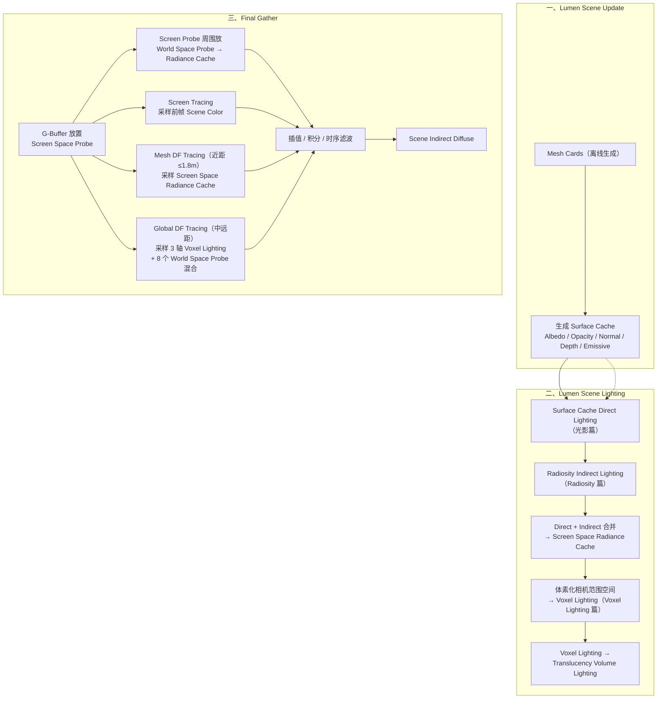
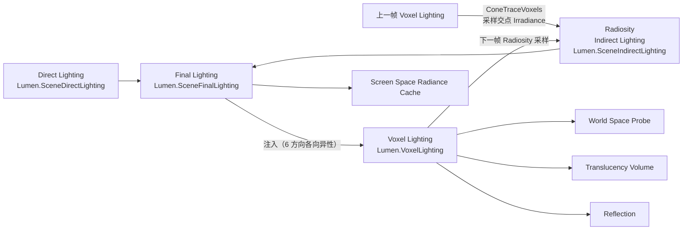
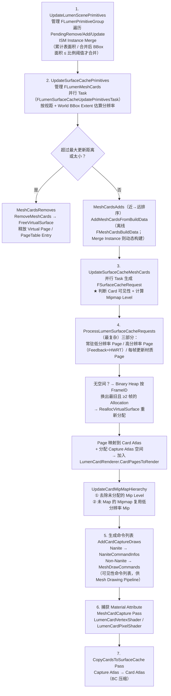
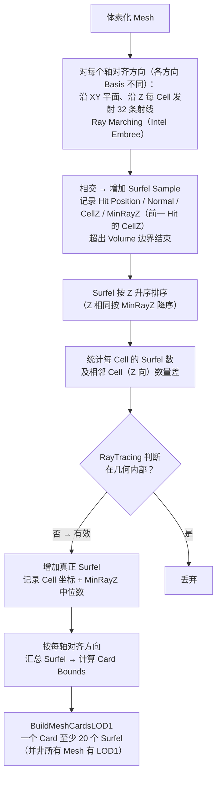
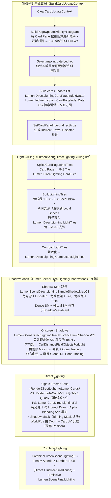
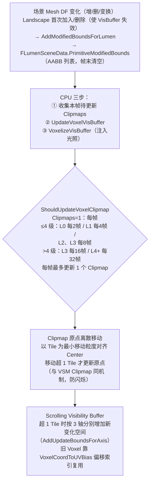
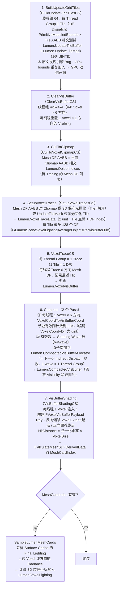
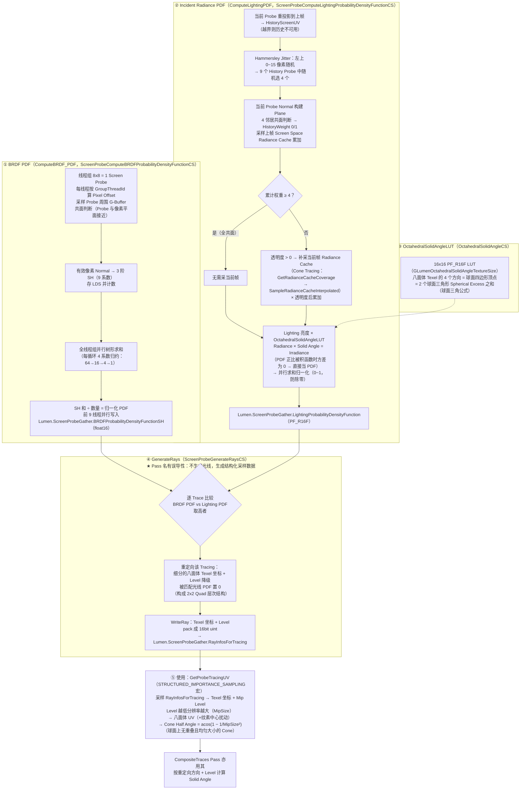

# UE5 Lumen 源码解析系列总结

> 来源：丛越《游戏引擎随笔》知乎专栏，UE5 Lumen 源码解析系列（0x29–0x34），共 6 篇。
> 本文档为阅读整理笔记：原文的流程图/代码截图均以 Mermaid / 代码块重建。
> 标注说明：`★原文引用` = 原文逐字给出的代码；`（语义示意）` = 原文为截图/文字描述，此处按描述重写。
> 整理日期：2026-09-07

## 目录

1. [系列总览](#1-系列总览)
2. [Lumen 整体架构（原理篇 0x29）](#2-lumen-整体架构原理篇-0x29)
3. [Surface Cache 篇（0x30）](#3-surface-cache-篇0x30)
4. [光影篇（0x31）](#4-光影篇0x31)
5. [Radiosity 篇（0x32）](#5-radiosity-篇0x32)
6. [Voxel Lighting 篇（0x33）](#6-voxel-lighting-篇0x33)
7. [Importance Sampling 篇（0x34）](#7-importance-sampling-篇0x34)
8. [贯穿系列的工程亮点](#8-贯穿系列的工程亮点)
9. [附录：RDG 资源与 CVar 速查表](#9-附录rdg-资源与-cvar-速查表)

---

## 1. 系列总览

| 篇号 | 链接 | 标题 | 主题 |
|---|---|---|---|
| 0x29 | zhuanlan.zhihu.com/p/499713106 | 源码解析（一）原理篇 | 全系统原理、数学基础、组件概览、总体流程 |
| 0x30 | zhuanlan.zhihu.com/p/516141543 | 源码解析（二）Surface Cache 篇 | 材质属性缓存：Card / Atlas / PageTable / 捕获流程 / 离线生成 |
| 0x31 | zhuanlan.zhihu.com/p/517756126 | 源码解析（三）光影篇 | Lumen Scene 直接光照：Card Page / Tile 光源剔除 / Shadow Mask |
| 0x32 | zhuanlan.zhihu.com/p/522165652 | 源码解析（四）Radiosity 篇 | 间接光照：Tile 追踪 → 空间滤波 → SH → 积分 |
| 0x33 | zhuanlan.zhihu.com/p/525521811 | 源码解析（五）Voxel Lighting 篇 | 体素光照：Clipmap / Visibility Buffer / 光照注入 |
| 0x34 | zhuanlan.zhihu.com/p/531442379 | 源码解析（六）Importance Sampling 篇 | 重要性采样：BRDF/Lighting PDF / 结构化采样 |

Lumen 体量（原文数据）：**140 个 Pass、56 个 C++ 文件约 3 万行、86 个 Shader 约 2 万行**（不含所依赖的 UE 基础系统）。与 Nanite、Virtual Shadow Map 深度整合，支持 HWRT（Ray Tracing Pipeline / Ray Query）混合管线。

核心设计哲学：**间接光照以 Diffuse 为主（低频信号），可以用粗粒度的场景描述（Mesh 与 Material）和非物理精确的近似来实时求解**——只要视觉可接受即可。Lumen 是多种 RTGI 技术的集大成者：SDF、Voxel Lighting、Radiosity、Irradiance Field、Radiance Cache、SSGI，外加独创的 Surface Cache。

---

## 2. Lumen 整体架构（原理篇 0x29）

### 2.1 数学基础

从渲染方程出发（★原文引用，LaTeX 转写）：

```text
渲染方程:
  Lo(x, ωo) = ∫_Ω fr(x, ωi→ωo) · Li(x, ωi) · (n·ωi) dωi

Monte Carlo 离散积分（实时只能用少量样本估算）:
  Lo ≈ (1/N) · Σ_{k=1..N}  Li(l) · fs(l→v) · cos(θ) / p(k)

Lumen 的简化:
  - 只解 Indirect Diffuse → BRDF 取 Lambert: fr = albedo / π
  - Incoming Radiance 通过 Ray Tracing 获取
  - Tracing 得到的 Radiance 积分成 Irradiance → 最终光照值
```

**Lumen 本质 = 以 Radiance 的计算、缓存、查询、积分管理为核心的光照系统。**

### 2.2 两大性能支柱

实时 Ray Tracing 只能承受每像素 1/2 条光线（Epic 估算），高质量 GI 需要上百条 → 纯 BVH 光追不可行。Lumen 的答案是：

| 支柱 | 内容 | 作用 |
|---|---|---|
| SDF 加速结构 | **Mesh DF**（每 Mesh 预生成）+ **Global DF**（运行时由 Mesh DF 合并成全场景一份） | Mesh DF 用于 1.8m 内 **Detail Tracing**；Global DF 用于远距 **Global Tracing**。替代非连贯的 BVH 树，GPU 友好 |
| Surface Cache | 6 个轴对齐方向（上/下/左/右/前/后）的材质属性图集（Albedo/Opacity/Normal/Emissive），低分辨率 | Tracing 命中点简单投影到 6 方向即可采样材质，如同"粗粒度 G-Buffer" |

### 2.3 各组件一句话

- **Radiance Cache**：对 Surface Cache 做 Deferred 式直接光照（光栅化 Card Rect），每 Texel 的结果就是 Radiance → 全场景光照缓存；与历史帧累积 → 无限反弹。
- **Lumen Scene** = DF（几何表达）+ Surface Cache（材质表达），类比 FScene = Mesh + Material。
- **Screen Space Probe**：每 16 像素均匀放置 + 自适应加密（检查 4 个 corner probe 是否被遮挡，插值失败则加倍分辨率迭代）。仅用于 Mesh DF Tracing（1.8m 内）。
- **Voxel Lighting**：体素化**相机周围空间**（不是几何！），光照各向异性存 6 方向，Clipmap 覆盖 50m～6.4km。供 Global DF Tracing 采样。
- **Radiosity Indirect Lighting**：Lumen 是 Casting 非 Tracing（命中不再 bounce）→ 用 Radiosity 从 Surface Cache 射线与 Global DF 求交，交点采样上帧 Voxel Lighting，转 2 阶 SH。
- **World Space Probe**：解决远光噪点与长距 tracing 性能不稳。Screen Probe 周围稀疏放 8 个 Probe，带 Clipmap（默认 4 级，最大 6 级），对 Voxel Lighting 采样缓存。
- **Importance Sampling**：上帧 Radiance Cache 引导光线方向（Li 侧）+ G-Buffer BRDF 累计引导（fs 侧，BRDF=0 方向不 trace）。
- **Shadow**：本质是光照可见性。Surface Cache 标 Shadow Mask（用已有 Shadow Map / VSM）；SM 与 Camera-Visibility 相关而 Surface Cache 无关 → 缺失处用 Mesh/Global DF Ray Tracing 补（"在 Surface Cache 上做 DF Shadowing"）。
- **降噪**：Spatial（Probe 空间 3×3 ≈ 屏幕空间 48×48 大 Kernel，因 Radiance Cache 是 1/16 屏幕分辨率）+ Temporal（管线末端）+ IS 本身也降噪。
- **Reflections**：Roughness>0.4 重用 Screen Space Radiance Cache（GGX lobe 已汇聚到 Diffuse）；<0.4 额外 tracing（Screen Ray Marching / Mesh DF / Global DF 三种）+ 双边滤波。
- **Translucency Volume GI**：视锥 Froxel 化，可见 Froxel 做 Global DF Tracing，3D Texture 存 Radiance，Spatial Filter 后积分转 2 阶 SH。

### 2.4 总体执行流程（★原文结构）



### 2.5 核心数据流（帧间闭环）



> 关键闭环：**Radiosity 用上一帧的 Voxel Lighting 生成 Indirect → 本帧 Voxel Lighting 又注入本帧 Radiosity 结果**。所以后续所有光照流程天然带间接光（Infinite Bounces 的实现本质）。

---

## 3. Surface Cache 篇（0x30）

### 3.1 核心概念

| 概念 | 说明 |
|---|---|
| **Card** | "捕获相机"。本质是局部轴对齐 BBox：XY 定义 Viewport 大小、Z 定义正投影 Depth（可视化即 Box 形 Frustum）。每 Mesh 离线生成，至少 6 个（6 轴对齐方向），复杂结构每方向可多个，每 LOD 上限 32 个。`r.Lumen.Visualize.CardPlacement` 可视化 |
| **Card LOD** | 仅 2 级（每级至少 6 Card 覆盖 6 方向，故并非所有 Mesh 有 LOD1）。远距离用更少 Card 减少光栅化 |
| **Surface Mipmap** | 同一 Mesh 在 Surface Cache 上并存多分辨率材质属性。最大 11 级（2K，`MaxResLevel`）～最小 3 级（8 Texels，`MinResLevel`）。**与传统 Mipmap 不同：平铺展开存储（非常规 mipmap 链），Level 越小分辨率越低**，采样需额外地址转换 |
| **Capture Atlas** | 捕获流程的**临时**图集（每帧按需分配大小，无需持久化）：`Lumen.CardCaptureAlbedoAtlas`(RGBA8)、`Lumen.CardCaptureNormalAtlas`(RG8)、`Lumen.CardCaptureEmissiveAtlas`(R11G11B10)、`Lumen.CardCaptureDepthStencilAtlas` |
| **Card Atlas** | **持久化**的真正 Surface Cache 物理存储：`Lumen.SceneAlbedo/Opacity/Depth/Normal/Emissive` + 4 张 Radiance Cache 用图（`SceneDirectLighting / SceneIndirectLighting / SceneNumFramesAccumulatedAtlas / SceneFinalLighting`）。默认 4K×4K×5 张，每张 32bit ≈ 320MB → **除 Depth 外全部硬件 BC 压缩**（`CVarLumenSurfaceCacheCompress` 开关）。Depth 不能有损：要精确还原世界坐标 + 计算 Radiance Occlusion |
| **Virtual Page / Page Table** | 仿 Virtual Texture。Virtual Page（逻辑）127×127，物理 Page 128×128（每边 +0.5 Texel Border 供过滤）。Mipmap > Page Size → 拆多个 Entry；≤ Page Size → Page 上**子分配**（`SubAllocationSize`） |

### 3.2 核心数据结构（语义示意，按原文截图整理）

全部以 **SoA（Structure of Arrays）** 存在 `FLumenSceneData` 中，对象间**只存索引不存指针**（最大化 Cache 命中率），容器为 `TSparseSpanArray`（稳定索引 + 连续跨度分配，内部 `FSpanAllocator`）：

```cpp
// —— 以下为按原文描述整理的结构示意（原文为 UE 源码截图）——

// Card：捕获用的"相机"
struct FLumenCard {
    // 局部轴对齐 BBox：XY = Viewport，Z = 正投影 Depth
    // Surface Mipmap 层次数组（Level 越小分辨率越低！与传统相反）
    // 方向索引（6 轴对齐方向之一）
};

// Surface Mipmap：PageTableSpanOffset / PageTableSpanSize
// 可直接索引到 PageTable
struct FLumenSurfaceMipMap { /* ... */ };

// PageTable 项：Surface Mipmap ↔ Capture/Card Atlas 寻址
struct FLumenPageTableEntry {
    // PhysicalPageAddress        物理页地址
    // PhysicalAtlasRect          物理存储区域
    // SubAllocationSize          子分配大小（Mip ≤ Page 时）
    // CardIndex / MipmapLevel    反向索引
};

// Lumen Scene 基本图元集合，对应 1..N 个 FPrimitiveSceneInfo
// （FPrimitiveSceneInfo 中也存反向索引列表）
struct FLumenPrimitiveGroup { /* ... */ };

// Card 集合，与 FLumenPrimitiveGroup 一一对应
// Cards 在 FLumenSceneData 中连续存储 → 只需起始索引 + 数量
struct FLumenMeshCards {
    int PrimitiveGroupIndex;
    int FirstCardIndex;
    int NumCards;
};
```

### 3.3 运行时核心流程

由 `FDeferredShadingSceneRenderer` 驱动：



**★ Mipmap Level 计算算法**（原文分步描述，语义示意）：

```cpp
// UpdateSurfaceCacheMeshCards 的并行 Task 内（语义示意）
float ViewDistance = min(Distance(CardWorldOBB, ViewPos), 100.0f);   // ① 视距 clamp 100
float PlaneMax      = max(WorldOBB.Extent.X, WorldOBB.Extent.Y);     // ② WorldOBB XY 平面最大值（UE Z 轴朝上）
float MaxProjected  = PlaneMax * Card.ResolutionScale / ViewDistance; // ③ 最大投影大小
int   MaxSnappedRes = Pow2(MaxProjected);                             // ④ 2 的幂 → 最大分辨率
bool  bVisible      = InMaxViewDistance && MaxSnappedRes >= MinResolution;
// ⑤⑥ 保证不小于 MinCardResolution(=8)，再按 2 的幂算出最终 Mipmap Level
```

**★ 为何先捕获到 Capture Atlas 再 Copy 到 Card Atlas，不直接写？**
1. 要用 BC 压缩：无法创建 BC 格式 RT 直接写入 → Copy Pass 用 **UAV Aliasing** 成 Block4/Block2 的 uint 格式在 Shader 中写压缩数据（`LumenCardCopyPS`）。
2. 独立 Copy Pass 可把每种材质属性合并为少量 Instanced Draw（只画 Quad），一次绘制完成，性能更好。
3. Depth 特殊：格式 **R16G16_UNORM**，第二通道存 **Depth²**，供后续 Radiance Occlusion 计算、减少 Leaking。

**★ 捕获 PS 细节**：Lumen 主要为 Indirect Diffuse 服务，Lighting 只考虑 Diffuse → 把 Material 视为**完全粗糙的电介质材料**，用移动端极致优化的近似环境 BRDF（Roughness=1 且 N=V）计算 Albedo；Normal 转换到 Card Space 便于后续光照。

### 3.4 Card 的离线生成



### 3.5 作者的优化与彩蛋

- **Instance 去重捕获**：同一 Mesh 不同 Instance 的相同 Mipmap Card 会重复捕获 → 浪费光栅化 + Capture Atlas 空间。在分配请求处理时做唯一性去重（同一 Mesh 同 Mip Level 只捕获一次）。512 Cube 场景实测：**Non-Nanite MeshCardCapture 提速近 4 倍**；Nanite 几乎无感（Nanite 的 Culling/Rasterize 太快，重复不构成瓶颈；Matrix Demo 前后无差别）——这也是官方建议尽量用 Nanite 的原因。
- **彩蛋**：HISM 的 `FPrimitiveSceneProxy::bSupportsMeshCardRepresentation = false` → **HISM 实际不能生成 Lumen Card**（官方文档不准确），只有 Screen Trace 起作用。
- 展望：Capture/Card Atlas 分配、Virtual Page 管理均可移到 GPU → 更 GPU Driven。

---

## 4. 光影篇（0x31）

### 4.1 关键结构：Card Page 与 PageTable GPU 数据

```text
FLumenCardPageData（Lumen.PageBuffer，★原文描述）
  ├─ 由 FLumenCardPageGPUData::FillData 从 FLumenPageTableEntry 转换填充
  ├─ 压缩为 5 × float4
  └─ Shader 通过 GetLumenCardPageData(CardPageIndex) 访问
     → 一个结构串起 Card / Page / Mipmap / 物理 Atlas 地址
     → 由此可访问整个 Surface Cache

PageTable GPU 版（Lumen.PageTable，FLumenSceneData::UploadPageTable 上传）
  ├─ 每项仅 2 × uint32：
  │    SampleAtlasBiasX(12bit) | SampleAtlasBiasY(12bit)
  │    SampleCardResLevelX(4bit) | SampleCardResLevelY(4bit)
  ├─ 物理纹理区域不上传，Shader 中 ComputeSurfaceCacheSample 现算
  └─ GPU Dispatch 数量 = PageTable 数量 → 按 Entry Index 访问 Card Page
```

**为何 Card Page 与 PageTable 分成两个 Buffer？** ★原文：二者作用/访问频率/访问场景不同；合并则每项需 5+1=6 个 float4，只访问其一时 GPU Cache Miss 增加、带宽开销上升。

### 4.2 核心流程



### 4.3 Shadow Mask 存储机制：Binning Mask

★原文机制（借鉴 Nanite Deferred Material 的 Material Classify Pass）：

```text
每 Texel 2 bit Shadow Mask
每 16 个 Texel 为一组 → 16 × 2 = 32 bit = 1 个 uint
每 Tile（8×8 = 64 Texel）→ 64 / 16 = 4 个 uint
内存占用 = 每 Texel 1 uint 方案的 1/64，读写带宽同步大降
Buffer 大小 = 本帧待更新 Surface Atlas 大小 → Tile 数 × 每 Tile 最大光源数
```

写入/读取语义示意（原文为截图）：

```hlsl
// —— 写入（LDS 中先以 Binning Mask 累积，最终由线程组前 4 线程落盘）——
uint PackedMask = 0;
PackedMask |= ShadowFactorBits << ((TexelIndexInGroup % 16) * 2);   // 每 Texel 2bit
WriteSharedShadowMaskRay(GroupIndex, LightIndex, PackedMask);       // 写 LDS

// —— 读取（Direct Lighting PS 中按当前光源索引取 Mask）——
uint  Packed  = ShadowMaskTiles.Load(TileBase + LightIndex * 4 + TexelIndex / 16);
uint  MaskBit = (Packed >> ((TexelIndex % 16) * 2)) & 0x3;
float ShadowFactor = DecodeShadowFactor(MaskBit);
```

**Dense SM 与 Virtual SM 并存**（★原文引用）：

```hlsl
struct FShadowMaskRay
{
    float ShadowFactor;
    bool  bShadowFactorComplete;   // 两种 SM 同时存在时的完成标记
};
// 只存在一种 SM：直接取当前 SM 的 ShadowFactor；
// 两者并存：两个 ShadowFactor 相乘（除非 VSM 的 Factor 已非常小）
```

### 4.4 Direct Lighting 要点

- 光照结果输出到 `Lumen.SceneDirectLighting`；每光源一次 indirect draw（RenderDoc 中两个方向光 = 两次 draw），**逐光源 Alpha Blending Add = 隐式积分**，全部光源处理完才是真正 Irradiance（所以源码里单次结果的变量名 `Irradiance` 并不准确，★原文指出）。
- VS 中：Quad 的 `InstanceId` → `CardPageIndexData` 间接索引 Buffer → 真正 CardPageIndex → `GetLumenCardPageData` → 由 `PhysicalAtlasUVRect` 与顶点 UV 算 AtlasUV（光栅化插值后即每 Texel 的 AtlasUV）。若 Radiosity 降采样（`RADIOSITY_ATLAS_DOWNSAMPLE_FACTOR != 1`）需按 Indirect Lighting Atlas 实际分辨率重算 IndirectLightingAtlasUV，**防止 Bilinear Sampling 越界**。
- PS 中：采样 Surface Cache 得 Opacity/Depth；WorldPos = Depth + CardUV 反投影（同屏幕空间由 SceneDepth+UV 还原世界坐标的思路）；WorldNormal × Lambert → Irradiance。

---

## 5. Radiosity 篇（0x32）

### 5.1 原理

Lumen 本质是 **Ray Casting**（命中 SDF 后不再 bounce，最多一次 bounce 的间接光）。Radiosity 补足无限反弹。传统 Radiosity 需离散化 Patch（复杂场景开销大）→ **Lumen Scene 已被"光栅化"为 Tile，Tile 即 Patch**；再结合 Monte Carlo：每个 Tile 汇总来自场景其它 Tile 的 Exitant Radiance 计算 Irradiance。

★原文理论依据（辐射度量学）：

```text
Radiosity（Exitant Radiance 的半球积分）:
  B(x) = ∫_Ω L(x→ω) (n·ω) dω

Exitant Radiance（半球积分反射方程，fr 为 BRDF）:
  L(x→ω) = ∫_Ω fr(x, ω'↔ω) L(x←ω') (n·ω') dω'

真空中 Radiance 沿直线传输且恒定:
  L(x→ω) = L(x'←ω)     （x' 为 ω 方向最近可见点）

⟹ 可见点收到来自 x 的 Incident Radiance = x 的 Irradiance
⟹ 用 Global DF Cone Tracing 求交 + 采样 Voxel Lighting 得交点 Irradiance
   = 该 Tile 的 Exitant Radiance
```

### 5.2 核心流程（纯 GPU Driven，入口 `RenderRadiosityForLumenScene`）

```mermaid
flowchart TD
    A["1. BuildRadiosityTiles（BuildRadiosityTilesCS）<br/>Card Page → 8x8 Tile<br/>每 4 线程组处理 1 个 Page（128/8=16x16 Tile/页）<br/>→ Lumen.Radiosity.CardTiles"] --> B["2. Tracing & Lighting<br/>（LumenRadiosityDistanceFieldTracingCS）<br/>每 Tile 放 2x2 Probe（间隔 4 Texels）<br/>每 Probe 4x4=16 Trace（八面体存储）<br/>线程组 64 = 1 Tile + 4 Probe，每线程 1 Trace"]
    B --> B1["UnswizzleTexelTraceCoords<br/>→ CardTileIndex / CoordInCardTile / TraceTexelCoord<br/>CoordInCardTile 带 Hammersley Jitter（0~4 Texel 均匀分布）"]
    B1 --> B2["GetRadiosityTexelFromCardTile → FRadiosityTexel<br/>GetRadiosityRay：<br/>Probe Texel 中心（Hammersley 均匀分布）<br/>+ CosineSampleHemisphere（PDF = cosθ/π）<br/>→ 切线空间变换到世界 → WorldRayDirection<br/>+ Cone Half Angle"]
    B2 --> B3["ConeTraceVoxels：Global DF Cone Tracing<br/>→ 采样 Voxel Lighting 得 Incident Radiance<br/>无交点或交点 Opacity ≥ 0.5 → EvaluateSkyRadiance<br/>（Cone Angle → 推导粗糙度）"]
    B3 --> B4["Radiance Intensity Clamp<br/>（抗小亮发射源伪影；损失能量 + View 依赖）<br/>→ 按 AtlasCoord 写入<br/>Lumen.Radiosity.TraceRadianceAtlas（R11G11B10）"]
    B4 --> C["3. 空间滤波<br/>LumenRadiositySpatialFilterProbeRadiance<br/>Kernel：4 邻居（默认）或 13 邻居菱形（CVar 可选）<br/>当前 Texel 权重 = 2<br/>Neighbor 权重 = min(Opacity, PlaneWeight)<br/>PlaneWeight：共面=1 否则=0（二值，防 Light Leaking）<br/>→ Lumen.Radiosity.FilteredTraceRadianceAtlas"]
    C --> D["4. 球谐转换（LumenRadiosityConvertToSH）<br/>每 Probe 遍历 16 Trace，方向+PDF → 2 阶 SH 基函数<br/>Radiance 除以 PDF 后投影累加（RGB 3 组系数）<br/>求和平均 → 3 张 SH RGB Atlas<br/>（R16G16B16A16，分辨率=Probe 总数）"]
    D --> E["5. 积分（LumenRadiosityIntegrateCS）<br/>当前 Probe 向左上 Hammersley Jitter<br/>→ 9 个相邻 Probe 中随机选 4 个做双线性<br/>Probe 权重 = min(ProbeWeight×Opacity, PlaneWeight)<br/>SampleRadiositySH 累计 SH 系数<br/>Normal 算 SH 基函数（含 Diffuse Power）点乘重建<br/>÷ 总权重 → 当前 Probe Radiance"]
    E --> F{"Radiosity Temporal<br/>Accumulate 启用？"}
    F -->|"是"| G["按累计 Frames 算 Alpha<br/>历史帧与当前帧 Radiance 插值<br/>（时序超采样：质量↑，光照传播速度↓）"]
    F -->|"否"| H["直接输出"]
    G --> I["Lumen.SceneIndirectLighting<br/>（即光影篇 CombineLighting 的 Indirect 输入）"]
    H --> I
```



### 5.3 关键代码结构

★原文引用：

```hlsl
struct FRadiosityTexel
{
    bool  bInsideAtlas;
    bool  bHeightfield;
    float Opacity;
    float3 WorldPosition;            // 用于 Cone Tracing
    float3 WorldNormal;              // 用于 Cone Tracing
    float3x3 WorldToLocalRotation;

    uint2 AtlasCoord;                // 在 Indirect Lighting Atlas 中的坐标
    uint2 CardCoord;                 // Surface Cache 中的 Texel 坐标
    uint  IndirectLightingTemporalIndex; // 生成 Hammersley Jitter（每帧累加）
};
```

**PlaneWeight 算法**（★原文分步，语义示意）：

```hlsl
// Neighbor 与当前 Radiosity Texel 近乎共面才有影响，否则无影响
float CalculatePlaneWeight(float3 CurPos, float3 CurNormal, float3 NeighborPos)
{
    float PlaneDist = abs(dot(CurNormal, NeighborPos - CurPos)); // ① 构建平面，算 Neighbor 到平面距离
    float RelDist   = max(PlaneDist / distance(CurPos, NeighborPos), 0.1); // ② 相对距离，下限 0.1
    float DepthW    = RelDist * ProbePlaneWeightingDepthScale;   // ③ 系数默认 -100
    return DepthW > 0.0 ? 1.0 : 0.0;                             // ④ 只有 0/1 两种 → 防漏光
}
```

**已知的局限**（★原文）：4 个 Probe 的选择被限制在 Card 的 Mipmap 范围内（Surface Cache 无 Lumen Scene 空间连续性）→ 跨 Card 的空间相邻 Probe 被简单丢弃 → 能量缺失、Indirect Lighting 不准确。

---

## 6. Voxel Lighting 篇（0x33）

### 6.1 机制与结构

- **机制**：运行时体素化**相机周围一定范围的 Lumen Scene 空间**，从 6 个方向采样与 Voxel 相交的 Mesh DF → 按 Mesh Card 信息从 Surface Cache 的 **Final Lighting** 采样 Irradiance 注入 Voxel。不启用 SWRT（或全 HWRT）时不启用此模块。
- **Clipmap**：每级 64³ Voxel（`GLumenSceneClipmapResolution`），最多 8 级默认 4 级；第 0 级覆盖 `GLumenSceneFirstClipmapWorldExtent`（默认 2500cm）→ 50m；每级翻倍，最大 6.4km，默认 4 级 = 400m。最细 Voxel ≈ 0.78m。
- **Tile 化**：4³ Voxel = 1 Tile → 每 Clipmap 16³ Tile。目的：① Clipmap 原点以 Tile 粒度离散更新；② 层次化更新对齐 wavefront/warp（64 Voxel = 64 线程）。⚠ 源码变量名 Tile/Grid 混用，阅读需留意。
- **存储**：`Lumen.VoxelLighting` 3D Texture（`PF_FloatRGBA`）。**Y 方向排 Clipmap、Z 方向依次排 6 个方向**（+X −X +Y −Y +Z −Z）→ 各向异性。
- **采样**：`SampleVoxelLighting` = 经典 **Ambient Cube**：3 轴各采一次 + 方向权重混合 + 按权重和归一化。唯一调用者 `ConeTraceVoxels`（先 Global DF 求交 → 从小到大遍历 Clipmap 判断包含关系 → 采样），再被 Radiosity / World Space Probe / Translucency / Reflection 复用。
- **Voxel Visibility Buffer**：`Lumen.VoxelVisBuffer`（uint StructuredBuffer），存 **Mesh DF ID + 归一化 Hit Distance**（类比：VisBuffer=几何处理，Injecting Lighting=Fragment Shading）。跨帧持久、每帧按需更新。4 级时 64³×4×6 = **6,291,456 项 = 24MB**。

### 6.2 CPU 端流程



### 6.3 GPU 端流程（5 + 3 Pass）



### 6.4 Visibility Buffer 寻址（★原文算法）

```text
VoxelCoordToVisBufferCoord(VoxelCoord, DirectionIndex, ClipmapIndex):
  ① VoxelCoord → Clipmap UV
     （VoxelCoordToUVScale / VoxelCoordToUVBias，取小数部分
       → Wrap 结构 = Scrolling 机制的实现关键）
  ② ClipmapUV + ClipmapIndex + DirectionIndex → 3D Texture 的 Texel 坐标
  ③ Voxel 分组为 Tile（4³），计算 Tile 的 3D 坐标
  ④ Tile 3D → 线性索引 + Voxel 在 Tile 内的线性索引
     （ZOder3DEncode 生成 Morton Code，三维→一维 Z 字形，局部性好）
  ⑤ Tile 线性索引 + Tile 内索引 → 最终 1D 地址

内存布局：同一方向的 Clipmap 顺序存储，
每个 Clipmap 的 Voxel 分组为 Tile、Tile 内连续。
```

### 6.5 与 Radiosity 的时序

★原文：构建流程发生在 Radiosity **之后**——Radiosity 用**上一帧** Voxel Lighting 生成 Indirect，而 Voxel Lighting 的注入又来自**本帧** Radiosity 的 Indirect。**第一帧**时会在执行 Radiosity 前先构建一次 Voxel Lighting。

---

## 7. Importance Sampling 篇（0x34）

### 7.1 原理

- **本质**：样本数一定时增加有效样本、减少方差 → 对 Tracing 重定向，使光线朝有效 BRDF 与光照方向，不增加预算即可降噪、加快收敛。
- **八面体光线生成**：每 Probe 8×8=64 条光线（`GLumenScreenProbeTracingOctahedronResolution`）。八面体映射把球面方向 ↔ 2D Texel 坐标，所有 Probe 的 Tracing 存进一张 2D Atlas；Compute Shader 里每 Probe 一个 2D Thread Group `[8,8,1]`，`SV_GroupThreadID` 直接当 Atlas Texel 坐标 → 八面体法算球面方向。
- **结构化重要性采样**：高 PDF 样本细分（Subdivision）2×2 作超采样，形成层次结构。通过中间层 `Lumen.ScreenProbeGather.RayInfosForTracing`（RDG 2D Texture，存每条光线的八面体 Texel 坐标 + 细分 Level）实现：重定向只改该光线的细分 Texel 坐标与 Level；未重定向的 Texel 即自身坐标。
- **两个 PDF**：
  - BRDF PDF：精确——Probe 周围有效采样点 Normal 投影 3 阶 SH 均值，光线方向与 SH 点积得每 Trace 的 PDF。
  - Incident Radiance PDF：近似——重投影到上一帧 Screen Space Radiance Cache，平均 4 个相邻 Screen Probe（实时做不了光源采样）。

### 7.2 核心流程



### 7.3 SH vs 非 SH 的 BRDF PDF

★原文对比：

```text
SH 方案（默认，BRDF_PDF_SPHERICAL_HARMONIC 宏）：
  每 Probe 存 9 × 16bit 系数；真正的 PDF 在 GenerateRays 阶段才算
  （Tracing 方向 · Probe SH 均值）
  → 内存省、噪点/漏光表现明显更好

非 SH 方案：
  先为所有 Probe 的所有 Tracing 算好 PDF，取最大值作判断依据
  存 Lumen.ScreenProbeGather.BRDFProbabilityDensityFunction（PF_R16F）
  → 64 Trace 时需 64 × 16bit，内存比 SH 大 7 倍，效果更差
```

---

## 8. 贯穿系列的工程亮点

1. **两级 SDF 追踪**：1.8m 内 Mesh DF（Detail）+ 远距 Global DF（Global），替代非连贯 BVH——SWRT 实时的根基。
2. **Surface Cache = 6 方向粗粒度 G-Buffer**：命中点取材质 → 图集投影采样；Virtual Page + Page Table + Binary Heap LRU（换出最旧且 ≥2 帧）管理 320MB 图集；BC 压缩 + UAV Aliasing 写入；Depth 多存一个 Depth² 通道抗漏光。
3. **Tiled 光源剔除 + Binning Mask**：Card Page"光栅化"成 8×8 Tile 做光源剔除（每 Tile ≤8 灯）；Shadow Mask 每 Texel 2bit 打包（内存 1/64）；SM/VSM 盲区用 DF Shadow 补（Offscreen Shadows）。
4. **Tile 当 Patch 的 Radiosity**：Cone Tracing + 余弦加权采样（PDF=cosθ/π）+ 二值平面权重滤波（防漏光）+ SH2 投影 + 9 选 4 随机双线性，四层降噪叠加。
5. **Voxel Lighting 一切为了并行**：Tile=wave 大小；Morton Code 局部性；Scrolling VisBuffer 增量更新；保守 3D 光栅化；Compaction 后"1 wave=1 Thread Group"的 Indirect Dispatch。
6. **帧间闭环 = 无限反弹**：Radiosity ← 上帧 Voxel Lighting；Voxel Lighting ← 本帧 Radiosity（首帧特判预构建）。
7. **概率工具复用**：Hammersley 低差异序列 Jitter 贯穿 Radiosity / Radiance Cache / IS 三处；蓝噪声、八面体参数化、SH2 投影是三大基础设施。
8. **间接绘制/分发前置**：几乎所有 GPU Driven 阶段（Light Culling、Voxel Shading、Direct Lighting）都提前生成 Indirect Draw/Dispatch 参数 Buffer，CPU 不参与每帧循环。

---

## 9. 附录：RDG 资源与 CVar 速查表

### RDG 资源（按篇）

| 资源名 | 类型/格式 | 说明 | 出处 |
|---|---|---|---|
| `Lumen.CardCaptureAlbedoAtlas` | RGBA8 | 临时捕获：RGB Albedo + A Opacity | Surface Cache |
| `Lumen.CardCaptureNormalAtlas` | RG8 | 临时捕获：World Normal XY | Surface Cache |
| `Lumen.CardCaptureEmissiveAtlas` | R11G11B10 | 临时捕获：Emissive | Surface Cache |
| `Lumen.CardCaptureDepthStencilAtlas` | DepthStencil | 临时捕获：Depth | Surface Cache |
| `Lumen.SceneAlbedo / Opacity / Depth / Normal / Emissive` | BC 压缩（Depth 除外，R16G16_UNORM） | Card Atlas = Surface Cache 物理存储，4K×4K | Surface Cache |
| `Lumen.SceneDirectLighting / SceneIndirectLighting / SceneFinalLighting / SceneNumFramesAccumulatedAtlas` | — | Radiance Cache 用 Card Atlas | Surface Cache / 光影 |
| `Lumen.PageBuffer` | Buffer（5×float4/项） | FLumenCardPageData | 光影 |
| `Lumen.PageTable` | Buffer（2×uint32/项） | PageTable GPU 版（Bias 12bit + ResLevel 4bit） | 光影 |
| `Lumen.PriorityHistogram` | Buffer | Card Page 更新优先级直方图（128 级） | 光影 |
| `Lumen.DirectLighting.CardTiles / LightTiles / CompactedLightTiles` | Buffer | Tile 化与光源剔除 | 光影 |
| `Lumen.DirectLighting.ShadowMaskTiles` | Buffer（Binning Mask） | 每 Light/Tile 4 uint | 光影 |
| `Lumen.DirectLightingCardPageIndexData / IndirectLightingCardPageIndexData` | Buffer | 本帧待光照 Card Page 列表 | 光影 |
| `Lumen.Radiosity.CardTiles` | Buffer | Radiosity Tile 列表 | Radiosity |
| `Lumen.Radiosity.TraceRadianceAtlas` | R11G11B10 | 追踪 Radiance | Radiosity |
| `Lumen.Radiosity.FilteredTraceRadianceAtlas` | R11G11B10 | 滤波后 Radiance | Radiosity |
| `Lumen.Radiosity` SH RGB Atlas ×3 | R16G16B16A16 | 2 阶 SH Irradiance 系数（分辨率=Probe 数） | Radiosity |
| `Lumen.SceneIndirectLighting` | — | Radiosity 输出 | Radiosity |
| `Lumen.VoxelLighting` | 3D Tex R16G16B16A16 | Y=Clipmap，Z=6 方向 | Voxel Lighting |
| `Lumen.VoxelVisBuffer` | uint StructuredBuffer（24MB@4级） | DF ID + 归一化 HitDistance | Voxel Lighting |
| `Lumen.UpdateTileBuffer / UpdateTileMask` | Buffer / 3D Tex UINT8 16³ | 脏 Tile 列表/掩码 | Voxel Lighting |
| `Lumen.ObjectIndices / VoxelTraceData` | Buffer | 相交 Mesh DF / Trace 数据 | Voxel Lighting |
| `Lumen.CompactedVisBuffer / CompactedVisBufferAllocator` | Buffer / Counter | 紧致 Visibility + Indirect Dispatch 参数 | Voxel Lighting |
| `Lumen.ScreenProbeGather.BRDFProbabilityDensityFunctionSH` | Buffer float16 | BRDF 3 阶 SH PDF（9 系数/Probe） | IS |
| `Lumen.ScreenProbeGather.LightingProbabilityDensityFunction` | 2D Tex R16F | Incident Radiance PDF | IS |
| `Lumen.ScreenProbeGather.RayInfosForTracing` | 2D Tex | 结构化采样数据（16bit/光线） | IS |
| `OctahedralSolidAngleTexture` | 2D Tex R16F 16×16 | 八面体立体角 LUT | IS |

### CVar / 宏

| 名称 | 默认 | 说明 |
|---|---|---|
| `r.Lumen.Visualize.CardPlacement` | — | Card 可视化 |
| `CVarLumenSurfaceCacheCompress` | on | Surface Cache BC 压缩开关 |
| `GLumenMeshCardsMergeInstances` | on | ISM Instance 合并开关 |
| `GLumenMeshCardsMergeInstancesMaxSurfaceAreaRatio` | — | Instance 合并表面积比阈值 |
| `GLumenDirectLightingMaxLightsPerTile` | 8 | 每 Tile 最大光源数 |
| `r.LumenScene.Radiosity` | on | Radiosity 开关 |
| `Secondary Bounces`（flags） | — | 次级反弹开关 |
| `GLumenSceneClipmapResolution` | 64 | 每 Clipmap Voxel 分辨率（64³） |
| `GLumenSceneClipmapZResolutionDivisor` | 1 | Z 方向分辨率除数 |
| `GLumenSceneFirstClipmapWorldExtent` | 2500cm | 第 0 级覆盖半径 → 50m |
| `GLumenSceneVoxelLightingAverageObjectsPerVisBufferTile` | 128 | 每 Tile 最大 Mesh DF 数 |
| `GLumenScreenProbeTracingOctahedronResolution` | 8 | 每 Probe 光线数（8×8=64） |
| `GLumenScreenProbeImportanceSamplingNumLevels` | 1 | 结构化采样 Level 数（0/1 两级） |
| `GLumenScreenProbeImportanceSampleIncomingLighting` | on | Incident Radiance PDF 开关 |
| `GLumenScreenProbeImportanceSampleProbeRadianceHistory` | — | 采上帧 Radiance Cache 作判断依据 |
| `GLumenOctahedralSolidAngleTextureSize` | 16 | 立体角 LUT 分辨率 |
| `RADIOSITY_ATLAS_DOWNSAMPLE_FACTOR` | 1 | Radiosity Atlas 降采样系数（Shader 宏） |
| `SURFACE_CACHE_FEEDBACK` / `SURFACE_CACHE_HIGH_RES_PAGES` | — | 高分辨率 Page 分配条件（Shader 宏） |
| `STRUCTURED_IMPORTANCE_SAMPLING` / `BRDF_PDF_SPHERICAL_HARMONIC` | — | IS 相关 Shader 宏 |

### 关键 Pass 索引（按篇）

| Pass | Shader 函数 | 说明 |
|---|---|---|
| MeshCardCapture | LumenCardVertexShader/PixelShader.usf | 材质属性捕获（Nanite/Non-Nanite 同 PS） |
| CopyCardsToSurfaceCache | LumenSurfaceCache.usf (`LumenCardCopyPS`) | Capture→Card Atlas（UAV Alias 写 BC） |
| BuildPageUpdatePriorityHistogram 等 | — | Card Page 更新上下文（5 Pass） |
| SpliceCardPagesIntoTiles / BuildLightTiles / CompactLightTiles | LumenSceneDirectLightingCulling.usf | 光源剔除 |
| LumenSceneDirectLightingSampleShadowMapCS | LumenSceneDirectLightingShadowMask.usf | SM/VSM Shadow Mask |
| LumenSceneDirectLightingTraceDistanceFieldShadowsCS | 同上 | Offscreen DF Shadows |
| Lights（Raster） | RasterizeToCardsVS + LumenCardDirectLightingPS | 每光源 Indirect Draw |
| CombineLighting | RasterizeToCardsVS + CombineLumenSceneLightingPS | Final Lighting |
| BuildRadiosityTilesCS | LumenRadiosityCulling.usf | Radiosity Tile |
| LumenRadiosityDistanceFieldTracingCS | LumenRadiosity.usf | Cone Tracing |
| LumenRadiositySpatialFilterProbeRadiance / ConvertToSH / IntegrateCS | LumenRadiosity.usf | 滤波 / SH / 积分 |
| BuildUpdateGridTilesCS / ClearVisBufferCS / CullToVoxelClipmapCS / SetupVoxelTracesCS / VoxelTraceCS | LumenVoxelLighting.usf | VisBuffer 构建 5 Pass |
| VisBufferShadingCS | LumenVoxelLighting.usf | 光照注入 |
| ScreenProbeComputeBRDFProbabilityDensityFunctionCS | LumenScreenProbeImportanceSampling.usf | BRDF PDF |
| ScreenProbeComputeLightingProbabilityDensityFunctionCS | 同上 | Lighting PDF |
| ScreenProbeGenerateRaysCS | 同上 | 结构化采样数据 |
| OctahedralSolidAngleCS | LumenScreenProbeGather.usf | 立体角 LUT |

---

## 参考

- 原文系列：丛越《游戏引擎随笔》
  - [0x29 原理篇](https://zhuanlan.zhihu.com/p/499713106)
  - [0x30 Surface Cache 篇](https://zhuanlan.zhihu.com/p/516141543)
  - [0x31 光影篇](https://zhuanlan.zhihu.com/p/517756126)
  - [0x32 Radiosity 篇](https://zhuanlan.zhihu.com/p/522165652)
  - [0x33 Voxel Lighting 篇](https://zhuanlan.zhihu.com/p/525521811)
  - [0x34 Importance Sampling 篇](https://zhuanlan.zhihu.com/p/531442379)
- 系列后续（未包含在本次阅读范围）：Radiance Cache 篇、Final Gather 篇等（原文中多次预告）。
