- 2026-10-07 Git范围整理：`/Docs/reports/` 全部为本地诊断/审计/派生网页，已加入.gitignore，磁盘文件保留；正式结论与交接在Docs/completed，仍可提交。此时Docs实际已跟踪150项，报告文件均未跟踪，无git rm/index修改。报告路径在其他机器/新clone不保证存在，应按交接说明重捕获或传递本地归档。

- 2026-10-07 新会话主交接：[遮挡、后处理与五点收敛排查](completed/2026-10-07-sc-lumen-occlusion-postprocess-convergence-handoff.md)，[可复制提示词](completed/2026-10-07-sc-lumen-next-session-prompt.md)。本轮仅Docs交接与授权报告裁剪，无新Engine/渲染收益；当前生产265/231SPV恢复。旧LIVE状态均为历史。清理范围/SHA/空间实测：reports/sc-session-handoff-2026-10-07；旧大网页改近期轻量入口，11关键阶段可重放，其余旧raw/image不再保证存在。

# 引擎文档归档总览（ARCHIVE）

> 归档日期：2026-09-14 ｜ 范围：`Docs/` 全量 90+ 份 markdown 及附属资源
> 本文档是 `Docs/` 的**单一索引事实源**：每份文档的状态、一句话摘要、所在位置，以及"引擎各层功能 → 规划文档"的树状地图。
> **维护纪律**：新增文档须在本表登记；文档完工后移入 `Docs/completed/` 并同步本表与 mermaid 图。

状态图例：✅ 已完成（已归档）｜🚧 进行中｜📋 计划/未实施｜📖 长期参考｜⛔ 已被取代（归档留档）｜⚠️ 归档但内含未结项

---

## 1. 归档动作摘要（2026-09-14）

已完成的工作从 `Docs/` 各处迁入 [`Docs/completed/`](completed/README.md)，保持原子目录结构，git 历史经 `git mv` 保留；仓库内所有旧路径引用（md、CMake 注释、代码注释、Python 脚本 docstring）已同步改写。

| 原位置 | 新位置 | 内容 | 份数 |
|---|---|---|---|
| `Docs/*.md`（散件） | `Docs/completed/*.md` | WFC C.1 完成报告、资产管线调研、编辑器四大功能、SPGI 能量标定、Sequence 录制、Cascade SH 统一、物理选型调研、旧粒子升级规划（已取代）、场景烘焙评估 | 9 |
| `Docs/plans/*.md` | `Docs/completed/plans/*.md` | Nanite+Lumen 蓝图、Avalonia P0/P1/P2/P3 系列、p1c、导入管线设计+实施、World Editor R1/R2、M13 完成报告 | 13 |
| `Docs/RHI/ShaderRefactorNotes.md` | `Docs/completed/RHI/` | 已完成的着色器去重重构记录 | 1 |
| `Docs/superpowers/`（整目录） | `Docs/completed/superpowers/` | SurfaceCache、GPU SurfaceNets 9.3a/b、Dawn GlobalSDF 移植 v1/v2、WFC A1→C1 全阶段（plans/specs/notes） | 32 |
| `Docs/CodeReview/`（整目录） | `Docs/completed/CodeReview/` | 已停用 CI 机制的代码审查报告（50 份同质模板） | 51 |
| `Docs/CI/`（整目录） | `Docs/completed/CI/` | 已停用 CI 机制的占位测试报告 | 51 |
| `Docs/render-comparisons/`（整目录） | `Docs/completed/render-comparisons/` | Sponza Metal/Vulkan vs UE 参考四轮对比（已结案） | 1 |
| `Docs/2026-09-18-gi-energy-ownership-*.md`（2 份） | `Docs/completed/*.md` | GI 能量所有权审计+修复设计、修复实施计划（P0–P5 已全部实施并验证；验收数据在 `Docs/diagnostics/2026-09-18-gi-ownership/`） | 2 |

保留在 `Docs/` 原地的三类文档：**进行中**（GI 校准线、物理、PFX、Dawn、VT 等）、**长期参考**（手册/规范/API 文档）、**未结案**（`deferred/` 合并重放指南、`diagnostics/` 活跃诊断区）。`Docs/CLI_Agent_Interface_Plan.md` 另被 `AGENTS.md` 与 csproj 注释引用，必须留在原位。

---

## 2. 引擎各层功能 × 规划文档地图

```mermaid
flowchart TD
    ENG["GameEngine_VulkanCPP"]

    ENG --> RHI["RHI 三端硬件抽象层<br/>Vulkan / Metal / Dawn"]
    ENG --> DAWN["Dawn WebGPU 后端"]
    ENG --> GI["全局光照 GI（Lumen 系）"]
    ENG --> NANITE["Nanite / GPU-Driven"]
    ENG --> VT["虚拟纹理 Virtual Texture"]
    ENG --> PFX["粒子系统 PFX"]
    ENG --> PHYS["物理模拟（Jolt）"]
    ENG --> PCG["程序化生成 PCG / WFC"]
    ENG --> ASSET["资产管线 / ContentTools"]
    ENG --> EDITOR["编辑器（Avalonia）"]
    ENG --> SEQ["Sequencer / 过场"]
    ENG --> CLI["CLI / Agent 接口"]
    ENG --> SHADOW["阴影 / IBL / 后处理"]
    ENG --> BASE["引擎基础 / 平台 / 构建"]

    subgraph RHILayer["RHI 三端硬件抽象层"]
        RHI_API["📖 Docs/RHI/RHI_Core_API_Documentation.md"]
        RHI_TEST["📖 Docs/RHI/RHI_Test_Documentation.md"]
        RHI_BARRIER["📖 Docs/rhi-barrier-semantics.md"]
        RHI_RG["📖 Docs/RHI/RenderGraphDesign.md"]
        RHI_PASS["📖 Docs/RHI/PassManagementDesign.md"]
        RHI_MAT["📖 Docs/RHI/MaterialComponent_Design.md"]
        RHI_LAYER["📖 Docs/RHI/RenderLayerComponent_Design.md"]
        RHI_PARITY["🚧 Docs/2026-08-19-rhi-vulkan-metal-parity-plan.md"]
        RHI_MATRIX["📖 Docs/RHI/GraphicsAPI_Parity_Matrix.md 四API对照"]
        RHI_VPORT["🚧 Docs/2026-08-09-vulkan-lumen-gi-port-design.md"]
    end

    subgraph DAWNLayer["Dawn WebGPU 后端"]
        DAWN_MIG["🚧 Docs/Dawn_RenderPipeline_Migration_Plan.md"]
        DAWN_STATUS["🚧 Docs/RHI/Dawn_WebGPU_Implementation_Status.md"]
        DAWN_BACKLOG["🚧 Docs/Dawn_Optimization_Backlog.md"]
        DAWN_LESSONS["📖 Docs/RHI/Dawn_WebGPU_Lessons.md"]
        DAWN_WASM["📖 Docs/Dawn_WASM_Build_Deploy_Guide.md"]
        DAWN_DIAG["🚧 Docs/2026-07-09-dawn-meshlet-graywhite-diagnostic-guide.md"]
        DAWN_SDF["✅ Docs/completed/superpowers/plans/2026-07-10 与 07-13 GlobalSDF 移植 v1-回滚 / v2-修复"]
        DAWN_M10["✅ Docs/completed/superpowers/specs/2026-07-06-mode10-ddgi-design.md"]
        DAWN_INSTR["✅ Docs/completed/superpowers/plans/2026-07-09-dawn-meshlet-诊断仪器.md"]
    end

    subgraph GILayer["全局光照 GI（Lumen 系）"]
        GI_OPT["🚧 Docs/2026-08-24-gi-optimization-plan.md"]
        GI_OWN_AUDIT["✅ Docs/completed/2026-09-18-gi-energy-ownership-audit-and-remediation.md 能量所有权审计+修复设计（P0-P5 已实施）"]
        GI_OWN_PLAN["✅ Docs/completed/2026-09-18-gi-energy-ownership-remediation-plan.md 修复实施计划（已完成，验收见 Docs/diagnostics/2026-09-18-gi-ownership/）"]
        GI_GRID["📖 Docs/2026-09-16-ddgi-world-space-probe-grid-reference.md Probe密度/间距/多尺度参考"]
        GI_WRC["✅ Docs/2026-09-18-world-space-radiance-cache-design-and-plan.md WRC世界空间RadianceCache设计+计划（已实施，完工记录 completed/2026-09-19-…-completion.md；GI_WRC 节点在役）"]
        GI_FIT["✅ Docs/completed/2026-09-18-ddgi-scene-fit-probe-grid-plan.md 场景贴合Probe网格（P0/P1落地）"]
        GI_SUPP["📋 Docs/2026-09-07-gi-supplement-plan.md"]
        GI_FUSION["🚧 Docs/2026-08-26-spgi-lumen-screen-probe-fusion.md"]
        GI_CAL["🚧 Docs/2026-09-09-gi-physical-relation-calibration-plan.md"]
        GI_VK["🚧 Docs/plans/2026-09-09-vulkan-direct-gi-recovery-plan.md"]
        GI_TRANSPORT["📋 Docs/plans/2026-09-10-gi-transport-session-prompt.md"]
        GI_PROMPT["📋 Docs/2026-09-10-gi-energy-audit-new-session-prompt.md"]
        GI_LUMEN["📖 Docs/2026-09-07-lumen-source-analysis-notes.md"]
        GI_SC["✅ Docs/completed/superpowers/specs 与 plans/2026-05-07-surface-cache"]
        GI_ENERGY["✅ Docs/completed/2026-09-04-spgi-energy-calibration-and-ddgi-overexposure.md"]
        GI_CASCADE["✅ Docs/completed/2026-09-10-cascade-sh-l1-unification.md"]
        GI_ALIGN["🚧 Docs/metal_visual_alignment_20260902.md"]
        GI_DIAG["🚧 Docs/diagnostics/2026-09-12-vulkan-lighting/"]
        GI_RC["✅ Docs/completed/render-comparisons/2026-09-06-sponza/"]
        GI_AUDIT["✅ Docs/completed/render-comparisons/2026-09-16-sponza-gap-audit/ 当前画质差距审计"]
        GI_REAUDIT["✅ Docs/completed/render-comparisons/2026-09-16-sponza-gap-reaudit/ 第二轮画质复查"]
        GI_VOLUME_AUDIT["✅ Docs/completed/render-comparisons/2026-09-16-volume-gi-repair-audit/ Volume与GI修复专项"]
        GI_R3["✅ Docs/completed/render-comparisons/2026-09-16-sponza-froxel-atmosphere-round3/ 雾链修复与 IBL 镜面分离"]
        GI_R4["✅ Docs/completed/render-comparisons/2026-09-16-froxel-coordinate-repair-and-bloom/ Froxel 坐标契约修复 + 直射 Bloom"]
        GI_R5["✅ Docs/completed/render-comparisons/2026-09-16-spgi-sc-orientation-gate/ SPGI 热点治理：G0 统计窗口化 + SC 朝向门"]
        GI_R6["✅ Docs/completed/render-comparisons/2026-09-16-sc-card-pcss-visibility/ SC 卡片直射换 PCSS 深度"]
        GI_R7["✅ Docs/completed/render-comparisons/2026-09-16-spgi-face-gate-calibration/ 朝向门标定 0.25 + G5-lite"]
        GI_R8["✅ Docs/completed/render-comparisons/2026-09-16-detail-sdf-end-to-end/ per-mesh SDF 链路打通"]
        GI_R9["✅ Docs/completed/render-comparisons/2026-09-16-darkarch-g4-decomposition/ 暗拱欠亮 G4 分层分解"]
        GI_PROBE_AUDIT["⚠️ Docs/completed/render-comparisons/2026-09-17-probe-selection-density-audit/ Probe选择密度复查；重定位坐标与有效性待修"]
        GI_ORIGIN_FIX["✅ Docs/completed/2026-09-17-ddgi-effective-origin-contract-fix.md P0 重定位坐标契约 + 台账公式落地"]
        GI_SUN_AUDIT["🚧 Docs/completed/render-comparisons/2026-09-17-vulkan-lumen-sun-audit/ 太阳审计：P0/P1台账/P2日晕/P3 A/B 落地+§5.2 网格实采（IMPLEMENTATION-P0-P1.md），配准/SC读回/IBL/布帘/动态验收待办"]
        GI_CRASH["🚧 Docs/2026-09-04-spgi-metal-crash-investigation.md"]
        GI_ROOT_CURE["📋 Docs/2026-09-18-gi-energy-root-cure-plan.md GI 能量根治五阶段：单位制/天空单一源/回路物理化/天空分类/tunneling/门禁（待实施）"]
        GI_SC_PARITY["✅ Docs/2026-09-19-sc-card-lumen-parity-investigation-and-plan.md SC 卡片 vs Lumen 参照：现状调查与改造规划（Phase 0-5 全部落地，完工记录 completed/2026-09-21-…state.md）"]
        GI_ASYM_PLAN["✅ Docs/2026-09-20-gi-energy-asymmetry-fix-plan.md 能量不对称修复计划 F0-F6（已落地，完工记录 completed/2026-09-20-…completion.md）"]
        GI_ENERGY_FLOW["🚧 Docs/2026-09-20-gi-energy-flow-deep-investigation.md 能量流深度调查：辐射计量单位全链审计 + 能量不对称发现（A1-A3）"]
        GI_GAP["🚧 Docs/2026-09-20-sponza-vs-lumen-visual-gap-analysis.md Sponza vs UE Lumen 观感差距根因分析 + 缺口清单（行动项落地见 gap-actions 完工）"]
        GI_DEBUG_VIEW["✅ Docs/2026-09-20-pass-debug-view.md Pass Debug View 视口实时 pass 可视化（14 视图管线）"]
        GI_REFL_FEAS["📋 Docs/2026-09-20-lumen-reflections-feasibility.md 间接镜面缺口立项评估（已并入 SC 整合计划）"]
        GI_SC_NEAR["✅ Docs/2026-09-20-sc-capture-near-plane-mechanism.md SC 捕获近平面 near=0 崩溃机制排查 + 参数化方案"]
        GI_SC_INTG["✅ Docs/2026-09-20-sc-correctness-and-reflections-integrated-plan.md SC 正确性 × Reflections 整合 R0-R5（完工记录 completed/2026-09-20-…completion.md）"]
        GI_ASYM_DONE["✅ Docs/completed/2026-09-20-gi-energy-asymmetry-fix-completion.md 能量不对称 F0-F6 完工"]
        GI_SC_INTG_DONE["✅ Docs/completed/2026-09-20-sc-correctness-and-reflections-completion.md SC×REFL R0-R5 完工"]
        GI_GAP_DONE["✅ Docs/completed/2026-09-20-sponza-gap-actions-completion.md Sponza 观感差距行动轮 P0-P6 完工"]
        GI_SPgiPlanAB["✅ Docs/completed/render-comparisons/2026-09-21-spgi-probe-distribution/ 基线/P0P1/全计划对照图集 + Lumen 参考图（tier 分布 75%/25%、lightVar 512 封顶、FPS 30 持平）"]
        GI_DIST_DONE["✅ Docs/completed/2026-09-21-spgi-probe-distribution-completion.md SPGI Probe 分布优化完工记录（P0-P4 全阶段落地）"]
        GI_SPgiPlan["✅ Docs/2026-09-21-spgi-probe-distribution-optimization-plan.md SPGI probe 分布优化计划（P0-P4 全部实施，完工记录 completed/2026-09-21-…-completion.md；代表像素/normal门默认开，tier3+lightVar+tierRays Vulkan pilot 默认关）"]
        GI_COURT["✅ Docs/2026-09-21-courtyard-upstream-energy-investigation.md 中庭偏暗上游能量排查(R2 双通路)：五假设核验+双轨修复已落地（完工记录 completed/2026-09-21-probe-repr-e0-energy-dual-track-completion.md）：E0-I 仪表落地（diag mode 4/5 + SC 漏斗——首跑定论 SPGI 侧 orientFail 47.9% 为拒绝主因、下行黑区 5 射线可忽略）→ E0-B bounce 轨落地（nodirect atlas 探针查询 + 惩罚退役膝点 8；floor ROI +73% 对回滚对照、meanY 持平；780 帧回路稳定性修复=nodirect 不得接入 prev_light/tile 源）→ Sky 轨 K-1 tile 天空方向化落地 + K-2 半档复退无感 + K-3 计数结案；K-4 显式 V 维持远期立项"]
        PROBE_OPT["✅ Docs/2026-09-21-probe-representation-optimization-plan.md Probe 表示优化(R4) 全可执行阶段完工（同上完工记录）：P0 debug 解耦（PRIMAL_PROBE_SPHERE_MODE 四模式 + PRIMAL_WRC_PROBE_SPHERES env 入口 + RWCB 注入/irradiance 管线两处存量 bug 修复）→ P4 三指标（WRC 近场 SH9 重建 p95 90% FAIL/远场 PASS——SH9 带宽不足定量证据；WRC 角向方差近 0.79/远 0.031；SPGI SH2 重代入 P50 0.47）→ P1 raw ray 单缓冲 -88.5MB → P2 WRC AoS→SoA 双区域（radiance 512B 对齐 + meta 独立区，6 消费端迁移）；P3 oct 抽象触发条件未触发维持登记"]
        PROBE_OPT_DONE["✅ Docs/completed/2026-09-21-probe-repr-e0-energy-dual-track-completion.md Probe 表示优化 + 中庭能量链双轨完工记录（frame 780 验收 + Debug A/B 读数 + 遗留清单）"]
        ROUND2_DONE["✅⚠️ Docs/completed/2026-09-21-round2-orientfail-k4-hygiene-completion.md 第二轮（orientFail 治理/K-4 切片/radiance 卫生/moments 视图）：hint 门过杀实锤（关=found 3×但拱顶借光回归）→ 软键惩罚 PRIMAL_SPGI_HINT_SOFT 默认关；SPGI openSky 统计 + confidence 地板参数化（默认 no-op）；⚠️ 间歇 780 帧坍黑根因定位=SC tile radiosity 回路双稳态（SC_INDIRECT=0 六连全稳/默认 ~20% 坍黑/坍黑态逐位可复现），增长率钳制已发、根治=回路增益分析（下会话 P0）"]
        GI_FROXEL_PLAN["✅ Docs/completed/2026-09-30-froxel-volume-fog-upgrade-and-gate-completion.md Froxel 体积雾升级+门禁完工：WP1 light march 雾自阴影 + WP2 SPGI 环境项 + WP3 时间重投影（WP4 未排期）；TestVulkanFroxelRenderGraph G1-G5 RESULT PASS 5/5 + Metal MSL 全量移植"]
    end

    subgraph NANITELayer["Nanite / GPU-Driven"]
        NAN_BLUEPRINT["✅ Docs/completed/plans/2026-03-03-nanite-lumen-implementation-plan.md 历史蓝图"]
        NAN_SN93A["✅ Docs/completed/superpowers/plans/2026-06-18 GPU-SurfaceNets 9.3a"]
        NAN_SN93B["✅ Docs/completed/superpowers/plans/2026-06-22 GPU 流式地形 9.3b"]
    end

    subgraph VTLayer["虚拟纹理"]
        VT_DESIGN["🚧 Docs/2026-08-21-virtual-texture-system-design.md"]
        VT_GUIDE["📖 Docs/2026-08-24-virtual-texture-usage-guide.md"]
    end

    subgraph PFXLayer["粒子系统 PFX"]
        PFX_ARCH["🚧 Docs/2026-09-12-particle-framework-architecture.md"]
        PFX_OLD["⛔ Docs/completed/2026-09-12-particle-system-upgrade-plan.md"]
        PFX_EMISSIVE["🚧 Docs/2026-09-13-pfx-emissive-gi-injection-design.md"]
        PFX_UI["📋 Docs/2026-09-14-pfx-editor-ui-panels-design.md"]
        PFX_ROADMAP["✅ Docs/completed/2026-09-16-pfx-instance-collision-roadmap.md"]
    end

    subgraph PHYSLayer["物理模拟（Jolt）"]
        PHYS_SURVEY["✅ Docs/completed/2026-09-11-physics-simulation-survey.md"]
        PHYS_DESIGN["🚧 Docs/2026-09-11-physics-simulation-design.md"]
    end

    subgraph PCGLayer["程序化生成 PCG / WFC"]
        PCG_MANUAL["📖 Docs/2026-06-06-pcg-usage-manual.md"]
        WFC_PHASES["✅ Docs/completed/superpowers WFC A1→C1 全阶段 plans+specs+notes 共 19 份"]
        WFC_MIXED["✅ Docs/completed/2026-08-06-wfc-phase-c1-mixed-multi-category-completion.md"]
        WFC_BACKLOG["⚠️ Docs/completed/superpowers/notes/2026-07-30-wfc-followup-backlog.md 含未销账项"]
    end

    subgraph ASSETLayer["资产管线 / ContentTools"]
        ASSET_SURVEY["✅ Docs/completed/2026-08-07-asset-pipeline-phase1-library-survey.md"]
        ASSET_4LAYER["🚧 Docs/plans/2026-08-03-four-layer-asset-architecture.md"]
        ASSET_IMPORT["✅ Docs/completed/plans/2026-08-07-editor-import-pipeline 设计+实施两份"]
        ASSET_M13["✅ Docs/completed/plans/2026-08-14-model-import-pipeline-phase2-m13.md"]
        ASSET_BAKE["✅ Docs/completed/Scene_Bake_Gap_Assessment.md"]
        ASSET_FBX["📖 Docs/FBX_SDK_INSTALLATION.md 与 FBX_SDK_INSTALLATION_CI.md"]
    end

    subgraph EDITORLayer["编辑器（Avalonia）"]
        ED_PSERIES["✅ Docs/completed/plans/2026-07-28 P0/P1/P2/P3 与 feature-parity、p1c、视口RHI抽象 共 8 份"]
        ED_MID["🚧 Docs/plans/2026-07-28-p-midterm.md"]
        ED_GAPS["🚧 Docs/plans/2026-07-29-avalonia-remaining-gaps.md"]
        ED_DOCK["🚧 Docs/plans/2026-07-30-p1d-docking-full-migration.md"]
        ED_WORLD["✅ Docs/completed/plans/2026-08-11 World Editor R1+R2 两份设计"]
        ED_INSPECTOR["📋 Docs/plans/2026-08-17-asset-inspector-design.md"]
        ED_AUTOSAVE["📋 Docs/plans/2026-08-04-autosave-recovery-experience.md"]
        ED_PERSIST["✅ Docs/completed/superpowers/plans/2026-08-04-persistence-hardening.md"]
        ED_FOUR["✅ Docs/completed/2026-09-03-editor-content-creation-and-four-features-plan.md"]
    end

    subgraph SEQLayer["Sequencer / 过场"]
        SEQ_REC["✅ Docs/completed/2026-09-05-sequence-video-recording-plan.md"]
        SEQ_WS["📖 Docs/2026-09-07-sequencer-debug-workspace.md"]
    end

    subgraph CLILayer["CLI / Agent 接口"]
        CLI_PLAN["📋 Docs/CLI_Agent_Interface_Plan.md"]
    end

    subgraph SHADOWLayer["阴影 / IBL / 后处理"]
        SH_ROADMAP["🚧 Docs/2026-09-15-sponza-reference-look-roadmap.md"]
        SH_VSM["📋 Docs/RHI/VSM_Poisson_Implementation_Plan.md"]
        SH_IBL["📋 Docs/RHI/IBL_Implementation_Plan.md"]
        SH_SHADER["✅ Docs/completed/RHI/ShaderRefactorNotes.md"]
    end

    subgraph BASELayer["引擎基础 / 平台 / 构建"]
        BASE_JOB["📋 Docs/JobSystem_Necessity_Analysis.md"]
        BASE_MACOS26["🚧 Docs/2026-07-02-macos26-sdk-followup-optimization-backlog.md"]
        BASE_CMAKE["📖 Docs/CMAKE_BUILD_GUIDE.md"]
        BASE_ENV["📖 Docs/environment-variables.md"]
    end

    RHI --- RHILayer
    DAWN --- DAWNLayer
    GI --- GILayer
    NANITE --- NANITELayer
    VT --- VTLayer
    PFX --- PFXLayer
    PHYS --- PHYSLayer
    PCG --- PCGLayer
    ASSET --- ASSETLayer
    EDITOR --- EDITORLayer
    SEQ --- SEQLayer
    CLI --- CLILayer
    SHADOW --- SHADOWLayer
    BASE --- BASELayer
```

---

## 3. 在役文档清单（保留在 `Docs/`）

### 3.1 Docs/ 根目录

| 文档 | 状态 | 摘要 |
|---|---|---|
| `2026-09-30-froxel-volume-fog-upgrade-and-gate-plan.md` | ✅→完工记录见 completed/ | Froxel 体积雾升级与集成门禁计划（已完工，见 completion 行）：现状盘点（FroxelFogPass 三 pass 已落地、阴影 mode0/1/2、FROXEL env 门无自动断言、Metal 零覆盖）→ WP1 light march 雾自阴影（P0）→ WP2 SPGI 环境项 → WP3 体积时间重投影（WP4 抖动累积可选）；性能预算表；**TestVulkanFroxelRenderGraph** 照 DLSS 门禁模式（_Exit 0/1，G1-G5 断言 + 双相位 A/B，CMake 模板已给）；含 FroxelParams 三方镜像/构建坑等约束 |
| `2026-09-24-neural-gi-pass-training-plan.md` | 📋 | GI 各 Pass 神经渲染生成规划（**暂缓执行——决策：GI 基线观感达标后再启动**，神经代理会固化当前 GI 缺陷）：R1 降噪/融合增强（60 takes+11k 基线现成）→ R2 质量档"GI 超分"（复用 SR 双跑配对范式）→ R3 NRC 式代理（调研）；含 Phase G 前置门槛（ROI+分腿判读）、数据集规格与版本化（单场景债/时序契约/监督漂移风险）、Mac MPS 训练基础设施复用 |
| `2026-09-24-sr-training-div2k-sponza.md` | ✅ | 2× 超分模型训练完工：DIV2K 预训练（34.60dB）+ 引擎实拍 Sponza 帧微调（`PRIMAL_RENDER_SCALE=0.5/1.0` 双跑采集协议，200 对，160 训/40 留出）→ **game_val 32.96dB（bilinear 25.06，+7.91，目标 27 达成）**；零样本迁移仅 +0.11 证明微调为决定性步骤；EDSR-lite 1.19M 参数，TorchScript + CoreML 双导出（三端 PSNR 一致）；**M4 Pro MPS 实测 13.6 it/s，后续微调可全在 Mac 做**；真正短板=单相机路径数据多样性（文档含加强路线）；工具链 `sr_train_v2.py`/`build_game_pairs.py`/`prep_npy_cache.py`，产物 `ContentTools/neural/sr_output/` |
| `2026-09-24-dlss-sr-capture-experience-and-blockers.md` | 📖 | DLSS-SR capture 工具链经验与阻塞记录（ngx demo 包/CUDA capture/容器 Vulkan 栈），SR 训练文档（上条）的前置背景 |
| `2026-09-21-courtyard-upstream-energy-investigation.md` | ✅ | 中庭偏暗上游能量链排查（R2 双通路）：用户五假设逐条核验（①sky miss 历史成立已修 ②SC bounce 三重饥饿=第一嫌疑 ③π 排除 ④真凶=单点亮度惩罚 ⑤sampling 非瓶颈）；双通路判读采纳；修复双轨（E0-I 仪表 → E0-B bounce 根治 → E0-K sky 份额）已全部落地，见 `completed/2026-09-21-probe-repr-e0-energy-dual-track-completion.md`；K-4 显式天空可见性维持远期立项 |
| `2026-09-21-probe-representation-optimization-plan.md` | ✅ | Probe 表示优化计划（R4）：E0 能量链双轨 + P0 debug 解耦 + P4 三指标 + P1 单缓冲 + P2 SoA 全部完工（同上完工记录）；P3 oct 抽象触发条件未触发维持登记；普查证实无一探针体系是 vec4 |
| `2026-09-21-spgi-probe-distribution-optimization-plan.md` | ✅ | SPGI probe 分布优化计划（P0 代表像素 → P1 normal 门 → P2 4 槽位+compaction → P3 辐亮度判据 → P4 分档 ray）——**P0-P4 全部实施**，完工记录 `completed/2026-09-21-spgi-probe-distribution-completion.md`；代表像素/normal 门默认开，tier3+lightVar+tierRays Vulkan pilot 默认关 |
| `2026-09-20-pass-debug-view.md` | ✅ | Pass Debug View——视口实时 pass 可视化（14 视图管线）；`PRIMAL_PASS_DEBUG` 启动视图 + 运行时切换；详见 Docs/ARCHIVE.md 登记 |
| `2026-09-20-sponza-vs-lumen-visual-gap-analysis.md` | 🚧 | Sponza vs UE Lumen 观感差距根因分析 + 缺口清单（行动项见 gap-actions 完工；P2 阶梯实测 adapt 吸收为本轮方法学基线） |
| `2026-09-20-gi-energy-flow-deep-investigation.md` | 🚧 | 能量流深度调查：辐射计量单位全链审计（π 成对/albedo 单乘/L→E 恰一次）+ A1 tile 天空基色残差 + A3 F2 惩罚不对称发现 |
| `2026-09-20-gi-energy-asymmetry-fix-plan.md` | ✅ | 能量不对称修复计划 F0-F6（SC tile 天空档接线/HZB-SC 惩罚对称/UBO 对齐/回滚位）——已落地 |
| `2026-09-20-sc-correctness-and-reflections-integrated-plan.md` | ✅ | SC 正确性 × Lumen Reflections 整合 R0-R5（缺陷清单 + 分阶段实施）——全部落地，完工记录 `completed/2026-09-20-sc-correctness-and-reflections-completion.md` |
| `2026-09-20-lumen-reflections-feasibility.md` | 📋 | 间接镜面缺口立项评估（P6）——已并入 SC 整合计划，保留作选项调研依据 |
| `2026-09-20-sc-capture-near-plane-mechanism.md` | ✅ | SC 捕获近平面 near=0 崩溃机制排查（R2.1 产出）+ 参数化方案（不承诺 near=0 落地） |
| `2026-09-19-sc-card-lumen-parity-investigation-and-plan.md` | ✅ | SC 卡片 vs Lumen 参照：现状调查与改造规划（Phase 0-5 全部落地） |
| `2026-09-18-gi-energy-ownership-audit-and-remediation.md` | 🚧 | GI 能量所有权审计：外部评审 6 项结构性风险（Fusion→DDGI 反馈环/槽位语义/SC 双路径/量纲/openSky 三职/temporal 链）逐条对码核实，含 Surface Card 创建专项评估与 P0–P5 修复设计 |
| `2026-09-18-gi-energy-ownership-remediation-plan.md` | 📋 | 上述审计的修复实施计划（Vulkan 优先）：Phase 0 基线 → P0 量纲+槽位 → P1 断 Fusion→DDGI 主实验 → P2 SC 注入置信门 → P3 openSky 拆分 → P4/P5 temporal+RG |
| `2026-08-24-gi-optimization-plan.md` | 🚧 | GI 体系总优化计划（架构/效果/接口三轨道），后半为海量实施日志：Sponza GI 亮度 +199%、60FPS 冲刺、十余轮 Metal 根因修复 |
| `2026-09-18-world-space-radiance-cache-design-and-plan.md` | ✅ | World Space Radiance Cache（WRC）设计+实施计划——**已实施**（2026-09-19，完工记录 `completed/2026-09-19-world-space-radiance-cache-completion.md`）：DDGI 冻结保留；WRC 全新 `WRC*` 命名域六维硬隔离；A0–A5/B1–B3/C1/D1–D3/E1–E2 全 Stream 落地，`PRIMAL_WRC_ENABLE` 总闸默认 0 全量可回退 |
| `2026-09-16-ddgi-world-space-probe-grid-reference.md` | 📖 | DDGI World-Space Probe Grid 分布参考（长期锚点）：RTXGI 官方经验（2–3m 间距、(N-1)×S 覆盖、墙厚/漏光、relocation/classification）+ 多尺度 clipmap 方案，逐项对照本引擎 T4.4 near/far 双 volume、T5.5 多 volume 运行时与分档预设的真实参数；GI/probe 数量、间距、漏光类问题的第一入口 |
| `2026-09-16-spgi-screen-probe-distribution-reference.md` | 📖 | SPGI Screen Probe 分布参考（长期锚点，DDGI 参考的姊妹篇）：屏幕空间密度按像素/Tile（8×8~16×16）而非米、GBuffer surface 决定布点位置、自适应细分、ray 预算与复用链、历史匹配靠重投影而非 probe id、SC+DDGI+SPGI 三方分工；逐项对照本引擎 SPGI 现状（16×16×64rays、F1–F4 实装状态）。凡讨论 Screen Probe/SPGI 的 probe 数量、密度、布点、ray 预算、复用时第一入口 |
| `2026-09-07-gi-supplement-plan.md` | 📋 | GI 四轮审计的补充规划：60+ 项销账编号发现、R1–R5 RHI 项、D0–D5 算法包、M0–M5 里程碑，"机制进 RHI、算法进 pass"总原则 |
| `2026-08-26-spgi-lumen-screen-probe-fusion.md` | 🚧 | SPGI × UE Lumen Screen Probe 对照与 F1–F5 融合升级；代码已全部实装，效果级量化验收待补 |
| `2026-09-09-gi-physical-relation-calibration-plan.md` | 🚧 | GI 物理关系校准（C0–C5 六阶段）：修复"室内比直射亮"反转，C0/C1 已完成关闭，C2–C4 大量落地，勾选框未回填、以 §9 日志为准 |
| `2026-09-10-gi-energy-audit-new-session-prompt.md` | 📋 | GI 能量审计的新 session 交接提示词（T1–T4 已被后续会话基本消费） |
| `2026-09-07-lumen-source-analysis-notes.md` | 📖 | UE5 Lumen 源码解析六篇的整理笔记，是 GI 补充规划的特性面对照基准 |
| `2026-09-04-spgi-metal-crash-investigation.md` | 🚧 | SPGI Metal 系统级崩溃排查：多件确定性缺陷已修（描述符越界/内存池耗尽等），系统级故障未宣告解决 |
| `metal_visual_alignment_20260902.md` | 🚧 | Metal↔Vulkan 视觉对齐日志：约 15 项根因修复达成结构性对齐，遗留参数级标定与 High 档页故障 |
| `2026-08-09-vulkan-lumen-gi-port-design.md` | 🚧 | Lumen 全家桶移植 Vulkan 的 6-Phase 设计；Phase 1（SSAO）+2（DDGI/GIGather/Fusion）完成，3–6 未开始 |
| `2026-08-19-rhi-vulkan-metal-parity-plan.md` | 📋 | Vulkan 后端补齐 Metal 的 10 项功能缺口（F1–F10）以达合并标准，验收勾选 0/51 |
| `rhi-barrier-semantics.md` | 📖 | 三端 MemoryBarrier/fence 语义对照规范与三条跨端约定、三个已知坑 |
| `RHI/GraphicsAPI_Parity_Matrix.md` | 📖 | Vulkan/Metal/D3D12/Dawn 四 API 核心对象对照矩阵（19 行主表 + 交换链/二级录制/间接绘制/时间线补充行），含显式性光谱与 RHI 设计含义 |
| `2026-08-21-virtual-texture-system-design.md` | 🚧 | UE 级软件页表虚拟纹理设计（SVT+RVT+Layer Stack），M0–M5 已部分落地，设计稿待评审回填 |
| `2026-08-24-virtual-texture-usage-guide.md` | 📖 | VT 系统使用手册：vtbake 烘焙、运行时接入、vt_cvars 调参、平台格式表与 FAQ |
| `2026-09-12-particle-framework-architecture.md` | 🚧 | PFX 可编程粒子框架（Niagara 范式 + Houdini POP 场）：N0–N4、N6 大部完成（36 项单测全绿、双后端实跑），N5 GPU 图发射器延后 |
| `2026-09-13-pfx-emissive-gi-injection-design.md` | 🚧 | 发光粒子接入 Lumen T4.4 emissive 闭环：C1 聚合单槽注入，v1 已实现，v2 分块空间注入待排期 |
| `2026-09-14-pfx-editor-ui-panels-design.md` | 📋 | PFX 编辑器三面板设计（发射器浏览器/编辑器/场预览），纯设计稿，R1–R3 约 18–23 人日 |
| `completed/2026-09-16-pfx-instance-collision-roadmap.md` | ✅ | PFX 渲染 instance 与碰撞：P1 instance 补完（内置 mesh/实例旋转/实例色/Vulkan 步长/内嵌预览）→P2 逐粒子刚体（PhysicsBindings）→P3（convex/collision 事件/多线程）→P4（mesh_volume/asset hint）全部当日交付；TestParticleFX 67 组全绿，双后端实跑零故障 |
| `2026-09-16-pfx-troubleshooting-root-causes.md` | 📖 | PFX/编辑器排障根因速查：热预览与场景发射器分离、碰撞半径×粒子缩放语义、序列化器组件白名单、SIM 未运行静默失效、同 guid scene.load 泄漏 |
| `2026-09-15-sponza-reference-look-roadmap.md` | 🚧 | Sponza 参考画质路线图（表现层）：天空/大气统一、FroxelFog 启用与光轴、曝光+eye adaptation+bloom 接线、布帘透光与 CSM 升级；GI 能量线之外的画面缺口总账 |
| `2026-09-11-physics-simulation-design.md` | 🚧 | Jolt 集成实施级设计：M0/M1/M2-D/M4 大部已实施（含 EngineDLL ABI、可视化测试矩阵），M2 C# 面与 M3 编辑器闭环待做 |
| `2026-09-07-sequencer-debug-workspace.md` | 📖 | Sequencer 底部工作区操作手册（K 帧/cut/scrub/导出），71 项测试 + Metal 活体验证 |
| `2026-07-09-dawn-meshlet-graywhite-diagnostic-guide.md` | 🚧 | Dawn meshlet 灰白屏诊断指南：A1/A2/A3 钩子已落地（tag diagnostic-v1），bug 本身待复现收窄 |
| `Dawn_RenderPipeline_Migration_Plan.md` | 🚧 | Dawn 从 Forward-Only 到 Metal 功能对等的 5-Phase 规划；Phase 1 完成，Phase 2–5 未开始 |
| `Dawn_Optimization_Backlog.md` | 🚧 | Dawn 长期技术债：SSR 掠射角条纹与 TAA 残留锯齿两项 Open，各有缓解与未来方向 |
| `Dawn_WASM_Build_Deploy_Guide.md` | 📖 | WASM 构建 + GitHub Pages 发布全流程与 11 个关键踩坑 |
| `2026-07-02-macos26-sdk-followup-optimization-backlog.md` | 🚧 | macOS 26 SDK 升级后渲染测试积压：3 项已修，3 项延后（Mode 6 已定位推荐方案 A） |
| `2026-06-06-pcg-usage-manual.md` | 📖 | PCG（Phase 1 CPU）使用手册：DAG 图框架、8 类节点参数原理、Phase 2 展望 |
| `CLI_Agent_Interface_Plan.md` | 📋 | CLI/Agent 接口总规划（双通道 + C# 命令框架 + MCP 桥 + 帧捕获 + 日志三轨道）；⚠️ 被 AGENTS.md 与 csproj 引用，位置不可移动 |
| `CMAKE_BUILD_GUIDE.md` | 📖 | CMake 全平台构建指南与 6 例故障排查 |
| `FBX_SDK_INSTALLATION.md` | 📖 | FBX SDK macOS 三种安装方式与 CMake 检测机制 |
| `FBX_SDK_INSTALLATION_CI.md` | 📖 | FBX SDK 仓库内集成（`third_party/FBX_SDK/Mac`）的 CI 约定与升级维护指南 |
| `JobSystem_Necessity_Analysis.md` | 📋 | 原生 Job System 必要性分析（v3.0）：架构设计 + Phase 1–5 路线图，0/25 未实施 |
| `environment-variables.md` | 📖 | 全仓库 74 个环境变量旋钮的分类登记表（活文档，新增 env 必须登记） |

### 3.2 Docs/plans/（进行中）

| 文档 | 状态 | 摘要 |
|---|---|---|
| `2026-07-28-p-midterm.md` | 🚧 | 编辑器核心工作流中期计划（Docking/ContentWatcher/序列化/Undo）；P-M1 库已建成但被 P1.d 路线取代，余项部分被后续工作吸收 |
| `2026-07-29-avalonia-remaining-gaps.md` | 🚧 | Avalonia 剩余缺口计划（Task 0–9，TDD）；纹理 slice、内容浏览器搜索等已提交，Docking 集成改由 p1.d 路线承接 |
| `2026-07-30-p1d-docking-full-migration.md` | 🚧 | Dock.Avalonia 完整迁移：POC 已过（实施表 1/7），Step 5+ 需人工 GUI session |
| `2026-08-03-four-layer-asset-architecture.md` | 🚧 | 四层资产架构（源描述/SQLite 库/cook 缓存/运行时）：27 个任务，meta JSON、Scene v2 已落地 |
| `2026-08-04-autosave-recovery-experience.md` | 📋 | 启动时的 autosave 恢复流程设计（恢复对话框三选，绝不直接覆盖权威文件），无实施证据 |
| `2026-08-17-asset-inspector-design.md` | 📋 | 资产 Inspector 三栏设计（子网格/LOD 树 + 3D 预览 + 属性），0/11 验收未实施 |
| `2026-09-09-vulkan-direct-gi-recovery-plan.md` | 🚧 | Sponza 光照物理分布恢复：V1 直射定罪、DDGI 探针索引 bug 等已闭环（GIVerify 全绿），多弹射断供与 C4 标定遗留 |
| `2026-09-10-gi-transport-session-prompt.md` | 📋 | GI 多弹射恢复 session 交接提示词：5 个带量化验收的任务（多弹射/response 门禁/隧穿/双源统一/C4） |

### 3.3 Docs/RHI/

| 文档 | 状态 | 摘要 |
|---|---|---|
| `README.md` | 📖 | 目录索引；⚠️ 内容已过时（仅收录 3/12 文档，待更新——本档案可替代其索引职能） |
| `RHI_Core_API_Documentation.md` | 📖 | RHI 核心 API 文档 v0.2.0：句柄/枚举/描述符/CRTP 设备/MPSC 队列，含性能实测 |
| `RHI_Test_Documentation.md` | 📖 | RHI 测试模块文档：67 用例、覆盖率 92.3%、2025-12-30 实测性能报告 |
| `RenderGraphDesign.md` | 📖 | Render Graph 架构设计：DAG/三阶段工作流/自动 transient 资源管理（已落地实现） |
| `PassManagementDesign.md` | 📖 | 基于 RGPassCategory 的后处理 Pass 体系设计（SSAO/SSGI/Bloom/ToneMapping 已落地） |
| `MaterialComponent_Design.md` | 📖 | MaterialComponent ECS 组件设计：MaterialInstance 容器 + 每帧 DescriptorSet 输出 |
| `RenderLayerComponent_Design.md` | 📖 | 渲染层级/视口配置组件：32 层位掩码 + 相机 per-view Viewport/Scissor |
| `IBL_Implementation_Plan.md` | 📋 | IBL Split-Sum 方案：Irradiance/Prefiltered/BRDF LUT 三资源与 Compute 流程，未实施 |
| `VSM_Poisson_Implementation_Plan.md` | 📋 | VSM + Poisson Disk 阴影方案（moments + 双 Pass 模糊 + Chebyshev）；部分能力已在 shader 落地，文档未回填 |
| `Dawn_WebGPU_Implementation_Status.md` | 🚧 | Dawn 后端四阶段路线图状态：Stage1 基本完成、Stage2 进行中、Stage3/4 规划，附 WGSL 清单与 30 条修复记录 |
| `Dawn_WebGPU_Lessons.md` | 📖 | Dawn 移植 8 个关键坑复盘（字节序/V-flip/padding/frustum 行列混淆等） |

### 3.4 Docs/diagnostics/ 与 Docs/deferred/

| 目录 | 状态 | 摘要 |
|---|---|---|
| `diagnostics/2026-09-14-sponza-reference-match/` | 🚧 | Sponza向Unreal Lumen参考调整：日光方向实验、SPGI亮斑分支隔离、诊断输出路由修复及Bloom参数布局问题；包含原始引擎对照截图 |
| `diagnostics/2026-09-12-vulkan-lighting/` | 🚧 | "Sponza 左侧偏暗"诊断证据包（审计 + normalization-fix + parapet-fix + block-reconstruction 三轮，附截图/JSON/日志/脚本）；审计发现的缺陷已修复验证，整体 GI 校准活动仍开放（parapet-fix 2026-09-13 仍在更新） |
| `deferred/` | ⚠️ | Avalonia 合并演练被搁置改动的存档 + 重放指南；P1（DeferredLighting.metal 多方向光）**待重放**，对应 git 分支仍在本地，未结案故不归档 |

---

## 4. 已归档文档清单（`Docs/completed/`）

### 4.1 根散件（11 份）

| 文档 | 状态 | 摘要 |
|---|---|---|
| `2026-09-21-round2-orientfail-k4-hygiene-completion.md` | ✅⚠️ | 第二轮完工：①orientFail 治理（漏斗 16 项射线级分类；G2 hint 门过杀实锤=关掉 found 3×；软键惩罚 PRIMAL_SPGI_HINT_SOFT 默认关）/ ②K-4 切片（SPGI per-probe openSky 统计 + confidence 地板参数化默认 no-op）/ ③radiance 卫生（finalize/WRC/适应 NaN 消毒 + 64 上限）/ ④DDGI moments 接探针球 confidence/variance 热图；⚠️ 间歇 780 帧坍黑根因定位=SC tile radiosity 回路双稳态（SC_INDIRECT=0 六连全稳；默认 ~20% 坍黑；增长钳制已发、根治下会话 P0） |
| `2026-09-21-probe-repr-e0-energy-dual-track-completion.md` | ✅ | Probe 表示优化 + 中庭能量链双轨完工记录：E0-I 仪表（diag 4/5 + SC 漏斗——orientFail 47.9% 为 SPGI 拒绝主因、下行黑区 5 射线）/ E0-B nodirect atlas + 惩罚退役膝点 8（floor ROI +73% 对回滚、meanY 持平；780 帧回路稳定性修复）/ K-1 tile 天空方向化 / P0 探针球四模式 + env 入口（两处存量 bug 修复）/ P4 三指标（近场 SH9 p95 90% FAIL 定量证据、ANGVAR 近 0.79 远 0.031、SH2 P50 0.47）/ P1 单缓冲 -88.5MB / P2 SoA 双区域；frame 780 统一配方验收 + 遗留清单 |
| `2026-09-21-spgi-probe-distribution-completion.md` | ✅ | SPGI Probe 分布优化完工记录（P0-P4 全阶段落地）：代表像素选择 / F4 normal 门 / 4 槽位 compaction / 辐亮度判据 / 分档 ray；门禁通过；对照图集见 render-comparisons/2026-09-21-spgi-probe-distribution/ |
| `2026-09-20-gi-energy-asymmetry-fix-completion.md` | ✅ | 能量不对称修复 F0-F6 完工：F0 SC tile 天空档接线、F1 失败射线低频回退限幅、F2 SC/HZB 惩罚对称、F3 诊断视图、F4 读取链一处遗留在案、F5 卡片 override、F6 dc_gain 复验 |
| `2026-09-20-sc-correctness-and-reflections-completion.md` | ✅ | SC 正确性 × Reflections R0-R5 六阶段完工：R0 漏斗细分 / R1 查询 UV 米制 pad / R2 capture 专项 / R3 近平面机制 / R4 WRC 探针镜面采样 / R5 REFLECT 三档；boundsFail 主因=未卡化几何 |
| `2026-09-20-sponza-gap-actions-completion.md` | ✅ | Sponza 观感差距行动轮 P0-P6 完工（A4 三场景周环比与 boundsFail 覆盖缺口为会话外遗留） |
| `2026-09-19-world-space-radiance-cache-completion.md` | ✅ | WRC 完工记录：五 Stream（A0–A5/B1–B3/C1/D1–D3/E1–E2）全落地——能量单向化（bootstrap 探针馈送 + tile radiosity 单轨 + 占位符删除）、Fusion 档位 mode switch、WRC 独立代码域（trace/finalize/update/prefilter + CacheView + SPGI 远场消费 + FitGrid/消费计数预算）、SC Top-K 调度/页表/LRU、E1 紧致 AABB/E2 事件驱动增量；Vulkan/Metal 双树编译、Unit 5/5、Sponza 2671 帧 0 fault、WRC 路径探针收敛实测；已知问题与 Metal parity 后置项如实记录 |
| `2026-08-06-wfc-phase-c1-mixed-multi-category-completion.md` | ✅ | WFC C.1 混合多类别完成报告：M1–M7 全 ✅，26 个测试二进制全绿 |
| `2026-09-18-ddgi-scene-fit-probe-grid-plan.md` | ✅ | DDGI 场景贴合 Probe 网格实施方案（已实施归档）：Sponza 实测 bbox（37.2×15.6×22.9）为覆盖目标、`ceil(E/S)+1` 反推 counts、origin 对齐 bbox 角点；near 16,384→882 probes，trace 主 pass 3.62→0.65ms；纯 C++ 编排层（DDGIRuntimeParams 补 origin），零 shader；P0 显式 bbox / P1-A SDF 体积自动回填（16×11×11=1,936，与口径 A 预测一致）/ P1-B 同 AABB 密度 A/B（维持 3.0）全落地；P2 scrolling·classification 待做且优先级上调（见对比文档 §6） |
| `2026-08-07-asset-pipeline-phase1-library-survey.md` | ✅ | 资产管线 Phase 1 选型调研：PMP+libigl+xatlas+VHACD，否决 CGAL/Embree |
| `2026-09-03-editor-content-creation-and-four-features-plan.md` | ✅ | 编辑器内容制作主线（A1–A10）+ 四大功能（探针可视化/大气雾/渲染模式/粒子编辑器）：各批次与 B1–B4 均已落地，尾部 20+ 轮实施日志 |
| `2026-09-04-spgi-energy-calibration-and-ddgi-overexposure.md` | ✅ | SPGI 能量标定结案（无超标）+ DDGI 过曝根因修复；15+ 轮调查日志 |
| `2026-09-05-sequence-video-recording-plan.md` | ✅ | Sequence 拍片 + Run 录屏两链路实施后归档；⚠️ 遗留一项 GUI 冒烟验证 |
| `2026-09-10-cascade-sh-l1-unification.md` | ✅ | Cascade SH L1 升级与 DDGI 双端行为统一：5 项质疑全部闭环，验证全绿 |
| `2026-09-11-physics-simulation-survey.md` | ✅ | 物理内核选型调研：Jolt 5.6+ 唯一命中全部约束，已作为正式立项依据 |
| `2026-09-12-particle-system-upgrade-plan.md` | ⛔ | 旧粒子系统升级规划，同日被 PFX 框架文档取代；保留为存量盘点与过渡路径参考 |
| `Scene_Bake_Gap_Assessment.md` | ✅ | 场景烘焙断链评估：路线 A（Tools/PrimalBuild dotnet tool）已实施并实测 |

### 4.2 plans/（13 份）

| 文档 | 状态 | 摘要 |
|---|---|---|
| `2026-03-03-nanite-lumen-implementation-plan.md` | ✅ | Nanite+Lumen 总蓝图 v1.0（历史源头设计，实际实现已走出自己的路径） |
| `2026-07-28-avalonia-feature-parity.md` | ✅ | WPF→Avalonia 功能移植 T1–T11（后续文档证实全部完成） |
| `2026-07-28-p0-recovery-and-data-safety.md` | ✅ | 编辑器 P0 数据安全 16 缺陷修复（已执行，勾选未回填） |
| `2026-07-28-p1-short-term.md` | ✅ | Gizmo Translate 反投影/窗口重开/Build-Run 三项 stub 补全 |
| `2026-07-28-p1-viewport-rhi-abstraction.md` | ✅ | 视口宿主抽象 IEditorViewportHost + MacMetalViewportHost（Mac 已验证，Win/Linux 按范围不做） |
| `2026-07-28-p2-editor-completion.md` | ✅ | Texture/Geometry/World 三编辑器完整化 |
| `2026-07-28-p3-asset-editor-ux.md` | ✅ | 窗口布局记忆/最近打开/Dirty 快捷键/状态栏/去重（EditorLayoutSettings 已落地） |
| `2026-07-30-p1c-texture-multi-slice.md` | ✅ | 纹理多 slice"诚实 UI"方案（commit 49fce85），推翻 ABI 方案的勘察过程留档 |
| `2026-08-07-editor-import-pipeline-design.md` | ✅ | 插件式导入管线设计（IAssetImporterPlugin + 设置解析链），已批准并实现 |
| `2026-08-07-editor-import-pipeline-implementation-plan.md` | ✅ | 上述设计的 Task 0–14 执行手册，产物经 M13 报告证实并演进 |
| `2026-08-11-world-editor-scene-manipulation-design.md` | ✅ | World Editor R1：EntityFactory/Gizmo Rotate-Scale/Inspector 推送/默认材质（代码中 EntityFactory、EntityMetadata 均已存在） |
| `2026-08-11-world-editor-render-surface-design.md` | ✅ | World Editor R2：SceneEnvironment 持久化 + Gizmo 锚定 + AABB 高亮（SceneEnvironmentViewModel 等已存在） |
| `2026-08-14-model-import-pipeline-phase2-m13.md` | ✅ | M13 Shipped：ContentTools 全管线参数 ~208B POD ABI + GeometryImportPanel |
| `2026-09-23-gltf-glb-import-support.md` | ✅ | glTF 2.0 导入 Shipped：GltfImporter（.glb/.gltf + 内嵌贴图提取，PfxJson 复用）+ 编辑器面板解锁 + OBJ 行为孪生对拍测试 |

### 4.3 superpowers/（32 份，保持 plans/specs/notes 结构）

| 组 | 内容 | 状态 |
|---|---|---|
| plans+specs 2026-05-07 | Surface Cache Phase A（card/atlas 捕获 + 直射/间接双 pass + Screen Probe 近场） | ✅ 已落地（Metal） |
| plans+specs 2026-06-18 / 06-22 | GPU SurfaceNets 9.3a（4-pass compute）+ 9.3b（GPU 常驻流式地形 → GlobalSDF → Nanite indirect） | ✅ 状态行 ✅ Complete |
| plans+specs 2026-07-09 | Dawn meshlet 灰白屏诊断仪器（A1/A2/A3 钩子） | ✅ 钩子全部提交；bug 未结（活动指南留在 Docs/ 根） |
| plans+specs 2026-07-10 | GlobalSDF Dawn Port v1：验证失败 S5 回滚，§11 有结案记录 | ✅ 已结案（回滚） |
| plans+specs 2026-07-13 | GlobalSDF Dawn Port v2：F1–F4 修复全部提交，Mode 11 已跑通 | ✅（spec 状态行未回填） |
| specs 2026-07-06 | Mode 10：Meshlet+SSGI+SSR+DDGI 静态烘焙设计 | ✅ 实际已实现（spec 标 pending） |
| plans+specs 2026-07-27 → 08-06 | WFC A.1→A.4→B.1→B.2→C.1(Ruins)→观察者策略→C.1(混合多类别) 全阶段：约 250+ 单测、流式生成、双端 WASM | ✅ 各 notes 全部 "complete" |
| plans 2026-08-04-persistence-hardening | 编辑器持久化加固 5 任务（autosave 恢复包/dirty 传播/原子迁移） | ✅ 提交链齐全 |
| notes 2026-07-30-wfc-followup-backlog | WFC 遗留账：2D 4 条（停放）+ 3D 13 条（活跃） | ⚠️ 未销账，随目录归档但事项未完结 |

### 4.4 CodeReview/ 与 CI/（已停用机制的产物）

| 目录 | 状态 | 摘要 |
|---|---|---|
| `CodeReview/`（51 md） | ✅ | 50 份 CSharpReview 报告为同一模板（78 文件缺注释清单）按 Run ID 重复生成；生成脚本仍在 `Engine/Python_Scripts/`，现行 ci.yml 已不调用 |
| `CI/TestReports/`（51 md） | ✅ | 全部为"未发现 Python 测试入口"的占位空壳报告，最后 Run 2026-03-04 |

> 2026-09-24：这两组目录已停止 git 跟踪（仅本地保留，.gitignore 已加 `Docs/completed/CodeReview/`、`Docs/completed/CI/`）；后续新报告一律不入库。

### 4.5 render-comparisons/

> 2026-09-24：整目录本地留存、不再跟踪（.gitignore 已加 `Docs/completed/render-comparisons/` 与 `Docs/diagnostics/`，`*.ppm` 全局忽略）；合计约 530M 图集/日志/配置转储。本节表格作为离线档案索引保留，链接仅本机可解析。

| 目录 | 状态 | 摘要 |
|---|---|---|
| `2026-09-21-spgi-probe-distribution/` | ✅ | SPGI 分布计划 P0-P4 基线/P0P1/全计划对照图集 + UE Lumen 参考图（frame 360；三图同态核实=UBO 修复后二进制） |
| `2026-09-20-gap-actions-and-sc-audit/` | ✅ | Sponza 差距行动轮 + SC 审计对照图集 |
| `2026-09-20-gi-energy-asymmetry-fix/` | ✅ | 能量不对称修复 F0-F6 A/B 对照图集 |
| `2026-09-20-sc-correctness-and-reflections/` | ✅ | SC 正确性 × Reflections R0-R5 对照图集 |
| `2026-09-06-sponza/` | ✅ | UE Lumen 参考 vs Metal/Vulkan 四轮 GI 对比：结构性根因（Metal 侧旋钮未同步 Vulkan）修复后逐位对齐；P0/P1 缺口移交 09-12 诊断专项 |
| [`2026-09-16-sponza-gap-audit/`](completed/render-comparisons/2026-09-16-sponza-gap-audit/README.md) | ✅ 分析完成，修复未实施 | 当前 Vulkan 三次实采 vs 用户参考：SPGI 黄斑消融、资产/材质/光照差距、体积阴影坐标与透射厚度缺陷、修复优先级和验收方法；附原图、日志、配置及版本摘要 |
| [`2026-09-16-sponza-gap-reaudit/`](completed/render-comparisons/2026-09-16-sponza-gap-reaudit/README.md) | ✅ 复查完成，建议未实施 | 五组新实采复查：默认 validation 已清洁，SPGI 热点/地面暗仍在；FROXEL 可选路径布局错误与 PCSS/VSM 接线缺口、材质反射及动态验收不足，附修复顺序与证据 |
| [`2026-09-16-volume-gi-repair-audit/`](completed/render-comparisons/2026-09-16-volume-gi-repair-audit/README.md) | ✅ 分析完成，修复未实施 | 第三轮六组实采：Volume 的矩阵/坐标/深度/阴影投影错误、密度与积分及丁达尔验收方案；GI uint32 统计三次回绕、SC/探针能量逐段修复路线 |
| [`2026-09-16-sponza-froxel-atmosphere-round3/`](completed/render-comparisons/2026-09-16-sponza-froxel-atmosphere-round3/README.md) | ✅ 雾链修复+热点归因已实采验证；SC 校准待下轮 | 落地第二轮 P0/P1 雾链项：噪声布局 barrier、PCSS 深度体积阴影（mode 2，A/B 验收）、越界恒 lit、SDF 软门 + 合成消费恢复（FROXEL MAE 0.118→5.09）、IBL 镜面阴影地板分离、env=0 语义；SPGI_TRACE_DIAG 分支台账完成热点归因（SC card 分支，HZB 惩罚无关），SC 候选校验修复待下轮 |
| [`2026-09-16-froxel-coordinate-repair-and-bloom/`](completed/render-comparisons/2026-09-16-froxel-coordinate-repair-and-bloom/README.md) | ✅ 修复已实施并实采验证；GI 线未动 | 落地 volume-gi-repair-audit 批次 A–D（V1–V8）：proj*view、NDC Y/中心契约、camNear/Far 与雾深度分离（FrustumParams2 656B）、阴影矩阵 M·p、密度软门/uniform 调试路径、cosView 解析段积分、HG 符号、resolve 天空积分；V-Test-A 解析吻合（T 0.9653 vs 0.9649）；雾阴影 A/B 0.136→3.69（噪声 40 倍）；bloom 渐进宽模糊+增益重标定（全图 meanY 41.6 vs 参考 42.7，光池/天窗光晕落地）；Metal 孪生同步，Unit 4/4、Metal 100s 回归通过 |
| [`2026-09-30-froxel-volume-fog-upgrade-and-gate-completion.md`](completed/2026-09-30-froxel-volume-fog-upgrade-and-gate-completion.md) | ✅ Phase 0-3 + Metal 移植完工,门禁 5/5 | Froxel 升级完工记录:FroxelParams 656→800B 三方镜像;WP1 light march(朝光 N 步 Beer 累乘×几何查询,FROXEL_MARCH);WP2 SPGI 环境项(上一帧过滤输出,列屏幕 UV 采样,GAIN 30 观感校准,FROXEL_SPGI_AMBIENT);WP3 时间重投影(独立第 4 pass,3³ 邻域钳制,FROXEL_TEMPORAL);TestVulkanFroxelRenderGraph 相位机门禁 G1-G5 全绿(阈值已标定回填);Metal MSL 双模式阴影/march/ambient/reproject 全量移植 + TestModularPipeline env 集成;WP4 抖动累积未排期;整管线帧时间无可测增量 |
| [`2026-09-16-spgi-sc-orientation-gate/`](completed/render-comparisons/2026-09-16-spgi-sc-orientation-gate/README.md) | ✅ G0/G2 已实施并实采验证；capture 侧与 G3-G5 未动 | 落地 volume-gi-repair-audit G0（SPGI 台账 25 帧窗口读回+CPU uint64+守恒校验，修复 uint32 三次回绕）与 round3 遗留 SC 候选校验：TraceSDF 命中点 SDF 梯度法线编码进 hit_buffer.y，scQueryCardCandidate 增朝向身份门（位置 ±2m 误差带不可分，朝向类可分）。拱顶热点 arch ROI 121.1→36.3（参考 13.4），地面/暗拱不受损（对照 mode-3 全砍误伤）；诊断开关逐位同值；Metal 孪生同步，Unit 4/4、Metal 90s 无 fault |
| [`2026-09-16-sc-card-pcss-visibility/`](completed/render-comparisons/2026-09-16-sc-card-pcss-visibility/README.md) | ✅ 已实施并实采验证 | G2 capture 侧：SC 阴影 pass 从最近点采样 4m 粗 SDF march 换成与表面直射同源的 PCSS light-space 深度（4-tap PCF + 法线偏移，越界回退 SDF）——薄墙漏光烘焙假直射的根因修复。arch ROI 36.3→18.3（参考 13.4），no-SPGI 暗拱底亮 4.1→10.7，0 validation；Unit 4/4、Metal 80s 无 fault |
| [`2026-09-16-spgi-face-gate-calibration/`](completed/render-comparisons/2026-09-16-spgi-face-gate-calibration/README.md) | ✅ A/B 定档并实采验证 | SPGI 朝向门阈值运行时可调（diag_params.y + hint_params 尾扩 448B），A/B 定档 0.5→0.25：arch 17.0（门关回跳 21.0 证明门仍必要）、darkarch +0.8；三线性梯度 hint opt-in 与 0.25 等价；detail SDF 需资产烘焙未激活；G5-lite 双机位雾阴影世界锁定通过 |
| [`2026-09-16-detail-sdf-end-to-end/`](completed/render-comparisons/2026-09-16-detail-sdf-end-to-end/README.md) | ✅ 链路打通并实采验证；生产资产重烘焙待资产侧 | 修正"detail SDF 未激活"结论：六环链路五环本就通，断点=资产未开 enable_sdf + R16_UNorm 3D 上传缺分支 + 上传后无布局 barrier（本轮全修）。cook-mesh 新增 --sdf；PRIMAL_TEST_MODEL 资产覆盖；同资产 refine A/B meanY 16→36；默认资产零回归、0 validation |
| [`2026-09-16-darkarch-g4-decomposition/`](completed/render-comparisons/2026-09-16-darkarch-g4-decomposition/README.md) | ✅ 分解数据交付；修复待生产资产 --sdf 重烘焙 | G4 分层：暗拱 87% 应为间接光（L0 仅 3.7 vs 参考 29.3）；DDGI +7.0/SPGI +9.9 各送达一半、Full 置信度去重压制 −5.5；机位假设=4m 粗 GlobalSDF 填死拱门开口（与 Froxel V5/卡片假直射同族），解药=已打通的 detail-SDF refine + 生产资产重烘焙 |
| [`2026-09-18-ddgi-scene-fit-grid/`](completed/render-comparisons/2026-09-18-ddgi-scene-fit-grid/README.md) | ✅ P0/P1-A/P1-B 已实施并实采验证；P2 sky-probe 分类+亮度标定待做 | DDGI 场景贴合网格（14×7×9=882 @3.0）落地：trace 3.62→0.65ms、origin/age 统计健康、门禁重锚定后全绿（GIFerify 六带+GIGolden 0.019%）；四图 A/B vs UE 参考——中庭地面/墙面/远墙反弹朝参考收敛（38.7→60.5 / 参考 75.5），但封闭拱腹/暗龛过亮（上拱 32→177 / 参考 18.9，全图 meanY 105.8 vs 42.7）：全活探针场+8.7% 天空逃逸在旧增益标定下整体过驱。修复顺序=P2 sky-probe 分类/逃逸能量钳制 → ddgi_light_color 重标定 → 天空/大气（PRIMAL_SKY_IBL 已有入口）；fit15 密度档无收益维持 3.0，fit15 的 DDGI-Perf CPU 仪读数异常标记待查 |
| [`2026-09-18-indirect-brightening-investigation/`](completed/render-comparisons/2026-09-18-indirect-brightening-investigation/README.md) | ⚠️ 调查完成（源码链路+三组实采 A/B）；修复 P0/P1/P2 待实施 | 回答"fit 后全图过亮是整体提亮还是真实 bounce"：**结构是真实 bounce，亮度是标定乘子均衡点**。三来源实采分解——SC 卡片供给（50× 直射单位，切断→mean 108.3→45.0）、GI 全局增益 gain=3（旧死探针场上标定，归 1→68.4，纯整体提亮）、天空逃逸+0.70π 反馈自循环（封闭拱腹 179.9 vs 参考 18.9 的残差通道）；ddgilight0 复证 `DDGITraceRays` 无阴影解析 E_direct（15×NdotL）不在活跃路径（地雷待清）。修复顺序=P0 gain 归 1 → P1 反馈物理化（0.70→albedo/π 量级）+sky-probe 分类 → P2 地面反弹供给复核+fit15 密度在 gain=1 下重测；验收锚=meanY≈43/dark≈60%/拱腹≤25 |

---

## 5. 备注与风险

1. **`Docs/RHI/README.md` 索引过时**（仅覆盖 3/12 文档），其索引职能已由本档案承接，后续可改写为单行指向本文档。
2. **勾选框纪律**：本仓库大量计划的 `- [ ]` 勾选框不随进度回填（如 GI 校准计划 0/24 但 C0/C1 已完成）。判断文档真实状态请以文首状态行、§9/§10 执行日志、完成 notes 与 git 提交链为准，本档案已代为核对。
3. **被脚本引用的路径约定**：`Engine/Python_Scripts/{cpp_review,csharp_review,generate_test_report}.py` 的 docstring 已更新为 `Docs/completed/...` 新路径；若未来恢复 CI 报告生成，建议重新评估落盘位置（历史报告与现行产物不应混放）。
4. **`deferred/` 不归档**：其重放指南与 `feat/avalonia-migration`、`rehearsal/avalonia-into-dev` 两个本地分支强绑定，P1 项待执行后再归档。
5. 移动使用 `git mv` 保留历史；`Docs/2026-09-10-cascade-sh-l1-unification.md` 与 `Docs/2026-09-11-physics-simulation-survey.md` 当时未被 git 跟踪，为普通 `mv`，首次提交时随归档一并入库。

### 2026-09-17 新增对比分析

| 状态 | 文档 | 摘要 |
|---|---|---|
| 🚧 P0/P1（GI 台账）落地+§5.2 实采+P2 日晕/材质消融+P3 A/B/动态回放/自适应曝光验证（2026-09-17，[实施记录](completed/render-comparisons/2026-09-17-vulkan-lumen-sun-audit/IMPLEMENTATION-P0-P1.md)），配准/布帘资产（外部依赖）/更长时序待办（specOcclusion 两步已落地） | [Vulkan × Lumen 太阳角度、颜色与画质审计](completed/render-comparisons/2026-09-17-vulkan-lumen-sun-audit/README.md) · [并排图文版](completed/render-comparisons/2026-09-17-vulkan-lumen-sun-audit/comparison.html) | 三组新实采、统一尺寸 ROI；45° 同方位试验失败、等亮度颜色影响有限；太阳/SC/GI/天空反射/材质的源码定位与分步修复验收。已落地：采集有效参数序列化（effective_params + engine_reported，含曝光/view-projection 矩阵/各 pass 尺寸/编译参数/已消费 HDR·SDF 清单/采集分辨率/ROI 归一坐标+区域示意图）、双 RenderGraph 站点共享太阳填充器（修复 SC 备用色 ddgi/light 1.5× 漂移）、物理角直径 PCSS（0.5357°，=0 回退旧档）、天空日晕色度随太阳、GI_LADDER_DUMP 能量台账（vis→直射→探针→融合逐段读回+A/B/C 分段判定，首测：暗地面判定 C_indirect_ok——探针供给真实、融合链一致）、PRIMAL_MATERIAL_ABLATION 三档材质消融（强饱和=albedo 色度、高频明暗=法线、贴白非镜面辉点）、SPONZA_CAM_SCRIPT 动态回放+切镜 1/2/4/8/16/60 帧采样（+1 帧距收敛态 0.81/255）+P50/P95 帧时、§5.2 轴诊断场景（画面右=+Z/进深=+X/太阳在−Z侧）、±2° 细搜（h82/a243 最优/h80 悬崖）、同源天空 IBL（PRIMAL_SKY_IBL，暗拱转中性天光）、自适应曝光 camera-cut 曲线（Δlog2L 0.6/20 帧收敛）、SC atlas 卡片定点读回（sc_source_lit）、环境镜面解耦两步（GTAO 变体 21.6%→5.2%；探针可见性变体消除饱和、无旗区 0.68 最优）、用户反馈修复（bloom 默认关 + GI 增益 3×，地面 31→66.5）、§5.2 候选网格 40 组 + top-3 全 GI 验证（[结果](completed/render-comparisons/2026-09-17-vulkan-lumen-sun-audit/sun-direction-search/README.md)：无候选双路标同时达成，当前角度仍是合理中心）、Bloom/Froxel 单项 A/B + albedo 消融基线（[结果](completed/render-comparisons/2026-09-17-vulkan-lumen-sun-audit/p3-postprocess-ab/README.md)：Bloom 贡献 +5.8 mean/全部贴白，光照校准应关 Bloom 评价）。 |

### 2026-09-17 Probe 选择与密度复查

| 状态 | 文档 | 摘要 |
|---|---|---|
| ⚠️ 分析完成，修复待实施 | [Probe 选择、密度与中庭间接光](completed/render-comparisons/2026-09-17-probe-selection-density-audit/README.md) · [并排图文版](completed/render-comparisons/2026-09-17-probe-selection-density-audit/comparison.html) | 九组新实采；实际 SPGI 8px/48 rays，64 rays 双复采与 1200 帧；确认 DDGI relocation/Finalize 起点不一致，复核 fallback、置信度与旧台账判定边界。旧条目中的 C_indirect_ok 仅为启发式判定，不构成融合守恒或命中正确性验收，详见新报告 §8。 |

### 2026-09-17 DDGI 重定位坐标契约修复（P0 落地）

| 状态 | 文档 | 摘要 |
|---|---|---|
| ✅ P0 两项 + 借格分类 + ray 上限 + 调度实测 + ORIGIN_STATS 读回 + 地面归因收口 + SPGI valid 解耦 + 探针可视化修复已落地；P1 剩余待办 | [DDGI 重定位坐标契约修复与台账公式修正](completed/2026-09-17-ddgi-effective-origin-contract-fix.md) | 审计 §5/§8.1/§8.3 的 P0 与后续测量/解耦：relocated origins 缓冲（TraceSDF 发布、Finalize/Gather 消费，w 三态分类，借格可见性半权）；GILadder 逐像素镜像真实融合式（+ssgi/albedo、residual 分布、C 档语义边界）；SCREEN_PROBE_RAYS 钳 64；DDGI_AGE_STATS（governor 半预算无饥饿）；DDGI_ORIGIN_STATS（近场 484/16384 重定位、借格 0）；DDGI_LEGACY_CONSUMERS A/B 收口——地面 65→39 全部来自坐标契约消费端，旧值含错误起点重建能量；ScreenProbeAverage valid/几何命中解耦（fallback 置信度 0.35 底）；探针球可视化修复（§8.3 根因：逐顶点相机隐藏撕裂 + 全量绘制不可读，改探针中心整球隐藏 + 相机高度切片 + relocated origins 状态色 绿/黄/红/灰，验收直方图与 ORIGIN_STATS 一致）。全部回归绿。 |
