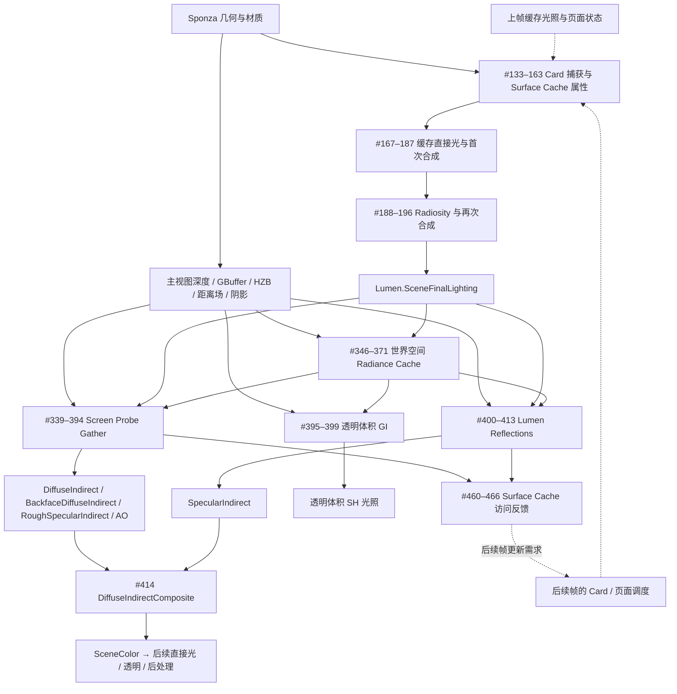
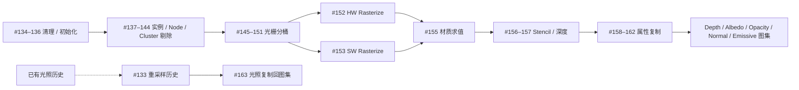
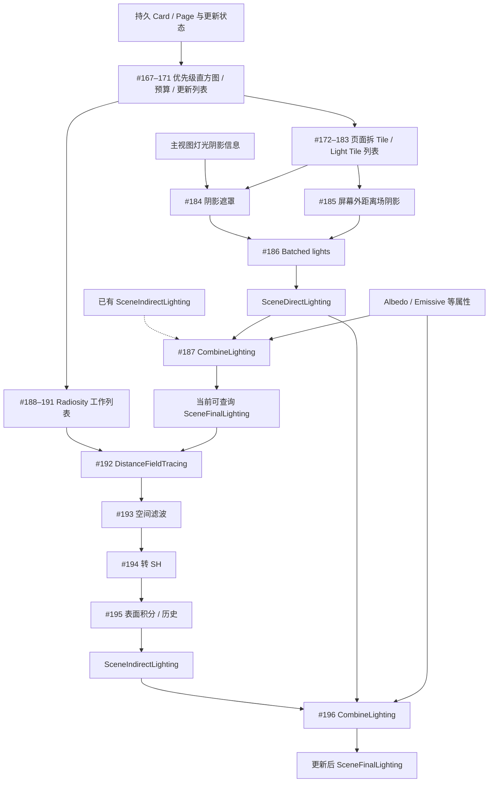
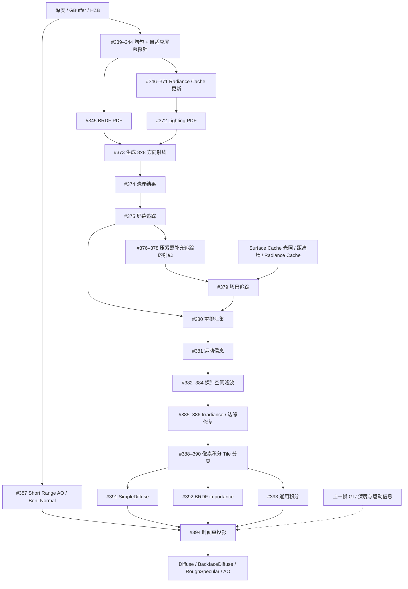
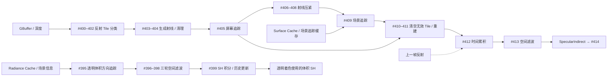

# 同场景 Unreal Lumen Pass 分析与数据流

- 2026-10-06：601新只读V350实际SC writer灯光/params与post-completion逐位，唯一方向光色(150,132,108)已含原×50；不可代DDGI色×w3。3919 native primary CONTROL点20µm/alpha1/映射通过，CPU窄3102首面中1823 NdotL正，shadow1125hit/698root-exit miss，但native alpha/shadow地址未证，不据此加光。独立只读GPU probe编译/spirv-val、未安装/执行。新350原SC/native门PASS，生产255SHA保持，无新build/Unit/Metal/配对SCstage；103raw77unique/42新目录SHA输入与JSON/CPU query-first逐位、148副本清理，601capture57段保留56，目标未完成。[灯光源与首面shadow资格边界](../reports/sc-resolve-2026-10-03/native-first-light-inputs/README.md)。

- 2026-10-06：600只读32组单次更新反事实：5733 actual52/原rho=.5/native history→ray→原projection动态clamp闭合，五因素Shapley经实际Gather六ROI加和通过。亮斑bank−.008148、rho−.005271、N−.002935、distance+.000201（signed preclamp非HDR份额）；不把整run失败归因t或删history。下一步实际首面SC light单位／native shadow／一跳供光资格，未恢复无阴影直射。26输入35raw33unique新目录JSON与全部raw逐位、最终70副本核SHA清理，前一预分解轮独列；当前255SHA保持，无新GPU／回归／视觉收益，600capture56段保留55，目标未完成。[实际分解与资格边界](../reports/sc-resolve-2026-10-03/coherent-surface-factorization/README.md)。

- 2026-10-06：600一致analytic首面point/N/rho/t候选同binary OFF/ON350，5733实际tuple→history→ray→SH闭合但亮斑indirect−71.31%、右廊−49.38%，原350亮斑误差增24.998>2，DISCARD；ON480／候选配对门未跑，CPU首面ID6未知保留。两源/231SPV恢复、两child删除、fullserial/Unit7+5/新V350480/Metal65/恢复SCstage-native PASS。274raw135unique/164新目录SHA输入与两JSON/CPU首面/comparison逐位、438自有副本清理；网页600capture55段保留54，目标未完成。[候选拒绝与恢复证据](../reports/sc-resolve-2026-10-03/analytic-coherent-surface-candidate/README.md)。

- 2026-10-06：595暗廊native首面材质214条（40813/409106/50795）原point20µm/alpha1/flags0/native映射/CPU首面ID-t/front通过，rho均值约(.295,.247,.17)与旧灰.5不同；非根因/只换rho资格。22输入23raw新目录重放/46副本清理、生产255SHA保持。私有analytic一致point/N/rho/输出t候选child编译spirv-val通过，未安装／渲染／新回归／视觉验证；595网页54段保留53，下一步同binary实际对照。[材质补证](../reports/sc-resolve-2026-10-03/native-dark-first-material/README.md)／[候选准备](../reports/sc-resolve-2026-10-03/analytic-coherent-surface-candidate/README.md)。

- 2026-10-06：595只读暗廊实际writer支持，六actual536/565源gzip核SHA相同、540query点逐位；左右实际consumer集合10 fresh probe／781 analytic ray，nearest原2mm支持0，重新查询逐位。507/409/408非零history且rho=.5，521旧324来源UNKNOWN；非pixel能量/root或删光理由。无渲染/新capture/新回归/视觉收益，255生产SHA保持；13输入16raw独立重放/34副本清理，595网页53段保留52。[当前暗廊取光资格](../reports/sc-resolve-2026-10-03/native-dark-writer-support/README.md)。

> 最新只读追加：2026-10-06：595只读history cross-SH局部Jacobian，45历史native输入核SHA／原writer与动态clamp门PASS，fresh220局部谱半径1.000679／奇异值1.000944；最强mode89.15%在438–440，但左右暗廊actual tap0，非全局稳定性或灰亮root，不衰减history/删SH。无渲染／新capture／新回归／视觉收益；parent250生产SHA保持，595capture追加52段保留51，下一步暗廊实际主probe取光surface/Nρ/history支持。[算子、当前Gather反证与独立重放](../reports/sc-resolve-2026-10-03/native-history-transfer/README.md)。

## 595最新：同帧jitter／texel-center GPU重建，无GI视觉收益，已回退（2026-10-06）

四组同binary/233SPV OFF350/ON350/OFF480/ON480，私有Uniform23读取Stage3实际368B GPU CB offset352、24独立mode/frame；原128B camera／N/SH/visibility/floor/回退不变，未恢复黑条几何过滤。原231SPV生成后逐位保持，两child模块/native Uniform writes/binds/dispatch及350 host/GPU CB exact。ON actual GPU world两帧各574相机ray→CPU20µm/64stack first均≤原2mm，350/480 max1.449/1.048mm、unknown0；这是沿实际query首面t与receiver距离差，不冒充最近Euclidean表面/全raster triangle/alpha/front/tie。whole573 ID FAIL8保留UNKNOWN。

原OFF/ON完整350480 SCstage及四Gather full/six1%／Fusion2halfULP PASS、两帧均无新增zero-confidence near，但固定EV1.8546颜色、暗部灰亮和空间层次无可保留改善。右真实indirect−.0454%/−.0712%，左+.00965%/+.0271%，墙−.1025%/−.1975%。350 normal1194像素不同未归因、574采样normal相同；480 view/volumes/SH/openSky/moments/origins/provenance/depth/normal/rasterCB全逐位，仍微小变化。重建偏差不足解释主要视觉差距，DISCARD，不凭几何改善保留GI修改。

八已有源/231SPV恢复、两个child删除、parent250 SHA exact（含前588249）；fullserial DebugVulkan／新Unit7+5／新ordinaryV350480／Metal≥65／恢复原SCstage/native门PASS，三350四SC/六main逐位/GPU112/13/80保持3256/8190及20恢复。网页595capture51段保留50；1048raw419unique/706新目录SHA输入、四reconstruction/query-first/world和comparison JSON逐位、四原native门重放PASS；1755自有副本核SHA清理statvfs+6245163008B非独占，global exports未动。初始include路径错误/首次freshness拒绝/重放fusion输出路径缺失均修复留日志，不改门。P0缺失历史FAIL/六display FAIL/whole ID FAIL8分列，目标未完成。[GPU修正与无收益回退](../reports/sc-resolve-2026-10-03/gather-reconstruction-candidate/README.md)。

下一步返回actual writer取光点surface支持、N/ρ与前帧history混合支持，连接当前Gather主要probe贡献；先补实际source/读取/数学/回退，再做窄修复对照。不得重复本已discard的重建修正/黑条几何过滤，或全局floor/SH/history比例压暗；不能用Lumen流程、局部交叉或命中数量取代全局视觉收益证据。

## 588最新：实际光栅jitter与Gather重建对应，诊断回退（2026-10-06）

新completed350的368B Stage3 draw CB GPU staging＝上传前host逐位；实际native set0/binding0/range368、graphics serial6/module-owned GPUDrivenDraw SPIR-V、viewport与final D32 resource相连。实际模块offset352 jitter加clip.xy×w再翻转Y，不是之前检查的无jitter GLSL；actual jitter full像素(+.21875,−.12037)，原Gather128B/selected80B对应parent exact。分文件driver trace不证物理descriptor或每点draw triangle身份。

574本次native packed texel/world，六world版本3444 CPU geometry first／原20µm/64stack/unknown0。center+actualDrawInverse−jitter后全574几何距离≤原2mm、max589.6µm；保留原Gather inverse修正时全574仍≤2mm/max1.465mm。近地5/64→64/64、黑条邻域155/196→196/196；最强邻点(433,191)原8.076mm、center-only9.258mm→.03752mm，解释先前center-only反例。仅减jitter仍用输出UV时大量不合格。这里只是CPU corrected geometry，尚无新GPU corrected world/alpha/front/tie/视觉收益，不能当全局灰亮root；whole573 ID FAIL8仍UNKNOWN。

七临时C++恢复、231SPV不改、18source+231SPV共249 parent SHA exact（包含原244）；fullserial DebugVulkan／新Unit7+5／新ordinaryV350480／Metal≥65／原SCstage/native门PASS，两个350四SC/六main逐位/GPU112/13/80保持3256/8190与20恢复。网页588capture50段保留49，固定EV1.8546／真实indirect HDR仍未达Lumen暗部颜色／空间层次。276raw157unique／169新目录SHA输入、analysis/query-first/world/pixel/disassembly逐位、原native门重放PASS；450自有副本清理statvfs+2296922112B非独占。global exports未动，P0缺失历史FAIL/三个display FAIL/whole ID FAIL8分列。

下一步直接做actual同frame raster CB供给的texel-center+jitter重建窄开关对照；AddPasses构图时CPU jitter可能上一帧，需直接读取Stage3实际GPU CB offset352（新增私有Uniform binding，不改原128B camera CB／floor debug域）。先核native新world与CPU几何和原来源/回退/门，再OFF350480／ON350480看固定EV颜色、连续性及真实HDR；无收益自行回退。不恢复黑条遮挡过滤，不裁floor/normal/SH/history、不改曝光/光照/原128ray/旧SC/card/cacheT／原门。目标未完成。[实际光栅来源与恢复](../reports/sc-resolve-2026-10-03/native-gather-raster-source/README.md)。

## 584只读最新：实际Gather texel-center重算，尚需光栅／GPU重建证据

从584核SHA恢复36实际源，574 near receiver／1722 CPU geometry ray／unknown0。GLSL取full-res整数depth却用half-res输出UV重建；CPU UV索引21点与native provenance不同，使用实际packed texel，不猜source。CPU center后2mm内距离：右55/64→64/64，地面5/64→50/64（CPU64为52），只是CPU几何，不是新native alpha/front/ambiguity资格。最强黑条邻点(433,191)8.076→9.213mm反而更差，中心修正不当全局root/修复。CPU32旧world与native max278µm、新32/64center max185µm，2mm边界须新GPU验证；所查GLSL/CPU jitter注释与depth getter不替代actual raster module/viewport/drawCB/triangle身份。

未改Engine／无新GPU/截图/HDR/build/Unit/V/Metal/SCstage，沿用584 EV/HDR标明历史；生产244/source/binary/assets保持。网页584capture49段保留48；43raw28unique／36新目录SHA输入、analysis与六derived raw逐位，86自有副本清理statvfs+1454071808B非独占。P0缺失历史FAIL/旧displayFAIL/whole573 ID FAIL8仍分列。先补实际光栅depth／投影读取与GPU重建，资格闭合再试窄修复；不恢复已拒绝过滤或裁floor/SH/history，目标未完成。[源对应与反例](../reports/sc-resolve-2026-10-03/native-gather-depth-center/README.md)。

## 584最新：Gather几何过滤造成黑条，已拒绝并完整回退（2026-10-06）

- 第三组新同binary/SPIR-V OFF350／ON350原Gather全帧/六ROI1%及Fusion2halfULP PASS；真实indirect右−18.769952%、左−21.247985%、墙−1.112043%，但64零权重像素出现可见细黑条。实际(432,191)与相距1.684cm、normal dot .990855的邻像素，Gather Y跳变.558511→5.178163；局部连续性反例明确，DISCARD。不是物理同表面/全帧连续性或灰亮root证明，也不把降亮视为视觉改善。
- 全图动态原20µm/64stack、native alpha1/front、camera receiver≤2mm、gap>.152m及近共面第二面UNKNOWN，未知保持旧结果；新采样622资格CPU first ID一致/t max2.28236µm，只是native输入重构query子集，非新GPU query echo／全部opacity／physical descriptor/history祖先证书。whole573 ID FAIL8保持UNKNOWN。未跑ON480，候选完整350480 SCstage NOT_RUN；第三组OFF350480原SCstage独立PASS。
- prototype错误aux-preserves-primary metadata拒绝和第二组64 zero-stencil stamp拒绝原数据全部保留。最后新组显式补实际bestRefl单probe源/unused blend0低频项、原门PASS，仍因黑条失败；不改原reader/门/曝光/光照/射线/更新/旧SC/card/cacheT。全部旧dirty保留，五已有源和231原SPV恢复、三自有child文件删除，进入阶段时13source+231SPV共244SHA exact。完整DebugVulkan serial／Unit7+5／新ordinaryV350480／Metal≥65／恢复原SCstage/native门PASS；350四SC/六main逐位/GPU112/13/80保持3256/8190和20恢复。
- 网页584capture48段保留47；1305raw499unique／186新目录SHA输入重放qualification/driver/continuity JSON及CPUquery-first逐位、原native门重放PASS、黑条/wholeID失败保留。1313自有副本核SHA清理，statvfs可用增量9,975,910,400B含并发，不称独占物理回收；current sources/binary/assets清理后exact，browser_QA false。十个旧display门FAIL，P0缺原baseline/null/NOT_RUN历史FAIL分列。[本轮失败与恢复证据](../reports/sc-resolve-2026-10-03/gather-geometry-candidate/README.md)、[状态](../reports/sc-resolve-2026-10-03/gather-geometry-candidate/progress.json)。
- 下一步先闭合实际插值支持与全零/未知回退、邻像素资格边界及原SH→gather→Fusion来源，再测试窄修复；不得直接重启本已拒绝几何过滤、裁全局floor/SH/history或按下降百分比压暗。固定EV1.8546与真实HDR显示颜色及空间层次仍有差距，Lumen目标未完成。

## 结论与范围

这些 Pass 主要完成三件事：**维护可反复查询的场景表面光照缓存；用稀疏探针与射线估计屏幕所需的间接光和反射；通过空间/时间滤波把有限样本变成稳定图像**。大量 Clear、分配、压紧、分桶和 IndirectArgs Pass 是 GPU 工作调度，不是独立的光照算法。

原始完整帧有 **481 个 RDG Pass**。原归档按事件名/父 Scope 包含“Lumen”索引到 **140 个**；这次从参数元数据的源码路径补认出 **#395–399 的 5 个 Lumen 透明体积 Pass**，并纳入 **#414 的间接光合成 Pass**，逐项解释共 **146 个**。新增项目一直在完整帧归档中，不是重新捕获。主场景的 Nanite、GBuffer、距离场、阴影和后处理是共享基础设施，不把全部 481 个都称为 Lumen。

- **实采证据**：Pass ID、事件参数、输入/输出资源标识、参数结构、资源版本和尺寸。
- **源码解释**：参数元数据定位到本机 UE 5.7 源码，结合对应 shader 类、RDG 事件和资源用途解释操作。
- **概念流程**：下面的分层图压缩了调度与中间资源，不是 GPU 硬件执行时间线。实线表示主要数据流，虚线表示历史或后续帧反馈。自动生成的详细图只表示 RDG 声明的资源读写关系，不证明 shader 每条分支实际访问了资源。

此次出现 `TraceVoxels`、`DistanceFieldTracing` 等软件场景追踪事件，没有在本次选定 Lumen Pass 中发现硬件光追事件。不能把 `HW Rasterize` 误读为硬件光追。这里解释本帧实际分支，不补画未执行的 Mesh SDF Detail/HWRT 分支。

## 1. 一帧的总体流转

直接光有两个不同位置：#186 在 **Surface Cache 上**求值，供间接射线命中查询；主屏幕太阳的直接光在完整帧里还有 #429 `Light::StandardDeferred: VulkanReference_Sun`。它们服务不同接收位置，不能仅凭名称认定屏幕直接光被加了两遍。#414 输出也不是最终显示图，之后仍有主视图光照与后处理。

## 2. Card 捕获与 Surface Cache：把表面变成可查询的图集

本帧 Scope 明确写着 **2 card captures、0.031M texels**。这只是本帧的增量更新，不是整个 Sponza 只有 2 张 Card。未更新页面仍可以作为已有缓存输入。本帧 Card 捕获中的 18 个 Nanite 调度/光栅 Pass 被归入 Lumen Scope，但它们实现的是几何捕获支持。#154 的 Nanite 反馈未画入主属性链，因为它负责另一类状态。

## 3. Surface Cache 光照：直接光、Radiosity 和双次合成

#187 和 #196 不是无意义重复：前者让缓存先拥有本轮直接光与已有间接光，Radiosity 可以据此采样；后者将新的间接光合并进去。资源绑定直接证实二者都写 `Lumen.SceneFinalLighting`，#195 写 `Lumen.SceneIndirectLighting` 与 `SceneNumFramesAccumulatedAtlas`。多次反弹借助缓存与跨帧更新传播，不能把“本帧只见一次 Radiosity Trace”解释成只有一次反弹，也不能把缓存历史解释成同一帧无限递归。

## 4. Screen Probe Gather：从有限方向样本得到全屏 GI

屏幕探针与世界空间 Radiance Cache 探针不是同一东西。前者贴合当前可见表面，后者复用空间中的方向光照。#346–371 的大量成对 Pass 说明本帧更新了两个缓存实例；#366/#367 分别为 32×32 与 8×8 方向分辨率。资源同名不代表同一存储，必须看 ID。#348 来自 ScreenProbes，#349 来自 TranslucencyVolume；本机源码中两类需求可一起调度。本文不只凭分辨率为每个槽位硬编码用途。

本帧 #394 标明内部视图 **1485×885**，最终 Dump 截图是 **2398×1428**。这说明不能把输出截图分辨率当成每个 GI Pass 的分辨率。DownsampleFactor=16 的均匀放置也不能简单推断全场景成本降到 1/256，因为还有自适应探针、方向射线、缓存更新和全屏积分。

## 5. 反射和透明体积

反射事件中的 `MaxRoughnessToTrace:0.40` 是本帧专门反射追踪的阈值；Screen Probe Gather 已输出 `RoughSpecularIndirect`。所以不能把所有镜面间接光都归到 #400–413。透明体积 SH 并非 #414 的直接输入；它用于后续透明着色，不应把该支路硬接成不透明 SceneColor 的一次额外相加。

## 6. 为什么要有这么多调度 Pass

| 类型 | 本帧例子 | 目的 |
|---|---|---|
| 清理 | ClearBuffer / ClearTraces / ClearUnusedTileData | 重置计数器和未使用输出，防止旧数据混入 |
| 分类 / 分桶 | RasterBin / TileClassification / PriorityHistogram | 按几何、材质、更新优先级划分工作 |
| 分配 / 压紧 | Allocate / CompactTraces / CompactLightTiles | 只让后续 shader 处理有效工作 |
| 间接参数 | IndirectArgs / SetupCompactedTracesIndirectArgs | 由 GPU 生成后续 dispatch/draw 数量，减少 CPU 介入 |
| 表示转换 | ConvertToSH / ConvertToIrradiance / FixupBorders | 将稀疏方向光照变成能快速连续查询的表示 |
| 稳定化 | SpatialFilter / TemporalReprojection / TemporalAccumulation | 降低有限样本的噪声，处理历史与变化 |
| 反馈 | Hash / Compact / Readback | 把缓存访问需求送给后续帧的更新调度 |

Pass 数本身不是成本。某些 Clear/Args 很小，追踪/滤波可以很重；同名 Pass 也可能具有不同分辨率和工作列表。此次 DumpGPU 扰动了帧执行，缺少逐 Pass GPU timestamp，因此文档不按 Pass 数排名性能。

## 7. 逐 Pass 说明

下表完全覆盖选定的 146 个 ID。输出列来自实采 RDG 绑定，按资源名称去重显示最多 5 项；完整标识、全部输入/输出、二进制路径和参数源码位置保存在附属 JSON。带 `…` 表示还有输出未在表内展开。事件参数按捕获值保留。

### 7.1 Card 捕获

| ID | 实际事件 | 做什么 | 主要输出资源 |
|---:|---|---|---|
| 133 | `ResampleLightingHistoryToCardCaptureAtlasCS` | 将已有光照历史重采样到临时 Card Capture Atlas，减少缓存页面重新捕获时的光照跳变。 | `Lumen.ResampledCardCaptureDirectLighting`、`Lumen.ResampledCardCaptureIndirectLighting`、`Lumen.ResampledCardCaptureNumFramesAccumulated`、`Lumen.ResampledCardCaptureTileShadowDownsampleFactorAtlas` |
| 134 | `ClearCardCapture` | 清理本次 Card 捕获区域，为材质/深度重新写入准备目标。 | `Lumen.CardCaptureAlbedoAtlas`、`Lumen.CardCaptureNormalAtlas`、`Lumen.CardCaptureEmissiveAtlas`、`Lumen.CardCaptureDepthStencilAtlas` |
| 135 | `ClearTextureRects(Nanite.VisBuffer64 PF_R32G32_UINT 512x512 Mip=0)` | 清理 Nanite 可见性缓冲的捕获矩形，移除旧的三角形可见性记录。 | `Nanite.VisBuffer64` |
| 136 | `InitArgs` | 初始化 Nanite 捕获所需的计数器和间接执行参数。 | `Nanite.QueueState`、`Nanite.MainRasterizeArgsSWHW` |
| 137 | `InstanceCull - Explicit List` | 按本次捕获指定的实例列表进行实例剔除。 | `Nanite.CandidatesNodesBuffer`、`Nanite.QueueState`、`Nanite.StatsBuffer` |
| 138 | `InitNodeCullArgs` | 初始化 Nanite 层级节点遍历的间接参数。 | `Nanite.QueueState`、`Nanite.CullArgs0`、`Nanite.CullArgs1` |
| 139 | `NodeCull_0` | 遍历本次 Nanite 层级的对应轮次，筛选需要进一步展开或提交的节点；四行是层级遍历轮次。 | `Nanite.QueueState`、`Nanite.CandidatesNodesBuffer`、`Nanite.CandidateClustersBuffer`、`Nanite.StreamingRequests`、`Nanite.CullArgs1` |
| 140 | `NodeCull_1` | 遍历本次 Nanite 层级的对应轮次，筛选需要进一步展开或提交的节点；四行是层级遍历轮次。 | `Nanite.QueueState`、`Nanite.CandidatesNodesBuffer`、`Nanite.CandidateClustersBuffer`、`Nanite.StreamingRequests`、`Nanite.CullArgs0` |
| 141 | `NodeCull_2` | 遍历本次 Nanite 层级的对应轮次，筛选需要进一步展开或提交的节点；四行是层级遍历轮次。 | `Nanite.QueueState`、`Nanite.CandidatesNodesBuffer`、`Nanite.CandidateClustersBuffer`、`Nanite.StreamingRequests`、`Nanite.CullArgs1` |
| 142 | `NodeCull_3` | 遍历本次 Nanite 层级的对应轮次，筛选需要进一步展开或提交的节点；四行是层级遍历轮次。 | `Nanite.QueueState`、`Nanite.CandidatesNodesBuffer`、`Nanite.CandidateClustersBuffer`、`Nanite.StreamingRequests`、`Nanite.CullArgs0` |
| 143 | `InitClusterCullArgs` | 为筛选后的 Cluster 工作量生成间接参数。 | `Nanite.QueueState`、`Nanite.ClusterCullArgs` |
| 144 | `ClusterCull` | 剔除不可见/不需要的 Cluster，确定实际光栅化几何。 | `Nanite.QueueState`、`Nanite.CandidateClustersBuffer`、`Nanite.VisibleClustersSWHW`、`Nanite.MainRasterizeArgsSWHW` |
| 145 | `CalculateSafeRasterizerArgs` | 计算安全的光栅执行参数，限制提交工作量。 | `Nanite.SafeMainRasterizeArgsSWHW`、`Nanite.SWHWClusterCount`、`Nanite.ClusterClassifyArgs` |
| 146 | `RasterBinInit` | 初始化光栅分桶元数据。 | `Nanite.RasterBinMeta` |
| 147 | `RasterBinCount` | 统计各光栅桶所需的几何数量。 | `Nanite.RasterBinMeta` |
| 148 | `ClearBuffer(Nanite.RangeAllocatorBuffer Size=4bytes)` | 清零光栅桶范围分配器。 | `Nanite.RangeAllocatorBuffer` |
| 149 | `RasterBinReserve` | 按计数预留各桶的存储范围。 | `Nanite.RangeAllocatorBuffer`、`Nanite.RasterBinIndirectArgs`、`Nanite.RasterBinMeta` |
| 150 | `RasterBinScatter` | 将待光栅化几何散布到对应桶。 | `Nanite.RasterBinMeta`、`Nanite.RasterBinIndirectArgs`、`Nanite.RasterBinData` |
| 151 | `RasterBinFinalize` | 完成桶范围及执行参数，为 HW/SW 路径提供工作列表。 | `Nanite.RasterBinIndirectArgs`、`Nanite.RasterBinMeta` |
| 152 | `HW Rasterize (Triangles)` | 用硬件三角形光栅路径写入 Nanite 捕获可见性。HW Rasterize 指光栅化，不代表硬件光追。 | `Nanite.VisBuffer64`、`Nanite.StatsBuffer` |
| 153 | `SW Rasterize (Triangles)` | 用计算着色器软件光栅路径处理分配给它的 Nanite 几何。两个光栅路径互补。 | `Nanite.VisBuffer64`、`Nanite.StatsBuffer` |
| 154 | `NaniteFeedbackStatus` | 提交 Nanite 几何/流送反馈状态；它与帧尾的 Lumen Surface Cache 反馈是两套机制。 | `Nanite.QueueState`、`GPUMessageManager.MessageBuffer` |
| 155 | `LumenShadeCS` | 对捕获到的可见 Nanite 表面求值材质，生成供 Lumen 使用的表面属性。 | `Lumen.CardCaptureAlbedoAtlas`、`Lumen.CardCaptureNormalAtlas`、`Lumen.CardCaptureEmissiveAtlas` |
| 156 | `Mark Stencil` | 标记捕获区域的 stencil/有效像素，辅助后续深度和材质捕获。 | `Lumen.CardCaptureDepthStencilAtlas` |
| 157 | `Emit Depth` | 输出捕获深度，使 Card 具有表面位置/遮挡信息。 | `Lumen.CardCaptureDepthStencilAtlas` |
| 158 | `CopyToSurfaceCache Depth` | 将临时捕获的 深度 写入持久 Surface Cache 对应图集；这一步是表面属性存储，不是最终屏幕着色。 | `Lumen.SceneDepth` |
| 159 | `CopyToSurfaceCache Albedo` | 将临时捕获的 Albedo 写入持久 Surface Cache 对应图集；这一步是表面属性存储，不是最终屏幕着色。 | `Lumen.SceneAlbedo` |
| 160 | `CopyToSurfaceCache Opacity` | 将临时捕获的 Opacity 写入持久 Surface Cache 对应图集；这一步是表面属性存储，不是最终屏幕着色。 | `Lumen.SceneOpacity` |
| 161 | `CopyToSurfaceCache Normal` | 将临时捕获的 Normal 写入持久 Surface Cache 对应图集；这一步是表面属性存储，不是最终屏幕着色。 | `Lumen.SceneNormal` |
| 162 | `CopyToSurfaceCache Emissive` | 将临时捕获的 Emissive 写入持久 Surface Cache 对应图集；这一步是表面属性存储，不是最终屏幕着色。 | `Lumen.SceneEmissive` |
| 163 | `CopyCardCaptureLightingToAtlas` | 把 Card 捕获阶段保留/重采样的光照复制回缓存图集，维持更新后的光照历史。 | `Lumen.TileShadowDownsampleFactorAtlas`、`Lumen.SceneDirectLighting`、`Lumen.SceneFinalLighting`、`Lumen.SceneIndirectLighting`、`Lumen.SceneNumFramesAccumulatedAtlas` |

### 7.2 反馈初始化与页面光照调度

| ID | 实际事件 | 做什么 | 主要输出资源 |
|---:|---|---|---|
| 165 | `ClearBuffer(Lumen.FeedbackAllocator Size=4bytes)` | 清零本帧 Lumen 页访问反馈的分配计数器。 | `Lumen.FeedbackAllocator` |
| 166 | `ClearBuffer(Lumen.Feedback Size=41664bytes)` | 清理本帧 Lumen 页访问反馈存储。 | `Lumen.Feedback` |
| 167 | `ClearCardUpdateContext` | 清零直接/间接光更新列表、优先级统计及预算状态。 | `Lumen.DirectLightingCardPageIndexAllocator`、`Lumen.IndirectLightingCardPageIndexAllocator`、`Lumen.MaxUpdateBucket`、`Lumen.CardPageTileAllocator`、`Lumen.PriorityHistogram` |
| 168 | `BuildPageUpdatePriorityHistogram` | 统计 Surface Cache 页面更新优先级的直方图，供预算筛选使用。 | `Lumen.PriorityHistogram` |
| 169 | `Select max update bucket` | 按本帧更新预算选择优先级截止桶；不是所有页面都在这一帧重算。 | `Lumen.MaxUpdateBucket` |
| 170 | `Build cards update list` | 生成要更新光照的 Card 页面列表，分别服务直接光与间接光。 | `Lumen.DirectLightingCardPageIndexAllocator`、`Lumen.DirectLightingCardPageIndexData`、`Lumen.IndirectLightingCardPageIndexAllocator`、`Lumen.IndirectLightingCardPageIndexData`、`Lumen.CardPageTileAllocator` … |
| 171 | `SetCardPageIndexIndirectArgs` | 为页面更新列表生成 GPU 间接执行参数。 | `Lumen.DirectLighting.DrawCardPageIndicesIndirectArgs`、`Lumen.DirectLighting.DispatchCardPageIndicesIndirectArgs`、`Lumen.IndirectLighting.DrawCardPageIndicesIndirectArgs`、`Lumen.IndirectLighting.DispatchCardPageIndicesIndirectArgs` |

### 7.3 缓存直接光

| ID | 实际事件 | 做什么 | 主要输出资源 |
|---:|---|---|---|
| 172 | `ClearBuffer(Lumen.CardTileAllocator Size=4bytes)` | 清零直接光的 Card Tile 分配计数器。 | `Lumen.CardTileAllocator` |
| 173 | `SpliceCardPagesIntoTiles` | 将被选中的 Card 页面拆分为更小的光照 Tile 工作单元。 | `Lumen.CardTileAllocator`、`Lumen.CardTiles` |
| 174 | `InitializeCardTileIndirectArgs` | 由实际 Card Tile 数生成间接执行参数。 | `Lumen.DispatchCardTilesIndirectArgs` |
| 175 | `CalculateCardTileDepthRanges` | 计算每个 Card Tile 的深度范围，辅助灯光/阴影工作筛选。 | `Lumen.CardTileDepthRanges` |
| 176 | `ClearBuffer(Lumen.DirectLighting.LightTileAllocator Size=4bytes)` | 分别清零全局、每灯、每 Card Tile 的 Light Tile 分配/计数状态。 | `Lumen.DirectLighting.LightTileAllocator` |
| 177 | `ClearBuffer(Lumen.DirectLighting.LightTileAllocatorPerLight Size=16bytes)` | 分别清零全局、每灯、每 Card Tile 的 Light Tile 分配/计数状态。 | `Lumen.DirectLighting.LightTileAllocatorPerLight` |
| 178 | `ClearBuffer(Lumen.DirectLighting.LightTileAllocatorForPerCardTileDispatch Size=4bytes)` | 分别清零全局、每灯、每 Card Tile 的 Light Tile 分配/计数状态。 | `Lumen.DirectLighting.LightTileAllocatorForPerCardTileDispatch` |
| 179 | `BuildLightTiles` | 判断灯光对 Card Tile 的影响范围，构建灯光与表面 Tile 配对。 | `Lumen.DirectLighting.LightTileAllocator`、`Lumen.DirectLighting.LightTileAllocatorForPerCardTileDispatch`、`Lumen.DirectLighting.LightTiles`、`Lumen.DirectLighting.LightTileAllocatorPerLight`、`Lumen.DirectLighting.LightTileOffsetNumPerCardTile` |
| 180 | `ComputeLightTileOffsetsPerLight` | 计算每盏灯在 Light Tile 列表中的偏移，形成连续可执行范围。 | `Lumen.DirectLighting.LightTileOffsetsPerLight` |
| 181 | `InitializeLightTileIndirectArgs` | 生成灯光 Tile 着色的间接执行参数。 | `Lumen.DirectLighting.DispatchLightTilesIndirectArgs`、`Lumen.DirectLighting.DrawTilesPerLightIndirectArgs`、`Lumen.DirectLighting.DispatchTilesPerLightIndirectArgs` |
| 182 | `ClearBuffer(Lumen.DirectLighting.CompactedLightTileAllocatorPerLight Size=16bytes)` | 清零压紧后的每灯 Light Tile 计数器。 | `Lumen.DirectLighting.CompactedLightTileAllocatorPerLight` |
| 183 | `CompactLightTiles` | 压紧有效 Light Tile 列表，减少后续空工作。 | `Lumen.DirectLighting.CompactedLightTiles`、`Lumen.DirectLighting.LightTilesPerCardTile`、`Lumen.DirectLighting.CompactedLightTileAllocatorPerLight` |
| 184 | `ShadowMaskFromLightAttenuationPass(Sponza_VulkanReference.VulkanReference_Sun)` | 利用现有灯光衰减/阴影遮罩为 Card Tile 生成阴影信息；不等同于此 Pass 自己生成全部阴影。 | `Lumen.DirectLighting.ShadowMaskTiles` |
| 185 | `DistanceFieldShadowPass Sponza_VulkanReference.VulkanReference_Sun` | 为屏幕外的缓存表面补算太阳的距离场阴影，补足屏幕相关遮罩看不到的区域。 | `Lumen.DirectLighting.ShadowMaskTiles` |
| 186 | `Batched lights` | 在有效 Light Tile 上批量求值本帧灯光，写入 Surface Cache 的直接光图集。本帧事件标明 1 lights。 | `Lumen.SceneDirectLighting`、`Lumen.TileShadowDownsampleFactorAtlas` |
| 187 | `CombineLighting CS` | 将直接光、已有间接光与表面属性/自发光组合为 SceneFinalLighting，先提供可供 Radiosity 查询的缓存光照。 | `Lumen.SceneFinalLighting` |

### 7.4 Radiosity

| ID | 实际事件 | 做什么 | 主要输出资源 |
|---:|---|---|---|
| 188 | `ClearBuffer(Lumen.CardTileAllocator Size=4bytes)` | 清零 Radiosity 的 Card Tile / Radiosity Tile 分配状态。 | `Lumen.CardTileAllocator` |
| 189 | `ClearBuffer(Lumen.RadiosityTileAllocator Size=4bytes)` | 清零 Radiosity 的 Card Tile / Radiosity Tile 分配状态。 | `Lumen.RadiosityTileAllocator` |
| 190 | `BuildRadiosityTiles` | 为需更新的表面页面建立 Radiosity 探针/Tile 工作列表。 | `Lumen.CardTileAllocator`、`Lumen.CardTiles`、`Lumen.RadiosityTileAllocator`、`Lumen.RadiosityTiles` |
| 191 | `IndirectArgs` | 按有效 Radiosity 工作量生成 GPU 间接执行参数。 | `Lumen.DispatchCardTilesIndirectArgs`、`Lumen.RadiosityIndirectArgs` |
| 192 | `DistanceFieldTracing 4x4 probes at 4 spacing` | 从表面附近探针按方向追踪距离场，查询场景缓存光照，得到 Radiosity 方向辐射度；事件为 4×4 probes、spacing 4。 | `Lumen.Radiosity.TraceRadianceAtlas` |
| 193 | `SpatialFilterProbes` | 对 Radiosity 探针方向辐射度进行空间滤波，减小稀疏追踪噪声。 | `Lumen.Radiosity.FilteredTraceRadianceAtlas` |
| 194 | `ConvertToSH` | 将滤波后的探针方向光照转为球谐 SH 表示，便于表面法线方向上的积分。 | `Lumen.Radiosity.ProbeSHRedAtlas`、`Lumen.Radiosity.ProbeSHGreenAtlas`、`Lumen.Radiosity.ProbeSHBlueAtlas` |
| 195 | `Integrate` | 将探针 SH 光照积分到表面间接光图集，并维护累计帧数/时间历史状态。 | `Lumen.SceneIndirectLighting`、`Lumen.SceneNumFramesAccumulatedAtlas` |
| 196 | `CombineLighting CS` | 使用刚更新的 SceneIndirectLighting 再组合 SceneFinalLighting，供之后的 GI/反射查询。 | `Lumen.SceneFinalLighting` |

### 7.5 屏幕探针放置

| ID | 实际事件 | 做什么 | 主要输出资源 |
|---:|---|---|---|
| 339 | `UniformPlacement DownsampleFactor=16` | 按屏幕网格放置均匀探针，读取深度等表面信息；本帧 DownsampleFactor=16。 | `Lumen.ScreenProbeGather.ScreenProbeSceneDepth`、`Lumen.ScreenProbeGather.ScreenProbeWorldNormal`、`Lumen.ScreenProbeGather.ScreenProbeWorldSpeed`、`Lumen.ScreenProbeGather.ScreenProbeTranslatedWorldPosition` |
| 340 | `ClearTextureUint(Lumen.ScreenProbeGather.ScreenTileAdaptiveProbeHeader R32_UINT 93x56 Mip=0)` | 清理自适应屏幕探针的 Tile Header 与探针计数器。 | `Lumen.ScreenProbeGather.ScreenTileAdaptiveProbeHeader` |
| 341 | `ClearBuffer(Lumen.ScreenProbeGather.NumAdaptiveScreenProbes Size=4bytes)` | 清理自适应屏幕探针的 Tile Header 与探针计数器。 | `Lumen.ScreenProbeGather.NumAdaptiveScreenProbes` |
| 342 | `AdaptivePlacementMark 4x2` | 标记均匀探针覆盖不足的深度/几何变化区域，寻找自适应探针需求。 | `Lumen.ScreenProbeGather.AdaptiveProbePlacementMask` |
| 343 | `AdaptivePlacementSpawn` | 为被标记区域生成自适应屏幕探针。 | `Lumen.ScreenProbeGather.ScreenProbeSceneDepth`、`Lumen.ScreenProbeGather.ScreenProbeWorldNormal`、`Lumen.ScreenProbeGather.ScreenProbeWorldSpeed`、`Lumen.ScreenProbeGather.ScreenProbeTranslatedWorldPosition`、`Lumen.ScreenProbeGather.NumAdaptiveScreenProbes` … |
| 344 | `SetupAdaptiveProbeIndirectArgs` | 根据均匀与自适应探针数量设置后续间接执行参数。 | `Lumen.ScreenProbeGather.ScreenProbeIndirectArgs` |
| 345 | `ComputeBRDF_PDF` | 构建屏幕探针对应的 BRDF 方向概率分布，作为重要性采样依据。 | `Lumen.ScreenProbeGather.BRDFProbabilityDensityFunctionSH` |

### 7.6 世界空间 Radiance Cache

| ID | 实际事件 | 做什么 | 主要输出资源 |
|---:|---|---|---|
| 346 | `ClearProbeIndirectionCS` | 清理对应 Radiance Cache 的 3D 探针索引映射；两个 Pass 对应两个缓存实例。 | `Lumen.RadianceCache.RadianceProbeIndirectionTexture` |
| 347 | `ClearProbeIndirectionCS` | 清理对应 Radiance Cache 的 3D 探针索引映射；两个 Pass 对应两个缓存实例。 | `Lumen.RadianceCache.RadianceProbeIndirectionTexture` |
| 348 | `MarkRadianceProbes(ScreenProbes) 93x84` | 由屏幕探针标记当前需要访问的世界空间 Radiance Cache 探针。 | `Lumen.RadianceCache.RadianceProbeIndirectionTexture` |
| 349 | `MarkRadianceProbesUsedByTranslucencyVolume` | 由透明体积光照标记其需要的 Radiance Cache 探针。 | `Lumen.RadianceCache.RadianceProbeIndirectionTexture` |
| 350 | `UpdateCacheForUsedProbes` | 更新已使用探针的使用/历史状态，参与有效性和更新优先级判断。 | `Lumen.RadianceCache.RadianceProbeIndirectionTexture`、`Lumen.RadianceCache.ProbeFreeListAllocator`、`Lumen.RadianceCache.ProbeFreeList`、`Lumen.RadianceCache.ProbeLastUsedFrame` |
| 351 | `UpdateCacheForUsedProbes` | 更新已使用探针的使用/历史状态，参与有效性和更新优先级判断。 | `Lumen.RadianceCache.RadianceProbeIndirectionTexture`、`Lumen.RadianceCache.ProbeFreeListAllocator`、`Lumen.RadianceCache.ProbeFreeList`、`Lumen.RadianceCache.ProbeLastUsedFrame` |
| 352 | `ClearRadianceCacheUpdateResources` | 清理 Radiance Cache 的更新分配器、优先级等临时状态。 | `Lumen.RadianceCache.ProbeTraceAllocator`、`Lumen.RadianceCache.PriorityHistogram`、`Lumen.RadianceCache.MaxUpdateBucket`、`Lumen.RadianceCache.MaxTracesFromMaxUpdateBucket`、`Lumen.RadianceCache.ProbesToUpdateTraceCost` … |
| 353 | `ClearRadianceCacheUpdateResources` | 清理 Radiance Cache 的更新分配器、优先级等临时状态。 | `Lumen.RadianceCache.ProbeTraceAllocator`、`Lumen.RadianceCache.PriorityHistogram`、`Lumen.RadianceCache.MaxUpdateBucket`、`Lumen.RadianceCache.MaxTracesFromMaxUpdateBucket`、`Lumen.RadianceCache.ProbesToUpdateTraceCost` … |
| 354 | `AllocateUsedProbes` | 为需要的新探针分配缓存存储，复用/维护已有探针槽位。 | `Lumen.RadianceCache.RadianceProbeIndirectionTexture`、`Lumen.RadianceCache.ProbeLastTracedFrame`、`Lumen.RadianceCache.PriorityHistogram`、`Lumen.RadianceCache.MinNewProbeTraceCost`、`Lumen.RadianceCache.ProbeLastUsedFrame` … |
| 355 | `AllocateUsedProbes` | 为需要的新探针分配缓存存储，复用/维护已有探针槽位。 | `Lumen.RadianceCache.RadianceProbeIndirectionTexture`、`Lumen.RadianceCache.ProbeLastTracedFrame`、`Lumen.RadianceCache.PriorityHistogram`、`Lumen.RadianceCache.MinNewProbeTraceCost`、`Lumen.RadianceCache.ProbeLastUsedFrame` … |
| 356 | `SelectMaxPriorityBucket` | 按追踪预算选择本帧更新的最高优先级范围。 | `Lumen.RadianceCache.MaxUpdateBucket`、`Lumen.RadianceCache.MaxTracesFromMaxUpdateBucket` |
| 357 | `SelectMaxPriorityBucket` | 按追踪预算选择本帧更新的最高优先级范围。 | `Lumen.RadianceCache.MaxUpdateBucket`、`Lumen.RadianceCache.MaxTracesFromMaxUpdateBucket` |
| 358 | `AllocateProbeTraces` | 为被选中的探针分配本帧追踪工作。 | `Lumen.RadianceCache.ProbeLastTracedFrame`、`Lumen.RadianceCache.ProbesToUpdateTraceCost`、`Lumen.RadianceCache.MinNewProbeTraceCost`、`Lumen.RadianceCache.ProbeTraceAllocator`、`Lumen.RadianceCache.ProbeTraceData` |
| 359 | `AllocateProbeTraces` | 为被选中的探针分配本帧追踪工作。 | `Lumen.RadianceCache.ProbeLastTracedFrame`、`Lumen.RadianceCache.ProbesToUpdateTraceCost`、`Lumen.RadianceCache.MinNewProbeTraceCost`、`Lumen.RadianceCache.ProbeTraceAllocator`、`Lumen.RadianceCache.ProbeTraceData` |
| 360 | `SetupProbeIndirectArgsCS` | 生成探针处理及追踪工作所需的间接执行参数。 | `Lumen.RadianceCache.ProbeAllocator`、`Lumen.RadianceCache.ProbeFreeListAllocator`、`Lumen.RadianceCache.ClearProbePDFsIndirectArgs`、`Lumen.RadianceCache.GenerateProbeTraceTilesIndirectArgs`、`Lumen.RadianceCache.ProbeTraceTileAllocator` … |
| 361 | `SetupProbeIndirectArgsCS` | 生成探针处理及追踪工作所需的间接执行参数。 | `Lumen.RadianceCache.ProbeAllocator`、`Lumen.RadianceCache.ProbeFreeListAllocator`、`Lumen.RadianceCache.ClearProbePDFsIndirectArgs`、`Lumen.RadianceCache.GenerateProbeTraceTilesIndirectArgs`、`Lumen.RadianceCache.ProbeTraceTileAllocator` … |
| 362 | `GenerateProbeTraceTiles` | 把探针方向追踪拆为 Trace Tile 工作。 | `Lumen.RadianceCache.ProbeTraceTileAllocator`、`Lumen.RadianceCache.ProbeTraceTileData` |
| 363 | `GenerateProbeTraceTiles` | 把探针方向追踪拆为 Trace Tile 工作。 | `Lumen.RadianceCache.ProbeTraceTileAllocator`、`Lumen.RadianceCache.ProbeTraceTileData` |
| 364 | `SetupTraceFromProbesCS` | 根据实际 Trace Tile 列表生成探针追踪执行参数。 | `Lumen.RadianceCache.TraceProbesIndirectArgs`、`Lumen.RadianceCache.SortProbeTraceTilesIndirectArgs`、`Lumen.RadianceCache.RadianceCacheHardwareRayTracingIndirectArgs`、`Lumen.RadianceCache.HardwareRayTracing.RayAllocatorBuffer` |
| 365 | `SetupTraceFromProbesCS` | 根据实际 Trace Tile 列表生成探针追踪执行参数。 | `Lumen.RadianceCache.TraceProbesIndirectArgs`、`Lumen.RadianceCache.SortProbeTraceTilesIndirectArgs`、`Lumen.RadianceCache.RadianceCacheHardwareRayTracingIndirectArgs`、`Lumen.RadianceCache.HardwareRayTracing.RayAllocatorBuffer` |
| 366 | `TraceFromProbes Res=32x32 SkyVisibility:0` | 追踪 32×32 方向分辨率的世界空间探针，写入辐射度和深度图集；SkyVisibility:0 是该事件模式标记，不代表天空光为零。 | `Lumen.RadianceCache.RadianceProbeAtlasTextureSource`、`Lumen.RadianceCache.DepthProbeAtlasTexture` |
| 367 | `TraceFromProbes Res=8x8 SkyVisibility:0` | 追踪另一缓存的 8×8 方向分辨率探针，生成辐射度/深度；通过资源 ID 区分两个同名图集。 | `Lumen.RadianceCache.RadianceProbeAtlasTextureSource`、`Lumen.RadianceCache.DepthProbeAtlasTexture` |
| 368 | `FilterProbeRadiance Res=32x32` | 分别滤波两个缓存的探针方向辐射度。 | `Lumen.RadianceCache.FilteredRadianceProbeAtlasTexture` |
| 369 | `FilterProbeRadiance Res=8x8` | 分别滤波两个缓存的探针方向辐射度。 | `Lumen.RadianceCache.FilteredRadianceProbeAtlasTexture` |
| 370 | `FixupBordersAndGenerateMips` | 修复探针方向图集边界并生成 mip，支持连续方向采样和不同粗糙度/尺度查询。 | `Lumen.RadianceCache.FinalRadianceAtlas` |
| 371 | `FixupBordersAndGenerateMips` | 修复探针方向图集边界并生成 mip，支持连续方向采样和不同粗糙度/尺度查询。 | `Lumen.RadianceCache.FinalRadianceAtlas` |

### 7.7 屏幕探针追踪、过滤与积分

| ID | 实际事件 | 做什么 | 主要输出资源 |
|---:|---|---|---|
| 372 | `ComputeLightingPDF` | 构建光照方向概率分布，与 BRDF 分布共同指导屏幕探针射线采样。 | `Lumen.ScreenProbeGather.LightingProbabilityDensityFunction` |
| 373 | `GenerateRays 8x8` | 生成屏幕探针方向射线及采样信息；事件为 8×8，不是每个最终像素发 64 条射线。 | `Lumen.ScreenProbeGather.RayInfosForTracing` |
| 374 | `ClearTraces 8x8` | 初始化屏幕探针射线的辐射度、命中等结果。 | `Lumen.ScreenProbeGather.TraceRadiance`、`Lumen.ScreenProbeGather.TraceHit` |
| 375 | `TraceScreen(Scene)` | 先追踪屏幕深度/场景信息，填充可由当前视图解释的命中与辐射度。 | `Lumen.ScreenProbeGather.TraceRadiance`、`Lumen.ScreenProbeGather.TraceHit` |
| 376 | `ClearBuffer(Lumen.ScreenProbeGather.CompactedTraceTexelAllocator Size=4bytes)` | 清零需要补充追踪的射线列表分配计数器。 | `Lumen.ScreenProbeGather.CompactedTraceTexelAllocator` |
| 377 | `CompactTraces WaveOps:1` | 压紧仍需场景追踪的射线，利用 WaveOps 减少无效工作。 | `Lumen.ScreenProbeGather.CompactedTraceTexelAllocator`、`Lumen.ScreenProbeGather.CompactedTraceTexelData` |
| 378 | `SetupCompactedTracesIndirectArgs` | 按压紧后的射线数量设置补充追踪的间接参数。 | `Lumen.ScreenProbeGather.CompactTracingIndirectArgs` |
| 379 | `TraceVoxels` | 通过软件场景追踪路径补足屏幕追踪结果，使用距离场及缓存照明信息；名字中的 Voxels 不能解释为追踪 Nanite 三角形。 | `Lumen.ScreenProbeGather.TraceRadiance`、`Lumen.ScreenProbeGather.TraceHit` |
| 380 | `CompositeTraces` | 将追踪布局中的辐射度/命中信息重排汇集到 ScreenProbeRadiance 等探针图集；它与 #414 屏幕合成不同。 | `Lumen.ScreenProbeGather.ScreenProbeRadiance`、`Lumen.ScreenProbeGather.ScreenProbeHitDistance`、`Lumen.ScreenProbeGather.ScreenProbeTraceMoving` |
| 381 | `CalculateMoving` | 估计探针的运动/变化信息，为过滤和历史稳定性判断提供依据。 | `Lumen.ScreenProbeGather.ScreenProbeMoving` |
| 382 | `FilterRadianceWithGather` | 对屏幕探针方向辐射度执行本次空间滤波迭代；三行是连续滤波轮次，不是三次完整 GI。 | `Lumen.ScreenProbeGather.ScreenProbeFilteredRadiance` |
| 383 | `FilterRadianceWithGather` | 对屏幕探针方向辐射度执行本次空间滤波迭代；三行是连续滤波轮次，不是三次完整 GI。 | `Lumen.ScreenProbeGather.ScreenProbeFilteredRadiance` |
| 384 | `FilterRadianceWithGather` | 对屏幕探针方向辐射度执行本次空间滤波迭代；三行是连续滤波轮次，不是三次完整 GI。 | `Lumen.ScreenProbeGather.ScreenProbeFilteredRadiance` |
| 385 | `ScreenProbeConvertToIrradiance Format:0 WaveOpWaveSize:32 AO:0` | 把探针方向辐射度转换为可供表面采样/积分的 irradiance 表示。Format:0 是该实现的格式分支标记。 | `Lumen.ScreenProbeGather.ScreenProbeRadianceSHAmbient`、`Lumen.ScreenProbeGather.ScreenProbeRadianceSHDirectional` |
| 386 | `FixupBorders` | 修复屏幕探针方向图集边缘，避免方向映射接缝。 | `Lumen.ScreenProbeGather.ScreenProbeFilteredRadianceWithBorder` |
| 387 | `ShortRangeAO_ScreenSpace_HorizonSearch(Rays=2, Steps=3, DownsampleFactor:2, BentNormal:1)` | 在屏幕空间计算近距离 AO 和 Bent Normal；事件为 2 rays、3 steps、下采样 2，补充稀疏探针难覆盖的小尺度遮挡。 | `Lumen.ScreenProbeGather.ShortRangeAO` |
| 388 | `InitScreenProbeTileIndirectArgs` | 初始化屏幕像素积分阶段的 Tile 间接执行参数。 | `Lumen.ScreenProbeGather.IntegrateIndirectArgs`、`Lumen.ScreenProbeGather.ClearUnusedIntegrateTileIndirectArgs` |
| 389 | `TileClassificationBuildLists` | 按材质/着色需求将屏幕 Tile 分到不同积分路径。 | `Lumen.ScreenProbeGather.IntegrateIndirectArgs`、`Lumen.ScreenProbeGather.IntegrateTileData`、`Lumen.ScreenProbeGather.ClearUnusedIntegrateTileIndirectArgs`、`Lumen.ScreenProbeGather.ClearUnusedIntegrateTileData` |
| 390 | `ScreenProbeIntegrateClearUnusedTileData` | 清理本帧不使用的积分 Tile 输出，避免残留。 | `Lumen.ScreenProbeGather.DiffuseIndirect`、`Lumen.ScreenProbeGather.LightIsMoving`、`Lumen.ScreenProbeGather.BackfaceDiffuseIndirect`、`Lumen.ScreenProbeGather.RoughSpecularIndirect` |
| 391 | `SimpleDiffuse DownsampleFactor:1` | 对 SimpleDiffuse 分类 Tile 执行较简单的漫反射积分。 | `Lumen.ScreenProbeGather.DiffuseIndirect`、`Lumen.ScreenProbeGather.LightIsMoving`、`Lumen.ScreenProbeGather.BackfaceDiffuseIndirect`、`Lumen.ScreenProbeGather.RoughSpecularIndirect` |
| 392 | `SupportImportanceSampleBRDF DownsampleFactor:1` | 对支持 BRDF 重要性采样的分类 Tile 执行相应积分路径。 | `Lumen.ScreenProbeGather.DiffuseIndirect`、`Lumen.ScreenProbeGather.LightIsMoving`、`Lumen.ScreenProbeGather.BackfaceDiffuseIndirect`、`Lumen.ScreenProbeGather.RoughSpecularIndirect` |
| 393 | `SupportAll DownsampleFactor:1` | 对通用分类 Tile 执行完整支持的积分路径；三个分类 Pass 不表示每个像素都重复算三遍。 | `Lumen.ScreenProbeGather.DiffuseIndirect`、`Lumen.ScreenProbeGather.LightIsMoving`、`Lumen.ScreenProbeGather.BackfaceDiffuseIndirect`、`Lumen.ScreenProbeGather.RoughSpecularIndirect` |
| 394 | `TemporalReprojection(1485x885)` | 将当前漫反射、背面漫反射、粗糙镜面及短程 AO 与重投影历史结合，更新间接光结果和累计帧数。 | `Lumen.ScreenProbeGather.DiffuseIndirect`、`Lumen.ScreenProbeGather.BackfaceDiffuseIndirect`、`Lumen.ScreenProbeGather.RoughSpecularIndirect`、`Lumen.ScreenProbeGather.HistoryFastUpdateMode_NumFramesAccumulated`、`Lumen.ScreenProbeGather.ShortRangeAO` |

### 7.8 透明体积 GI（补充识别）

| ID | 实际事件 | 做什么 | 主要输出资源 |
|---:|---|---|---|
| 395 | `TraceVoxels 3x3` | 为透明体积网格追踪 3×3 方向光照，产生 VolumeTraceRadiance；这是 Lumen 源码 Pass，名字没有 Lumen。 | `Lumen.TranslucencyVolume.VolumeTraceRadiance`、`Lumen.TranslucencyVolume.VolumeTraceHitDistance` |
| 396 | `SpatialFilter` | 对透明体积方向光照执行三轮空间滤波。 | `Lumen.TranslucencyVolume.FilteredVolumeTraceRadiance` |
| 397 | `SpatialFilter` | 对透明体积方向光照执行三轮空间滤波。 | `Lumen.TranslucencyVolume.FilteredVolumeTraceRadiance` |
| 398 | `SpatialFilter` | 对透明体积方向光照执行三轮空间滤波。 | `Lumen.TranslucencyVolume.FilteredVolumeTraceRadiance` |
| 399 | `Integrate 47x28x26` | 将透明体积方向光照积分为 SH 体积，并写入当前/历史光照；事件网格为 47×28×26。 | `Lumen.TranslucencyVolume.SHLighting0`、`Lumen.TranslucencyVolume.SHLighting1`、`Lumen.TranslucencyVolume.SHLightingNewHistory0` |

### 7.9 反射

| ID | 实际事件 | 做什么 | 主要输出资源 |
|---:|---|---|---|
| 400 | `InitReflectionIndirectArgs` | 初始化反射 Tile/射线处理的间接参数。 | `Lumen.Reflections.ClearTileIndirectArgs`、`Lumen.Reflections.ResolveTileIndirectArgs`、`Lumen.Reflections.ClearUnusedTracingTileIndirectArgs`、`Lumen.Reflections.TracingTileIndirectArgs` |
| 401 | `TileClassificationBuildLists` | 按像素材质/粗糙度等条件建立需要反射追踪/解析的 Tile 列表。 | `Lumen.Reflections.ClearTileIndirectArgs`、`Lumen.Reflections.ReflectionClearTileData`、`Lumen.Reflections.ResolveTileIndirectArgs`、`Lumen.Reflections.ReflectionResolveTileData` |
| 402 | `ClearUnusedTraceTileData` | 清理未使用反射追踪 Tile 的数据。 | `Lumen.Reflections.ReflectionDownsampledDepth` |
| 403 | `GenerateRays MaxRoughnessToTrace:0.40` | 为需专门反射追踪的表面生成方向射线。本帧 MaxRoughnessToTrace=0.40；较粗糙镜面可由 Gather 路径服务。 | `Lumen.Reflections.ReflectionRayBuffer`、`Lumen.Reflections.ReflectionDownsampledDepth`、`Lumen.Reflections.RayTraceDistance` |
| 404 | `ClearTraces` | 初始化反射射线命中和辐射度结果。 | `Lumen.Reflections.TraceRadiance`、`Lumen.Reflections.TraceHit` |
| 405 | `TraceScreen(Scene)` | 先做反射屏幕追踪，利用当前视图可见场景补足细节。 | `Lumen.Reflections.TraceRadiance`、`Lumen.Reflections.TraceHit` |
| 406 | `SetupCompactionIndirectArgs` | 设置射线压紧阶段的间接执行参数。 | `Lumen.Reflections.CompactedTraceTexelAllocator`、`Lumen.Reflections.CompactionIndirectArgs` |
| 407 | `CompactTracesOrderedWaveOps 1024` | 按有序 WaveOps 路径压紧需要补充反射追踪的射线；1024 是事件中的实现工作参数，不是反射次数。 | `Lumen.Reflections.CompactedTraceTexelAllocator`、`Lumen.Reflections.CompactedTraceTexelData` |
| 408 | `SetupCompactedTracesIndirectArgs` | 按有效射线列表设置反射场景追踪的间接参数。 | `Lumen.Reflections.CompactTracingIndirectArgs`、`Lumen.Reflections.CompactRayTraceDispatchIndirectArgs` |
| 409 | `TraceVoxels(Scene)` | 用软件场景追踪补足反射结果，查询缓存照明，同时写入所访问 Surface Cache 页的反馈。 | `Lumen.CardPageHighResLastUsedBuffer`、`Lumen.FeedbackAllocator`、`Lumen.Feedback`、`Lumen.Reflections.TraceRadiance`、`Lumen.Reflections.TraceHit` |
| 410 | `ClearEmptyTiles` | 清理无有效反射结果的 Tile。 | `Lumen.Reflections.ResolvedSpecularIndirect`、`Lumen.Reflections.SpecularAndSecondMoment` |
| 411 | `ReflectionsResolve DownsampleFactor:1x1 SpatialReconstruction:1 Aniso:0` | 将射线结果解析/空间重建为像素反射光照。本帧 DownsampleFactor=1×1、SpatialReconstruction=1、Aniso=0。 | `Lumen.Reflections.ResolvedSpecularIndirect`、`Lumen.Reflections.ResolvedSpecularIndirectDepth` |
| 412 | `TemporalAccumulation` | 将当前反射与重投影历史进行时间累积。 | `Lumen.Reflections.SpecularAndSecondMoment`、`Lumen.Reflections.NumFramesAccumulated` |
| 413 | `Spatial` | 对时间累积后的反射进行空间滤波，输出 SpecularIndirect。 | `Lumen.Reflections.SpecularIndirect` |

### 7.10 最终间接光合成

| ID | 实际事件 | 做什么 | 主要输出资源 |
|---:|---|---|---|
| 414 | `DiffuseIndirectComposite(DiffuseIndirect=ScreenProbeGather) 1485x885` | 读取 Gather 的 DiffuseIndirect/BackfaceDiffuseIndirect/RoughSpecularIndirect、短程 AO 和反射 SpecularIndirect，结合材质写回 SceneColor。 | `SceneColor` |

### 7.11 Surface Cache 反馈

| ID | 实际事件 | 做什么 | 主要输出资源 |
|---:|---|---|---|
| 460 | `ClearBuffer(Lumen.CompactedFeedback Size=8192bytes)` | 分别清理反馈压紧存储、哈希键及哈希元素计数。 | `Lumen.CompactedFeedback` |
| 461 | `ClearBuffer(Lumen.HashTableKeys Size=8192bytes)` | 分别清理反馈压紧存储、哈希键及哈希元素计数。 | `Lumen.HashTableKeys` |
| 462 | `ClearBuffer(Lumen.HashTableElementCounts Size=8192bytes)` | 分别清理反馈压紧存储、哈希键及哈希元素计数。 | `Lumen.HashTableElementCounts` |
| 463 | `Hash table indirect arguments` | 生成反馈哈希构建的间接执行参数。 | `Lumen.BuildHashTableIndirectArgs` |
| 464 | `Build feedback hash table` | 对本帧访问的 Surface Cache 页建立哈希表，去重并聚合请求。 | `Lumen.HashTableKeys`、`Lumen.HashTableElementIndices`、`Lumen.HashTableElementCounts` |
| 465 | `Compact feedback hash table` | 把有效哈希项压紧为可回读的反馈列表。 | `Lumen.CompactedFeedback` |
| 466 | `Readback` | 提交反馈的 GPU→CPU 异步回读；该帧访问会影响后续帧缓存更新，不能画成同帧回到 #133 的执行循环。 | 无 RDG 输出记录；可能为读回/外部状态 |

## 8. 可以直接核对的资源链

这些关系来自具体资源 ID 的读写记录，而非仅按事件名字拼接。

| 生产者 | 资源 | 消费者 / 用途 |
|---|---|---|
| #186 | `Lumen.SceneDirectLighting` | #187/#196 组合缓存光照 |
| #187 | `Lumen.SceneFinalLighting` | Radiosity 路径查询当前缓存照明 |
| #192 → #193 → #194 | Radiosity Radiance / SH 图集 | #195 表面间接光积分 |
| #195 | `Lumen.SceneIndirectLighting` | #196 写回最终缓存照明 |
| #375/#379 | `TraceRadiance`、`TraceHit` | #380 汇集为屏幕探针表示 |
| #391–394 | `DiffuseIndirect`、`RoughSpecularIndirect` 等 | #414 与材质结合 |
| #409–413 | 反射命中/辐射度 → `SpecularIndirect` | #414 镜面间接光合成 |
| #399 | `Lumen.TranslucencyVolume.SHLighting0/1` | 后续透明着色支路，不是 #414 直接输入 |
| 场景追踪写入 Feedback | 访问页反馈 | #464–466 去重、压紧、回读 |

资源名不是唯一键，尤其两个 Radiance Cache 和同名历史/当前图集。机器分析应使用资源 ID 与子资源，再按 Pass 找其最新先行写入版本。RAW 图仅使用“输入读到最近先行写入”的声明关系，未加入所有 WAW/WAR、别名、资源屏障和队列同步；它不是可以重新调度渲染的完整 RDG 编译图。

## 9. 对 Vulkan 对照分析的意义

| 要回答的问题 | 优先查看 | 对照时必须统一 |
|---|---|---|
| 表面缓存覆盖/材质是否一致 | #158–162、Card/Page 元数据 | 缓存坐标、Card 覆盖、UV、Albedo/Normal 编码 |
| 天空/太阳给缓存的能量 | #186/#187 与 #196 | 光照单位、预曝光、表面材质响应；天空 Cubemap 数据体本次缺失 |
| 反弹光是否偏暗 | #192–195 与 SceneIndirectLighting | 探针方向分布、SH 约定、radiance/irradiance、Albedo 应用位置 |
| 屏幕与场景追踪谁提供了能量 | #375/#379/#380 | 命中含义、TraceRadiance 编码、方向布局；只有结果，未记录每个 shader 局部决策 |
| 时间累计导致什么变化 | #394、#412 与帧前缓存 | 历史有效性、运动/深度阈值、累计帧数；单帧不能重建整个收敛过程 |
| 反射与粗糙镜面是否走同一路 | #403/#411–414、RoughSpecularIndirect | 粗糙度阈值、BRDF、滤波与合成规则 |

不能直接把 `SceneIndirectLighting` 当成屏幕上的最终漫反射颜色，也不能把“Vulkan 使用相同太阳方向”当作两套 GI 数值等价。建议按“表面属性 → 缓存光照 → 追踪辐射度 → 积分结果 → SceneColor”的层级逐段比较，先确定各层编码和单位，再比较亮度。

## 10. 数据边界与复核入口

本次归档状态为 `ok`，140 个原索引 Pass 的参数/结构文件齐全。仍存在原生 DumpGPU 的 Texture3D、TextureCube 与 SkipTracking 数据体缺口，包括 Radiance Cache 的 Probe Indirection 3D 纹理。**可解释流程和资源绑定，但不能声称已验证缺失数据的数值或重放整个 Lumen 状态。** 本报告没有重新启动引擎、修改场景或测量逐 Pass 性能。

- [原归档说明](render-comparisons/2026-10-04-unreal-lumen-passes/README.md)：环境、资源量、缺口、GPU Dump Viewer 使用方法。
- [146 Pass 语义与完整绑定目录](render-comparisons/2026-10-04-unreal-lumen-passes/analysis-pass-catalog.json)：逐项说明、源码参数声明位置、数据路径。
- [从实采绑定重建的 RAW 边](render-comparisons/2026-10-04-unreal-lumen-passes/analysis-resource-edges.json)：生产/消费 ID 与具体资源标识。
- [146 节点详细 Mermaid 图源](render-comparisons/2026-10-04-unreal-lumen-passes/analysis-full-dependencies.mmd)：节点较多，阅读时优先使用本文分层图。
- [分析校验记录](render-comparisons/2026-10-04-unreal-lumen-passes/analysis-validation.json)。

参数元数据的 FileLine 定位的是 C++ 参数结构声明，不保证是 AddPass 调用行；读源码时向所在 shader 类和相应 RDG_EVENT_NAME 追溯。

## 11. 源码与官方资料

解释以本机随 UE 5.7 安装的 Renderer/RenderCore 源码为版本依据；Epic 网站的概念资料用于交叉核对。

- [LumenSceneRendering.cpp](</Users/Shared/Epic Games/UE_5.7/Engine/Source/Runtime/Renderer/Private/Lumen/LumenSceneRendering.cpp>): 2 个选定 Pass 的参数定义位于此文件。
- [RenderGraphUtils.cpp](</Users/Shared/Epic Games/UE_5.7/Engine/Source/Runtime/RenderCore/Private/RenderGraphUtils.cpp>): 17 个选定 Pass 的参数定义位于此文件。
- [NaniteCullRaster.cpp](</Users/Shared/Epic Games/UE_5.7/Engine/Source/Runtime/Renderer/Private/Nanite/NaniteCullRaster.cpp>): 18 个选定 Pass 的参数定义位于此文件。
- [NaniteShading.cpp](</Users/Shared/Epic Games/UE_5.7/Engine/Source/Runtime/Renderer/Private/Nanite/NaniteShading.cpp>): 1 个选定 Pass 的参数定义位于此文件。
- [NaniteComposition.cpp](</Users/Shared/Epic Games/UE_5.7/Engine/Source/Runtime/Renderer/Private/Nanite/NaniteComposition.cpp>): 2 个选定 Pass 的参数定义位于此文件。
- [LumenSurfaceCache.cpp](</Users/Shared/Epic Games/UE_5.7/Engine/Source/Runtime/Renderer/Private/Lumen/LumenSurfaceCache.cpp>): 6 个选定 Pass 的参数定义位于此文件。
- [LumenSceneLighting.cpp](</Users/Shared/Epic Games/UE_5.7/Engine/Source/Runtime/Renderer/Private/Lumen/LumenSceneLighting.cpp>): 7 个选定 Pass 的参数定义位于此文件。
- [LumenSceneDirectLighting.cpp](</Users/Shared/Epic Games/UE_5.7/Engine/Source/Runtime/Renderer/Private/Lumen/LumenSceneDirectLighting.cpp>): 10 个选定 Pass 的参数定义位于此文件。
- [LumenRadiosity.cpp](</Users/Shared/Epic Games/UE_5.7/Engine/Source/Runtime/Renderer/Private/Lumen/LumenRadiosity.cpp>): 6 个选定 Pass 的参数定义位于此文件。
- [LumenScreenProbeGather.cpp](</Users/Shared/Epic Games/UE_5.7/Engine/Source/Runtime/Renderer/Private/Lumen/LumenScreenProbeGather.cpp>): 12 个选定 Pass 的参数定义位于此文件。
- [LumenScreenProbeImportanceSampling.cpp](</Users/Shared/Epic Games/UE_5.7/Engine/Source/Runtime/Renderer/Private/Lumen/LumenScreenProbeImportanceSampling.cpp>): 3 个选定 Pass 的参数定义位于此文件。
- [LumenRadianceCache.cpp](</Users/Shared/Epic Games/UE_5.7/Engine/Source/Runtime/Renderer/Private/Lumen/LumenRadianceCache.cpp>): 24 个选定 Pass 的参数定义位于此文件。
- [LumenTranslucencyVolumeLighting.cpp](</Users/Shared/Epic Games/UE_5.7/Engine/Source/Runtime/Renderer/Private/Lumen/LumenTranslucencyVolumeLighting.cpp>): 6 个选定 Pass 的参数定义位于此文件。
- [LumenScreenProbeTracing.cpp](</Users/Shared/Epic Games/UE_5.7/Engine/Source/Runtime/Renderer/Private/Lumen/LumenScreenProbeTracing.cpp>): 5 个选定 Pass 的参数定义位于此文件。
- [LumenScreenProbeFiltering.cpp](</Users/Shared/Epic Games/UE_5.7/Engine/Source/Runtime/Renderer/Private/Lumen/LumenScreenProbeFiltering.cpp>): 7 个选定 Pass 的参数定义位于此文件。
- [LumenScreenSpaceBentNormal.cpp](</Users/Shared/Epic Games/UE_5.7/Engine/Source/Runtime/Renderer/Private/Lumen/LumenScreenSpaceBentNormal.cpp>): 1 个选定 Pass 的参数定义位于此文件。
- [LumenReflections.cpp](</Users/Shared/Epic Games/UE_5.7/Engine/Source/Runtime/Renderer/Private/Lumen/LumenReflections.cpp>): 8 个选定 Pass 的参数定义位于此文件。
- [LumenReflectionTracing.cpp](</Users/Shared/Epic Games/UE_5.7/Engine/Source/Runtime/Renderer/Private/Lumen/LumenReflectionTracing.cpp>): 6 个选定 Pass 的参数定义位于此文件。
- [IndirectLightRendering.cpp](</Users/Shared/Epic Games/UE_5.7/Engine/Source/Runtime/Renderer/Private/IndirectLightRendering.cpp>): 1 个选定 Pass 的参数定义位于此文件。
- [GPUFeedbackCompaction.h](</Users/Shared/Epic Games/UE_5.7/Engine/Source/Runtime/Renderer/Private/GPUFeedbackCompaction.h>): 3 个选定 Pass 的参数定义位于此文件。
- [RenderGraphUtils.h](</Users/Shared/Epic Games/UE_5.7/Engine/Source/Runtime/RenderCore/Public/RenderGraphUtils.h>): 1 个选定 Pass 的参数定义位于此文件。

Surface Cache 材质捕获、缓存光照分帧更新、先屏幕追踪再场景追踪的概念可参见 [Epic：Lumen Technical Details（5.7）](https://dev.epicgames.com/documentation/en-us/unreal-engine/lumen-technical-details-in-unreal-engine?application_version=5.7)。更新预算与质量/性能分层可参见 [Epic：Lumen Performance Guide（5.7）](https://dev.epicgames.com/documentation/en-us/unreal-engine/lumen-performance-guide-for-unreal-engine?application_version=5.7)。本文具体 ID、事件参数、流程表和资源关系均依据本地实采与版本源码，不借用网站示例来代表本帧。
