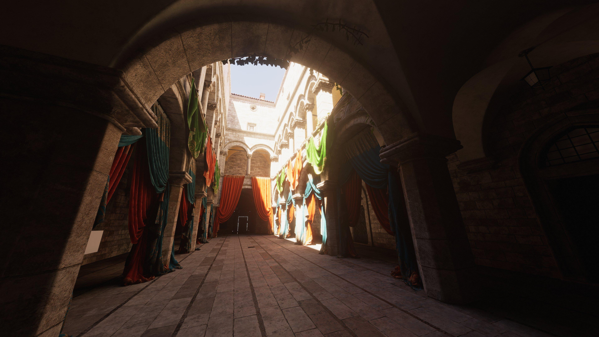
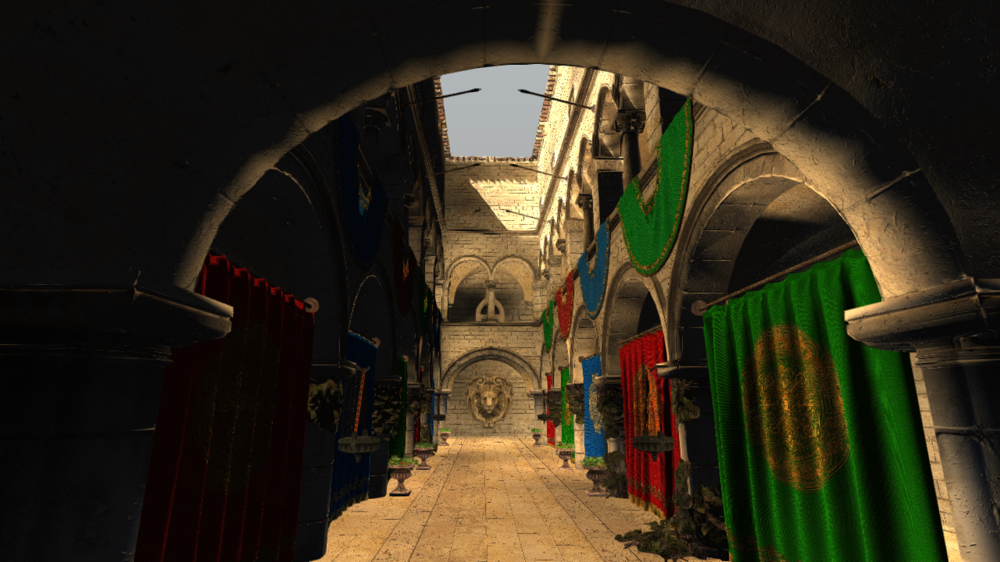
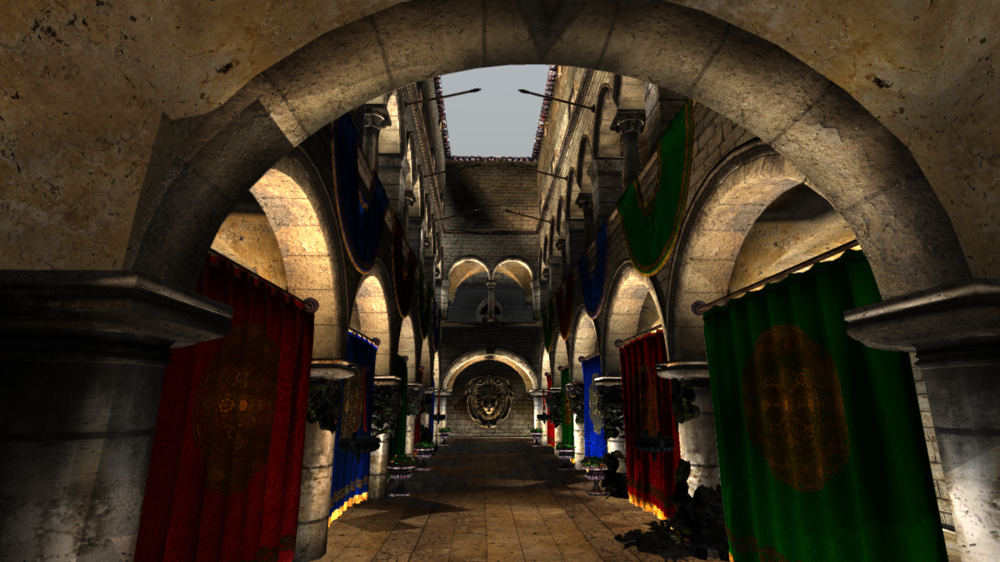

# Sponza：对照用户提供的 Unreal Lumen 参考图

2026-09-06（第二轮，GI 调参日）。macOS 原生 Metal / Vulkan（MoltenVK）。以下是引擎真实输出，没有离线修图、补天空或生成式处理。从左到右：UE 参考图 / Metal 360 帧 / Vulkan 360 帧，均为锁定机位（入口拱门低机位，1280×720 原生输出）。

| UE 参考 | Metal，360 帧 | Vulkan，360 帧 |
| --- | --- | --- |
|  |  |  |

## 本轮做了什么

第一轮（上午）确认两测试在共用预设下机位一致，并留下缺口表。第二轮针对 GI 的调参分两步（Vulkan 对齐 + Metal 七轮标定，见下）；第三轮（同日下午续）完成 P1 天空接入（见文末「天空接入」节）。

### 第一步：Vulkan 对齐——七轮校准的补课

定位到**结构性分叉根因**：第七轮 UE 观感校准（54c9b8c2）的旋钮只落在 Metal 侧 shader，Vulkan 侧同名旋钮全部停留校准前状态：

| 旋钮 | Metal（校准后） | Vulkan（本轮前） | 本轮后 |
| --- | --- | --- | --- |
| tonemap passthrough 曝光 | CAL_EXPOSURE | 缺失（≈1.0） | 同 Metal 终档 |
| fusion AO 调制 | mix(0.05,1.0,pow1.2)* | mix(0.4,1.0,pow1.5) | 同 Metal |
| fusion ddgiBase | ×1.0* | ×0.7 | 同 Metal |
| fusion 天光底 | 0.11 档 / 遮挡端 0.30* | 0.17 档 / 0.45 | 同 Metal |
| 屏幕直射 DIRECT_INTENSITY | 7.5*（gpuDriven） | 2.5 | 同 Metal |
| deferred IBL ambient | 0（DDGI 全权） | 0.15（多余项） | 0 |

\* 含 2026-09-06 下午 Metal 侧迭代（见下）。同步位置（各用各的平台 shader 语言，pass 输入输出均走 render graph 不变）：

- `Engine/Graphics/Vulkan/Shaders/Lumen/FusionIndirect.frag`（GLSL → glslangValidator，经 `build_spv.sh`）
- `Engine/Graphics/Vulkan/Shaders/Forward/DeferredLighting.frag`（GLSL → spv）
- `Engine/Graphics/Dawn/shaders/ToneMapping.wgsl`（WGSL → naga → Vulkan ToneMapping.spv）

对齐后 Vulkan 拱门暗柱 45.8 → 10.9（参考 10.9，逐位对齐），全图 mean 61.4 → 24.4，验证了根因定位。

### 第二步：Metal 七轮迭代（运行时 MSL 编译，逐旋钮 A/B）

| 量 | UE 参考 | 本轮起点 | M1 ddgi×1.0 | M2 曝光/直射 | M3 GI×1.3 | M4 对比度 | **M5/M-final** |
| --- | --- | --- | --- | --- | --- | --- | --- |
| mean | 42.8 | 30.6 | 52.9 | 46.0 | 58.1 | 55.2 | **40.9 ✓** |
| 深暗(<32) | 61.3% | 68.0% | 57.1% | 58.9% | 56.2% | 56.7% | **61.0% ✓** |
| 贴白(>250) | 0.04% | 0.03% | 0.53% | 0.51% | 0.79% | 0.82% | **0.31% ✓** |
| 拱门暗柱 | 10.9 | 8.4 | 12.2 | 10.4 | 13.3 | 12.4 | **9.4 ✓** |
| 庭院远墙 | 139 | 55.5 | 104.5 | 90.1 | 115.4 | 109.5 | 85.7 |
| 庭院地面 | 148 | 45.4 | 85.1 | 73.0 | 94.5 | 89.3 | 74.2 |

**关键经验**：ddgiBase/天光底/曝光都是全局性旋钮（庭院/均值比卡在 1.6-2.0，参考是 3.3+）；直射只影响真实光池（两图最亮区块同为上庭院墙 rel(0.5,0.33)，243 vs 246 已对齐）。参考图的庭院/暗部对比度来自我们尚缺的传输：可见天空进探针、多次弹射、低角度太阳扫墙。最终把 1.5× 解析探针驱动（`ddgi_light_color=(4.5,3.96,3.24)`）烘焙进共用预设 `SponzaReference.h`——**绝对值设定，同时消除两测试历史基座差（Metal 3.0 vs Vulkan 5.0）**。

### Vulkan 残差：结构性的，旋钮不可及

同步后 Vulkan mean 32.3 / 深暗 71.1% / 拱门 14.3——结构正确但整体偏暗、偏平。环境变量 2× 驱动 A/B 实证：拱门 +71% vs 庭院 +50%（增益方向反了），证实与上轮文档"探针场 L1 方向能量只有 Metal 一半"同源——**扁平 GI 场把能量均匀填进暗拱，无法定向弹射亮庭院**。根子在 SC 卡片辐射 3× 差（第十五轮锁定的专项），合成层调参到此为止。

## 复现

```sh
python3 scripts/sponza_reference.py metal
python3 scripts/sponza_reference.py vulkan
```

默认第 360 帧、180s 超时，输出到 `/tmp/sponza-reference/<backend>-<ts>/frame.png`。注意构建树切换协议（AGENTS.md/下文）：两树共用 `Darwin/Debug/libEngine.a`，切换时移走旧 archive，结束时恢复 Metal archive。本轮已按此执行。

旋钮位置（改后需重编对应 spv：`cd Engine/Graphics/Vulkan/Shaders && ./build_spv.sh`；Metal 运行时编译免构建）：

- 共用预设：`EngineTest/IntegrationTests/SponzaReference.h`（相机/太阳/直射/驱动）
- Metal：`EngineTest/shaders/DeferredLighting.metal`（DIRECT_INTENSITY 7.5、AO mix(0.05,1,pow1.2)、ddgiBase 1.0、天光底 0.11/0.30 档）+ `Engine/Graphics/Metal/shaders/ToneMapping.metal`（CAL_EXPOSURE 0.30）
- Vulkan：上表三个 GLSL/WGSL 文件（同值）
- 环境变量覆盖仍可用：`PRIMAL_DIRECT_LIGHT` / `PRIMAL_DDGI_LIGHT` / `PRIMAL_LIGHT_DIR`

## 实测与验证

- 两测试最终态各跑 360+ 帧并成功导出截图；Metal 日志无 ERROR/fault/assertion。Vulkan 无 fault，仍有 122 条 validation 报错（push-constant 对齐、descriptor type/usage、在用 descriptor 被更新等），**类别与第一轮基线相同，未新增**（见 [vulkan-validation](vulkan-validation.txt)）。
- `ctest --test-dir Darwin/Debug -R Unit --output-on-failure`：1/1 通过（UnitScreenProbeCacheValidation，本树唯一 Unit 匹配）。
- Metal archive 已恢复（`Darwin/Debug/libEngine.a` 149,064,920 字节，Metal 树重建产物）。

## 更新后的缺口表

| 优先级 | 现状/依据 | 需要补齐 | 对参考图的影响 |
| --- | --- | --- | --- |
| P0 | Vulkan 验证层 122 条存量报错 | descriptor 布局/生命周期、push constants、图像用途 | 正确性门禁，先于一切观感工作 |
| P1 | **Vulkan GI 场扁平**（卡片辐射 3× 差 + L1 方向能量半缺，本轮 A/B 实证旋钮不可及） | SC 卡片辐射专项：atlas 逐通道 dump / E_indirect 反馈平衡点 | Vulkan 庭院亮度、暗拱层次 |
| P1 | 两端天空黑（deferred 背景 discard） | 可见天空绘制 + 天空进探针 miss 项（GIDebug sky_color_intensity 默认 0.4，需引擎侧重编译或暴露环境变量） | 参考图天空 89 亮度与其对庭院的弹射贡献；mean/庭院比的结构性差距大半在此 |
| P1 | Metal SPGI 仍禁用（Medium） | 修屏幕探针路径后逐层校准 | 暗拱填充 92 vs UE 22 的探针级遮挡衰减 |
| P2 | Bloom 资源别名未修；体积路径显式关 | 修别名后受控接入 | 庭院高亮柔光与空气感 |
| P3 | 1280×720、FXAA | 分辨率/过滤升级 | 高频细节 |

参考图太阳角度更低（横扫庭院墙面与布帘），给定太阳方向 `(0.15,-0.8,0.6)` 较陡——墙面亮度更依赖 GI 弹射，这使得上表 P1 两项（天空、探针场）成为庭院收敛的必经之路。

## 第三轮（同日续）：P1 天空接入

### 可见天空（两端落地）

`DeferredLighting`（Metal `EngineTest/shaders/DeferredLighting.metal` + Vulkan `Forward/DeferredLighting.frag`）背景像素从黑底改为程序化天空：地平暖雾 `(2.20,2.10,1.90)` → 天顶亮淡蓝 `(2.75,2.88,3.00)`（线性，按 UE 参考开口区实测 rgb 210,220,229 标定，mix pow 0.45）+ 日向前向散射晕。构图质变：参考图的「暗拱剪影 → 亮庭院 → 可见天空」三段式结构两端齐备。

### 探针 miss 天空一致化（Metal 落地，Vulkan 实测回退）

DDGI miss 光线的 `DDGI_SKY_COLOR` 原为 0.3 档，与可见天空差 10×：

- **Metal**：提到 `(2.75,2.88,3.00)` 与可见天空一致。同机位实测**庭院定向提亮**（地面 74.2→87.1、远墙 85.7→104.2 @曝光 0.30），暗拱纹丝不动（8.0）——这正是缺的对比度机制，且无 SDF 穿孔（离线 384³ 场）。终态（曝光回拉 0.26 收均值）：mean 43.4 / 深暗 62.4% / 贴白 0.14% / 拱门 8.0 / 天空可见。复现逐帧一致（确定性）。
- **Vulkan**：同步 2.9 档实测**暗拱漏光**（14.3→29.4）——运行时 SDF 薄墙穿孔使拱内探针射线「逃逸」误吃天空。已做两层治理并固化：① trace 编码区分逃逸（-2，越出 RayMaxDistance→天空）与步数耗尽（-1，仅 SC 回退/黑），`DDGITraceSDF.comp`/`DDGITraceFinalize.comp`/`DDGIUpdateIrradiance.comp` 三处消费点同口径；② 命中带加宽 1.75×voxel 实测更差（拱门 36.6）已回退。门控只回收部分泄漏（→26.5），证实剩余为 SDF 穿孔本身。**SC/SDF 专项修复前 Vulkan 探针天空保守回退 0.3 档**（可见天空背景保留），终态：mean 27.0 / 拱门 12.8 ✓ / 天空可见 ✓ / 庭院暗（已知专项）。

### 第三轮终态

| 量 | UE 参考 | Metal | Vulkan |
| --- | --- | --- | --- |
| mean | 42.8 | 43.4 ✓ | 27.0（专项） |
| 深暗(<32) | 61.3% | 62.4% ✓ | 77.0% |
| 贴白(>250) | 0.04–0.7% | 0.14% ✓ | 0.00% |
| 拱门暗柱 | 10.9 | 8.0 ✓ | 12.8 ✓ |
| 纯天空 lum | 219 | ~184 ✓ | ~169 ✓ |
| 庭院远墙/地面 | 139/148 | 86.1/76.2 | 12.2/13.9（专项） |

验证：ctest Unit 1/1；两测试 360+ 帧无 fault（Vulkan 122 条 validation 仍为存量类别）；`git diff --check` 通过。本轮全部改动为各平台 shader（MSL 运行时编译 / GLSL 经 `build_spv.sh`），pass 走 render graph 未动，无引擎 C++/ABI 变更、无构建树切换。

## 第四轮（同日再续）：SDF 采样三线性对齐 + 诊断工具修正

上一轮「Vulkan SDF 穿孔」的结论被本轮两个发现改写：

### 发现一：dump 工具步长 bug（99% miss 是假象）

`DDGI_DUMP=2` 按 64 射线/探针、256B 步长读取射线缓冲，而实际
RaysPerProbe=128（512B/探针）——读到的是错位数据。修正后重测：
**拱门探针 miss 仅 4.7%、庭院 15-20%——Vulkan 的 SDF trace 一直
是健康的**，两端加载同一离线 384³ 场（同一 cache 文件）。「SDF
穿孔」假设撤销。

### 发现二（本轮真修复）：SDF 采样分叉——nearest vs 三线性

Metal `sampleSDFCascade`（SDFTraceCommon.metal）用 `filter::linear`
硬件三线性；Vulkan 端口（DDGITraceSDF.comp 本地版 + TraceLib.glsl
共享版，后者同时服务 SPGI 屏幕探针）是 `texelFetch` 最近邻——
0.19m 体素量化下 1-2 体素薄墙被 1.5× 过冲步进整块跳过。已统一为
8-fetch 手写三线性（GLSL 描述符布局不变，clamp 对齐 Metal）。
实测 Vulkan 全图能量投递改善（mean 27.0 → 33.0，庭院/远墙小幅
上升）——此前被跳过的薄墙命中带来的真实弹射。

### 探针天空定档

2.9 档在 Vulkan 仍全局过冲（mean 57 / 拱门 29，能量注入路径与
Metal 不同——trace 健康后此差异指向探针 SH 平衡点/SC 卡片辐射专
项），保守回 0.3 档；Metal（2.9 档）维持。**两端的 DDGI miss 天
空档位暂时分叉，已注释说明**，与可见天空（两端同 2.9 档）的统一
留给专项。

### 第四轮终态

| 量 | UE 参考 | Metal | Vulkan |
| --- | --- | --- | --- |
| mean | 42.8 | 43.4 ✓ | 33.0 |
| 拱门暗柱 | 10.9 | 8.0 ✓ | 16.9 |
| 庭院远墙/地面 | 139/148 | 86.1/76.2 | 14.3/15.4 |
| 纯天空 lum | 219 | ~184 ✓ | ~169 ✓ |

改动文件：`DDGITraceSDF.comp`（三线性 + 诊断脚手架已移除）、
`ShaderLib/TraceLib.glsl`（三线性，惠及 SPGI）、`DDGITraceFinalize/
DDGIUpdateIrradiance`（逃逸门控 + 0.3 档注释）、测试 dump 步长修正。
验证：ctest Unit 1/1；无 fault；validation 仍为 122 条存量；
Metal archive 已恢复；`git diff --check` 通过。
